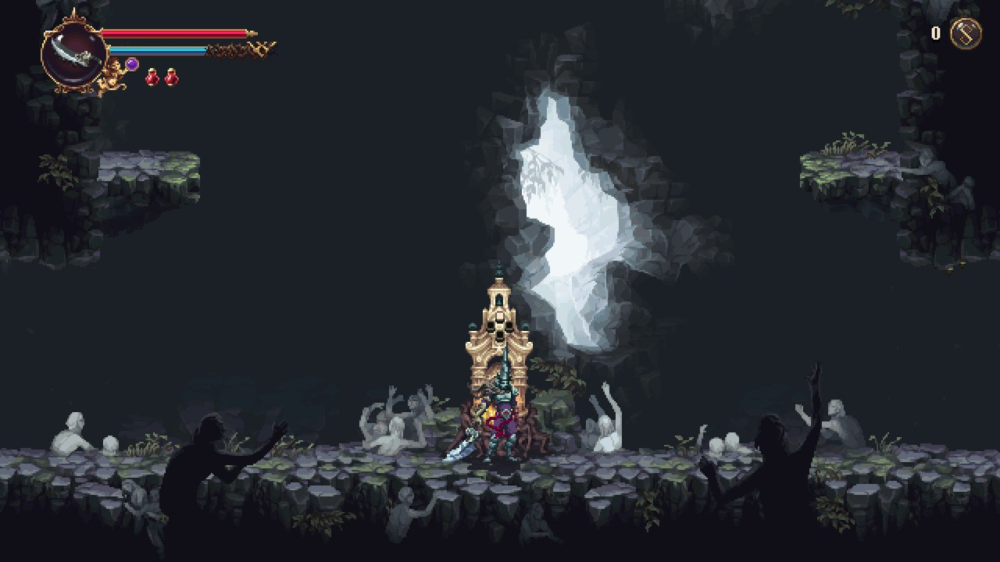
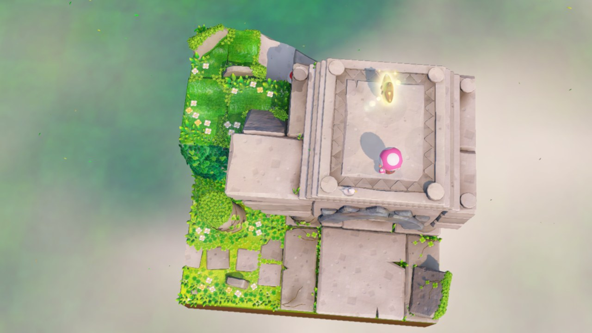
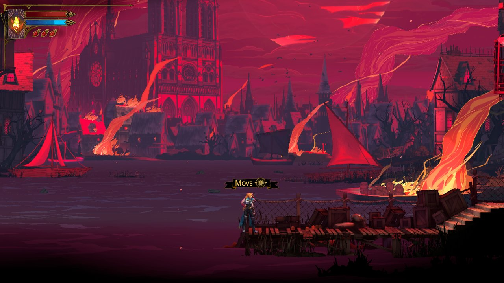
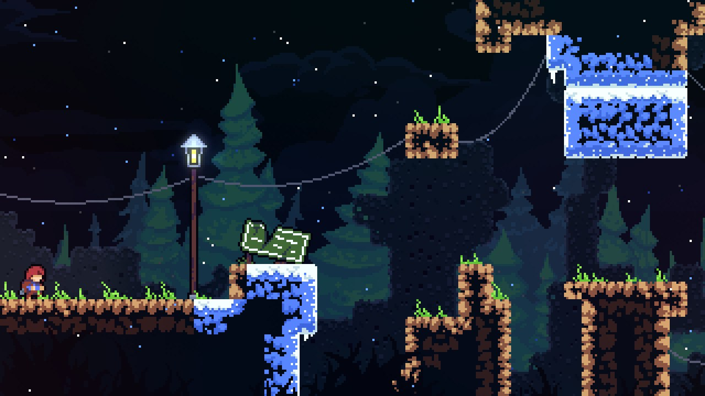
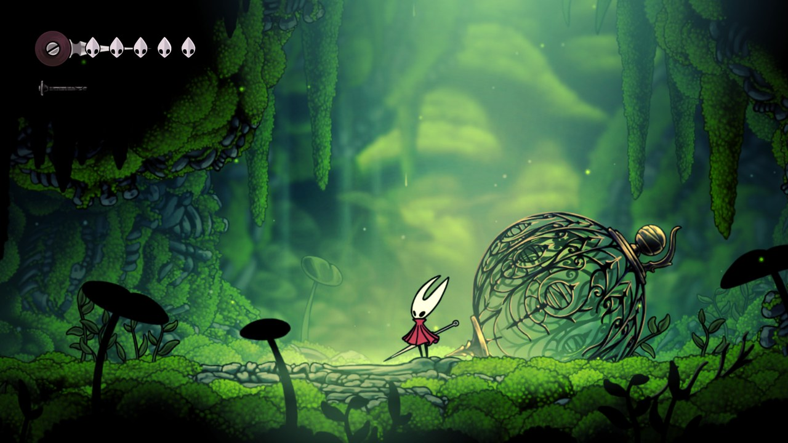
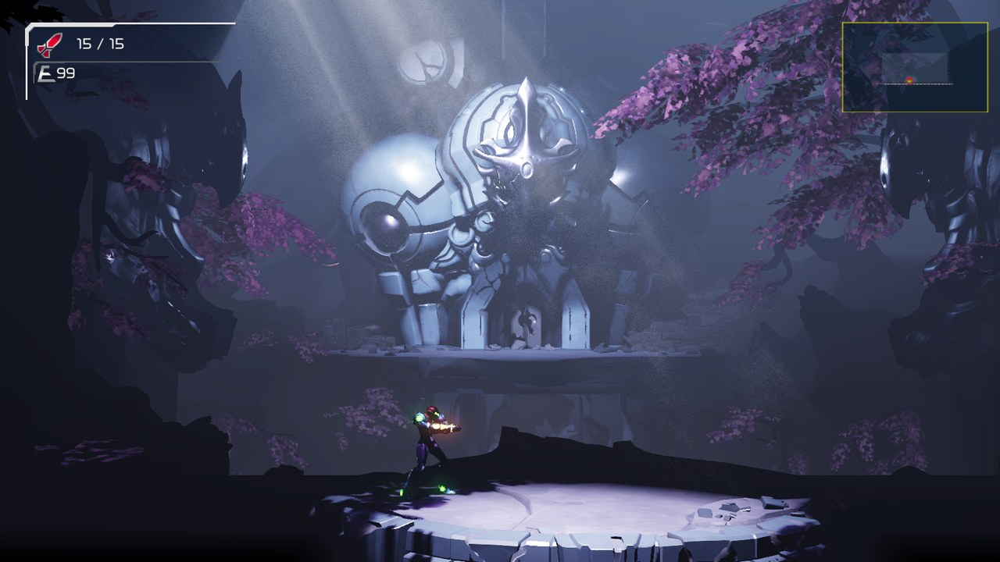
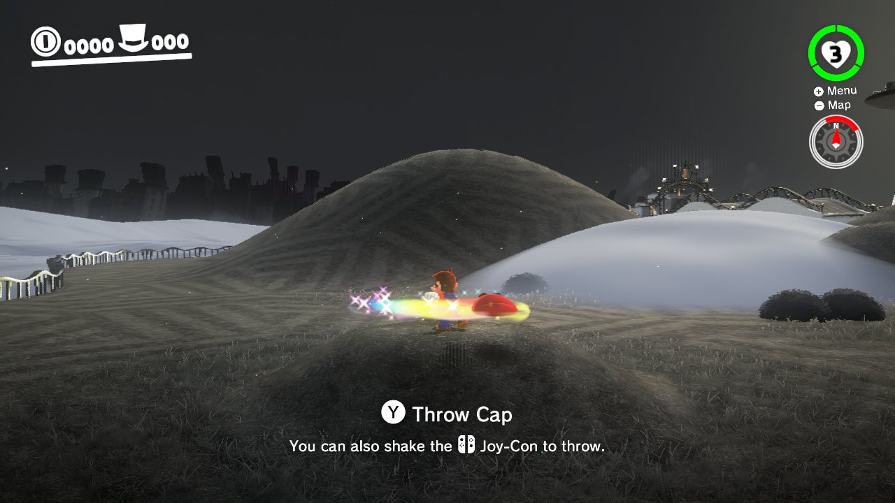
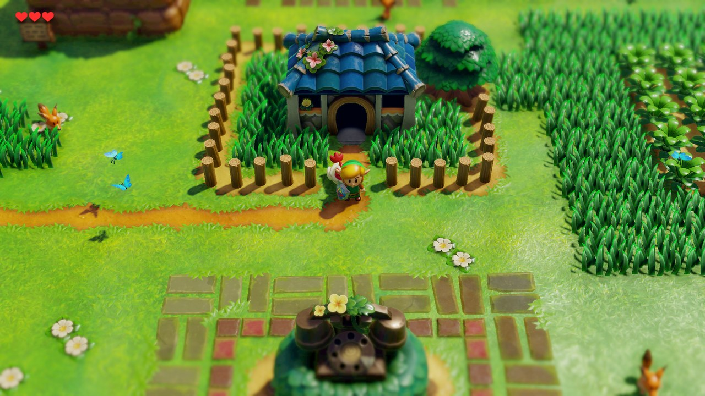

# nx2android

Port your own Nintendo Switch games to Android, natively: the game's own arm64 code runs on the device, with the Switch's system services stood in for by a host and NVN graphics replayed on Vulkan. Pick the game's folder, click **Port**, and get an APK plus the game's data, installed on your device if you like. Bring your own game files and keys; nothing from any game is in this repository.

This is the Android port of [nxnative](https://github.com/seedds/nxnative), which does the same on iPhone and iPad. Supported games: [Games](#games).

## Games

These games play on Android. Tested on a Lenovo Legion Y700 (Snapdragon 8 Elite, Adreno 830). The device's GPU must read BC-compressed textures (Adreno, Xclipse; not Mali or PowerVR).

| | |
|:---:|:---:|
|  13 Sentinels: Aegis Rim update 1.10 · 60 fps |  Advance Wars 1+2: Re-Boot Camp base game 1.0.0 · 60 fps (30 in battle on Switch) |
|  Blasphemous 2 update 1.0.8 · 60 fps |  Captain Toad: Treasure Tracker update 1.4.2 · 60 fps |
|  Castlevania: Belmont's Curse update 1.1.0 · 60 fps |  Celeste update 1.4.1.1 · 60 fps |
|  Donkey Kong Country Returns HD update 1.1.0 · 60 fps |  Graveyard Keeper 2 update 1.0.4 · 60 fps (30 on Switch) |
|  Hades II update 1.0 · 60 fps |  Hollow Knight: Silksong update 1.0.30000 · 60 fps |
|  Mario vs. Donkey Kong update 1.0.1 · 60 fps |  Metroid Dread update 2.1.0 · 60 fps |
|  NEO: The World Ends with You update 1.03 |  Paper Mario: The Origami King update 1.0.1 · 60 fps (30 on Switch) |
|  Pokémon Legends: Arceus update 1.1.1 · 60 fps (30 on Switch) |  Super Mario Bros. Wonder update 1.2.1 · 60 fps, dips to 40 |
|  Super Mario Odyssey update 1.4.1 · 60 fps · shake the device to throw Cappy |  Tales of Eternia Remastered update 2.0.0 · 60 fps |
|  The Legend of Zelda: Link's Awakening update 1.1.0 · 60 fps · **work in progress**: played in the Android Emulator only, not on a phone or tablet yet |  Unicorn Overlord update 1.05 · 60 fps · **boots**: saving and a full battle not tested yet |
|  Unpacking update 2.01 · 60 fps · played by touch |  Viractal: Will You Trust Your Party? update 1.4.5 |
|  Xenoblade Chronicles 3 update 2.2.0 · 30 fps · **work in progress**: some effects and models don't draw yet | |

A game that is not in this table is not supported yet. Which games each release has been checked to port: [docs/RELEASE_CHECK.md](docs/RELEASE_CHECK.md). The games we look at next, and the ones done: [docs/PORT_CHECKLIST.md](docs/PORT_CHECKLIST.md).

## For players: port a game without programming

1. Download `nx2android-<version>-windows-x64.zip` from [Releases](https://github.com/shirai91/nx2android/releases/latest), unzip it and start **nx2android.exe**.
2. **Setup** tab: click **Download missing tools** (the Android NDK, the .NET SDK and platform-tools, about 1 GB, from Google and Microsoft), then set your **prod.keys**. Every line turns green.
3. **Port** tab: choose the folder with the game's NSP, XCI, NSZ or XCZ files (base game, update, DLC) and click **Port**.
4. Tick **Install on the device when done** with the device plugged in and USB debugging on, or copy the APK and the data folder yourself.

The step-by-step guide is [packaging/INSTALL.md](packaging/INSTALL.md). You need your own game files and `prod.keys`, dumped from your own Switch; the tool never ships or downloads either. NSZ and XCZ files are decompressed during the port (into the build folder's `tmp/`, deleted once extracted).

## For developers

Running from the repository, the command line, the repository layout, building the bundle, tests and commit messages: [docs/DEVELOPMENT_GUIDE.md](docs/DEVELOPMENT_GUIDE.md). How it is put together: [docs/ARCHITECTURE.md](docs/ARCHITECTURE.md).

## Keys and game files

nx2android decrypts your game files with your `prod.keys` while it ports them, as Switch emulators do. This repository and its releases contain no keys, no game files and nothing extracted from them, and the tool never downloads either. Dump both from your own Switch, and don't share them or the APKs and data packs built from them.

Nintendo's takedown notices so far have gone to whoever hosts a project (13 Switch emulator repositories on GitHub in February 2026), not to players. Whether decrypting your own games for your own use is allowed depends on where you live.

## License

MIT, as nxnative (see `nxnative/LICENSE`). Third-party code keeps its own license.
