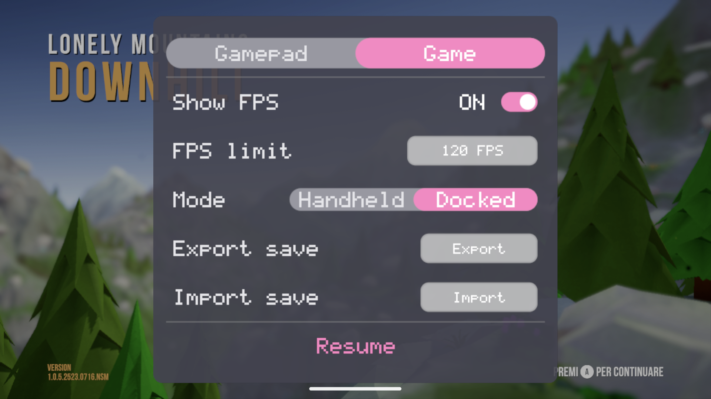

# Live FPS selection

Game tab: Default / 30 / 40 / 50 / 60 / 90 / 120. Tap or A cycles, including
Default after 120; left/right clamps at the endpoints. The menu already pauses
play: a choice is effective on resume without restarting. Show FPS is independent.

Default is the initial state and preserves environment/profile pacing plus the
existing adaptive 60/40/30 governor. An explicit choice is stored as `fps_limit`
in the app's existing settings.txt. Choosing Default removes that key and
restores the original policy. Invalid stored rates are ignored. No driver,
Android global refresh setting or game binary is changed.

## Meaning of a rate

The Android frontend exposes a weakly queried override of the NVN presentation
Hz. An explicit choice bypasses the adaptive governor, which otherwise would
hold a 90/120 target at 60 or lower. NVN's swap interval still multiplies the
period: interval 2 at 120 Hz means 60 presentations per second. Game-side sleeps,
simulation caps, GPU load and display refresh still constrain the result. This
is a runtime pacing control, not a universal engine FPS patch. Native Vulkan
games that bypass NVN are not covered by this override.

For GOOGLE_display_timing, an unsnapped ideal phase carries fractional vsyncs
between frames: repeatedly rounding each interval would turn 50 into 60 or 40,
and 90 into 120 or 60 on a 120 Hz display. The phase resets after rate changes,
refresh changes, timing disablement, swapchain reset or cadence resync. Some
rates require uneven vsync intervals; a 60 Hz display cannot show 120 distinct
frames a second. Drivers without this timing extension use the existing fallback.

Higher targets can increase heat and power consumption and may expose
game-specific timing or rendering defects. Default remains available.

## Validation

- Local v0.3.0-based release on Retroid Pocket 6 / Adreno 740 / PurpleVK:
  tester confirms all six numeric choices work in Lonely Mountains: Downhill.
  Approximately 120 FPS was reported at normal bicycle/timer/animation speed.
  Occasional brief black/white flashes were reported; their cause is unproven.
- Screenshot below is the real RP6 local six-rate menu, before Default was
  added for this contribution; it is not a screenshot of the new Default state.
- Current-main-based release library compiles and links with the Android NDK.
- `tests/test_frame_limit.py` compiles actual C selection, NVN period, adaptive
  bypass and fractional pacing functions; checks rate changes, default restore,
  swap-interval behavior, rounding drift, bounds, menu geometry, settings round-trips
  and Default removing the persisted override. It uses a
  host C compiler or an opt-in standalone Android check, without installing an APK.
- Current-main full-APK UI and other games need device
  validation. No general compatibility or battery/temperature claim is made.

