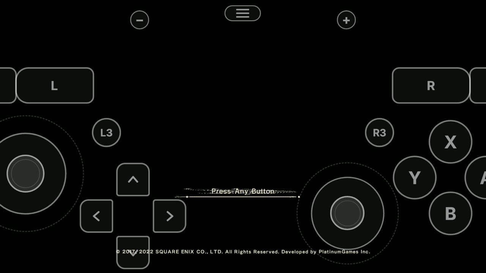
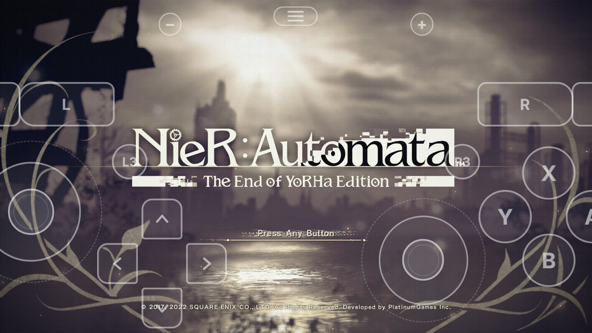
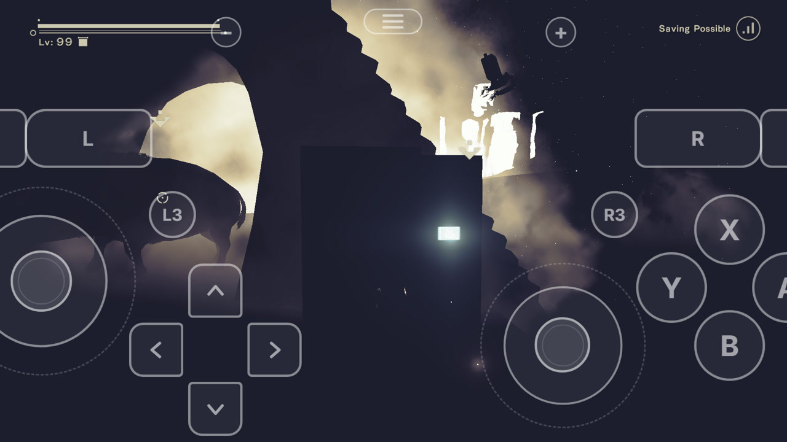
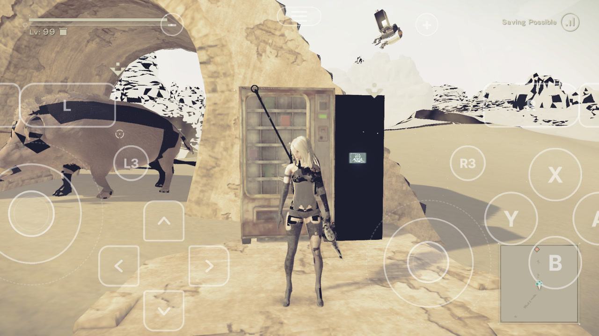

# NieR:Automata Android bring-up and test record

## Status

NieR:Automata The End of YoRHa Edition, update 1.0.3 (`v131072`), title
`010056B015FE8000`, SDK 12.3.9, PlatinumGames engine / NVN.

Status remains **boots**. Movies, title, menus and a save-loaded Desert Zone have
been exercised on Android. The title background, character and environment
materials now render. Missing triangles, incorrect bright background regions
and shadows remain. New Game progression, gameplay saving and long-session
stability are not validated. This is an experimental bring-up, not a playable claim.

## Changes and evidence

- **CPK shader extraction.** Read CRI UTF tables (plain or masked), stored and
  CRILAYLA-compressed entries, and recursively scan PlatinumGames DAT contents.
  Recognize length-delimited binding-table shader objects by boundaries and NVN
  magics, without title or filename branches. The real-data scan found 1,371
  objects, deduplicating to 1,225 keys: 451 vertex, 739 pixel, 31 compute and four
  geometry shaders; 31 compute-fact rows and 902 shader pairs.
- **Portable SPIR-V interfaces.** Omit unused clip/cull members while retaining
  actual clip IO, transform feedback and native passthrough. For Android's
  single viewport, keep the guest viewport mask private and emit a primitive
  only when bit zero is set. Software geometry passthrough forwards the bundle's
  fragment-consumed locations; guest culling reads are tracked separately and
  transform feedback retains the conservative path. This removes unsupported
  NVIDIA capabilities and excess geometry input components.
- **Integer vertex inputs.** Retype inputs and component pointers to the Vulkan
  fetch type, then bitcast loaded values back to the guest register type.
  Changing the fetch format itself would incorrectly change sign extension.
  Zero-buffer attributes follow the shader's numeric kind too.
- **Imageless framebuffers.** Carry the actual narrowed image-view usage through
  both new and cached views into framebuffer attachment metadata. Preserve the
  current backend's full compatible-format list.
- **CPU-filled colour LUT.** Extend first-use uploads to eligible CPU-filled
  uncompressed sampled textures. NieR's 256x16 RGBA8 LUT had nonzero guest storage
  and an empty GPU image, making the final composition black. Exclude
  depth/stencil, CPU-inaccessible pools, display/video textures, incompatible
  flags and overlap with GPU-written images. The title test region changed
  from 0% to 100% nonblack; the opening ship and clouds also became visible.
- **Geometry storage buffers.** Reflect and populate NVN geometry c0 addresses at
  `0x410 + 16 * slot`. Missing reflection and zero driver addresses redirected
  index-building shaders to fallback storage, leaving indirect colour draws
  empty despite valid depth. Slots 0 and 2 now address the actual buffers;
  materials, character and minimap render.
- **Windows linking.** Use UTF-8 Clang response files with Windows argument
  quoting, avoiding `WinError 206` for long object paths and paths with spaces.

The profile is data only. Runtime fixes follow shared NVN/Vulkan rules, with
no title-specific execution branch or permanent diagnostic shader override.

## Test record

### Rendering validation, 2026-11-08 through 2026-11-10

| Check | Result |
|---|---|
| Extraction and module rewriting | Completed for update 1.0.3 |
| Shader translation | All 1,241 variants built; zero translation failures |
| Movies, title and menus | Logo/demo movies and menu navigation work; title background restored |
| Opening sequence | Ship, exhaust and clouds visible in captures across 45 seconds |
| Save-loaded Desert Zone | Materials, character and minimap restored; missing triangles/bright regions remain |
| Vulkan validation | Geometry/vertex interface and framebuffer usage errors removed; no VUID in the recorded corrected map run |
| Diagnostics | Existing `SetRenderEnableConditional` warning remains: conditional rendering is not implemented |
| Short stationary map sample, validation off | Five 300-frame windows ending at frames 3900-5100: frame-time p50 33.32-33.82 ms, p95 35.28-35.70 ms; about 30 fps for this stationary scene only |
| Controls | Menu input exercised; gameplay movement and camera visible in the supplied recording |
| Saves and stability | No gameplay-save round trip or long-session soak established |

The screenshots below compare the same title/map locations, not pixel-identical
frames. Their sidebars are cropped to focus on rendering. Neither comparison
establishes a performance improvement. The supplied gameplay recording includes
other scenes and slower rendering; its on-screen FPS must not be conflated with
the short stationary timing sample.

| Scene | Before | After |
|---|---|---|
| Title composition |  |  |
| Desert Zone |  |  |

### Integration checks, 2026-11-10

The changes were integrated onto `origin/main` at `6e78de9`. The framebuffer
conflict was resolved by combining narrowed view usage with main's existing
compatible-format list; neither correction was dropped.

- `python -m unittest discover tests`: 239 tests, zero assertion failures,
  one environment error and 91 skips. The external-display packaging test
  invokes an unavailable `python3` executable (exit 9009). Native host harnesses
  and optional platform checks account for skips; a skipped test is not a pass.
- All six synthetic Maxwell-to-SPIR-V interface tests passed, including actual
  clip writes, native viewport masks, mask-zero/one emulation and consumer-only
  geometry locations.
- The CPU-texture, geometry-driver-segment and integer-input C harnesses were
  compiled with the Android NDK and executed successfully on Android. Geometry
  reflection tests cover existing vertex/pixel/compute tables and invalid offsets.
- Main's indirect-compute harness also passed all six cases in both descriptor
  modes when compiled with the NDK and run on Android, covering GPU counts,
  chunked arguments, invalid ranges, deferred uniforms and scratch lifetime.
- The integrated Android host compiled all 192 sources and linked successfully,
  including the custom-driver helper libraries. All 1,241 shader variants were
  rebuilt from the integrated translator source with zero failures.
- In the isolated geometry-binding A/B, every SPIR-V module remained byte-identical;
  only 20 geometry resource-reflection records changed. The driver-segment and
  reflection regressions failed before that correction and passed afterwards.
- Rebuilding against the newer main kept all 1,241 SPIR-V modules byte-identical
  to the recorded build. Reflection changed in 47 entries; all differences are
  storage-write flags from main's existing reflection correction.
- The CPK reader's four synthetic tests and both geometry reflection tests passed.
  The separate chain suite ran 12 tests: eight passed; four header fixtures were
  blocked by Windows symlink permissions (`WinError 1314`). A direct comparison
  of the generated header against the current source digest passed.
- The shader-chain header was regenerated after changing `Program.cs`. The
  pinned Apple translator binary and lock are unchanged. Apple rendering and
  a fresh Mac shader-library build were not validated here.

The recorded rendering run predates integration onto the newer main. The
integration build and synthetic Android harnesses do not replace a gameplay
retest of that exact combined build.

### Current gameplay recording

[Watch or download the current gameplay recording](https://github.com/poweron0102/nx2android/blob/evidence/nier-automata-20261110/nier-automata-loads-4x.mp4).
The recording retains its original framing, overlays and audio. Only the two
loading transitions run at 4x; their approximate real durations are labelled
in the video: 26.8 s (save to Desert Zone) and 27.0 s (transport to City Ruins).
These are visual transition intervals, including fades, not instrumented
engine loading timings. Menus and gameplay remain at normal speed.

## Regression risk for other games

These changes affect shared code, so cross-game regression risk remains.

| Area | Exposure and protection | Remaining coverage gap |
|---|---|---|
| CPK reader | CPKs are selected by extension and magic; unsupported TOCs fall back to loose scanning; section-boundary checks reject unrelated shader objects | Other CRI/PlatinumGames titles can expose unhandled entries or compression; a per-entry decode failure is logged and that entry is skipped |
| Shader translator | Native capability defaults and actual clip IO are retained; fragment consumer masks apply only to non-XFB geometry jobs | Other games' clipping, passthrough and transform-feedback combinations need rendering checks; source rebuilds can change other shaders |
| CPU texture upload | Avoids known GPU-written overlapping images and excludes unsuitable texture kinds | Ownership/aliasing in other engines is not proven by the synthetic harness; first-use image-table scans can add CPU work |
| Vertex signedness | Only mismatched integer fetch inputs are retyped; values are bitcast back and signed/unsigned/component-load cases are tested | Unusual SPIR-V pointer shapes and combinations with other shader variants need broader coverage |
| Framebuffers and geometry buffers | Carries the view's usage, preserves format lists, and keeps stage-specific address tables | Other drivers, attachment aliases and geometry writers require device coverage |
| Windows response files | Applied only on Windows; quoting is explicit and a host build linked from a path with spaces | Other toolchain versions and executable-link configurations are not exhaustively tested |

NEO, Viractal and other supported games were not re-tested. No claim of zero
regressions or cross-game performance improvement is made. Before treating this
as broadly validated, exercise those games' rendering, clipping, GPU-written
texture aliases and integer vertex inputs, plus an appropriate Apple chain
rebuild if using the shared translator changes there.

## Next checks

Reproduce and count missing triangles on the corrected geometry-binding build;
separate depth testing from index generation, inspect background/shadow errors,
and validate New Game progression, gameplay saves and a long play session.
Keep the profile at `boots` until those results justify promotion.
