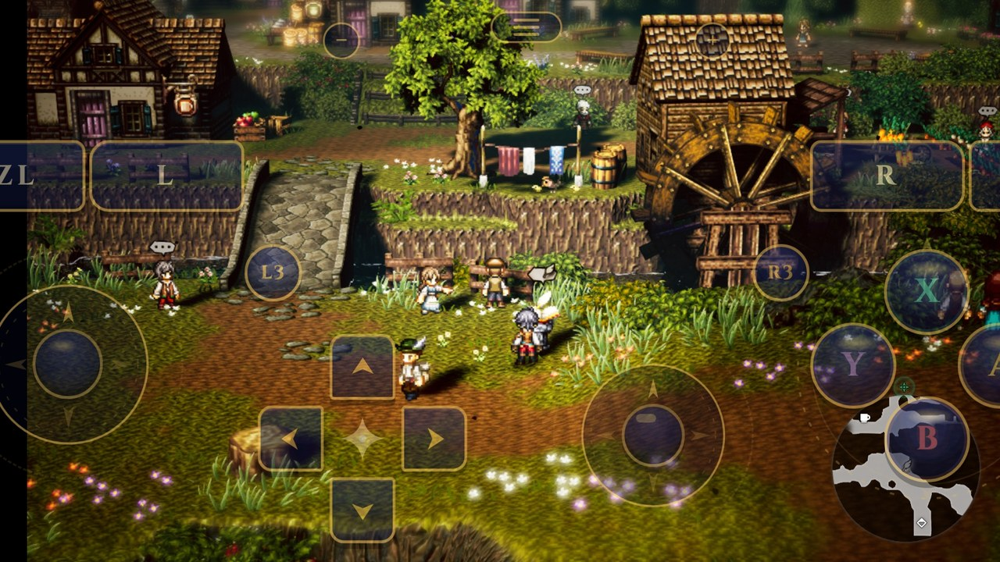

<!-- game facts: made by docs/gen_tables.py from android.tsv; edit android.tsv, not this block -->
# OCTOPATH TRAVELER 0 (Chinese release)

| | |
|---|---|
| Status | **playable** |
| Title ID | `01001300232F4000` |
| Tested with nx2android | `v0.4.0` |
| Tested build and device | v327680 Xiaomi 23117RK66C (Android 16) |
| App package | `org.nx2a.t01001300232f4000` |
| Needs | a GPU that reads BC-compressed textures (Adreno, Xclipse; not Mali or PowerVR) |

Read the profile's porting log in the comment header of [`android.tsv`](android.tsv). Back to the [games list](../../../../README.md#games).
<!-- end of the game facts -->

## Game version

- Update 1.0.5.
- The Chinese and Korean release.
- The profile was checked with `v327680` (the `tested` row of android.tsv).

## Frame rate

- 60 fps.

## Tested devices

| Device | GPU | Vulkan driver | Game version | nx2android | Result |
|---|---|---|---|---|---|
| Xiaomi 23117RK66C (Android 16) | not recorded | not recorded | 1.0.5 (v327680) | `v0.4.0` | playable |

Tested on the Xiaomi 23117RK66C (Android 16).

## Options

- Port with Game language: Chinese (Simplified) (`--language zh-Hans`).

## Quirks and known issues

- Not recorded.
