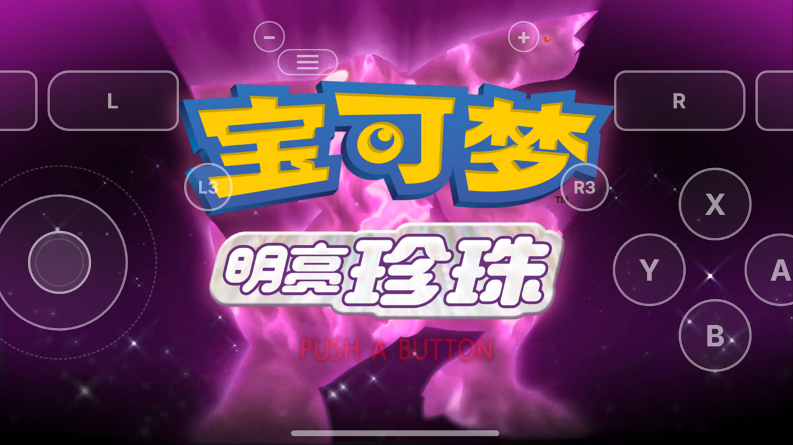

<!-- game facts: made by docs/gen_tables.py from android.tsv; edit android.tsv, not this block -->
# Pokémon Shining Pearl

| | |
|---|---|
| Status | **playable** |
| Title ID | `010018E011D92000` |
| Tested with nx2android | `v0.4.0` |
| Tested build and device | v393216 2410DPN6CC (Snapdragon 8 Elite, Adreno 830, Android 16) |
| App package | `org.nx2a.t010018e011d92000` |

Read the profile's porting log in the comment header of [`android.tsv`](android.tsv). Back to the [games list](../../../../README.md#games).
<!-- end of the game facts -->

## Game version

- Update 1.3.0.
- The profile was checked with `v393216` (the `tested` row of android.tsv).

## Frame rate

- 60 fps (30 on Switch): the same Unity settings as Brilliant Diamond, whose profile this one is cloned from, held through the game (frame work p50 10.4 ms in the field).

## Tested devices

| Device | GPU | Vulkan driver | Game version | nx2android | Result |
|---|---|---|---|---|---|
| 2410DPN6CC (Snapdragon 8 Elite, Adreno 830, Android 16) | Adreno 830 | Qualcomm | 1.3.0 (v393216) | `v0.4.0` | played through the story to the end, in Chinese, 60 fps, 0 of 64 frames late |

## Options

- None: the default options work. Chinese needs a CJK shared font (`DM_SHARED_FONT`, the porter's `--shared-font`): this run used one, as Brilliant Diamond's page describes.

## Quirks and known issues

- None known: the game was played through to the end of the story on the device.
- Everything else is Brilliant Diamond's, which is playable; its page has the details.
