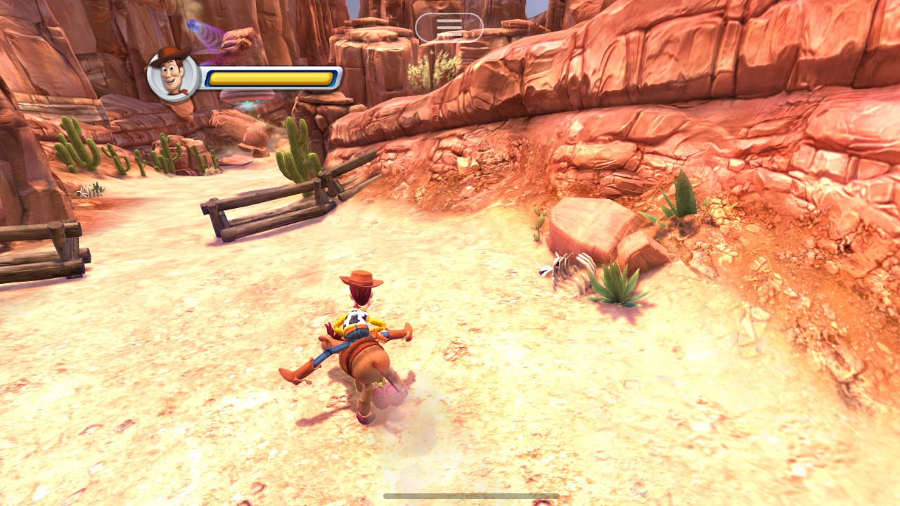

<!-- game facts: made by docs/gen_tables.py from android.tsv; edit android.tsv, not this block -->
# Toy Story 3 Complete Edition

| | |
|---|---|
| Status | **playable** |
| Title ID | `01001DC025BC4000` |
| Tested with nx2android | `v0.5.0` |
| Tested build and device | v196608 Samsung Galaxy S23 Ultra SM-S918B (Snapdragon 8 Gen 2, Adreno 740, Android 17) |
| App package | `org.nx2a.t01001dc025bc4000` |

The profile sets these for you (`android.tsv`); a player changes the pause menu ones in the game, and the env rows in the data pack's `env.txt`:

| Row | What it does |
|---|---|
| `DM_AUDREN_CATCHUP_FRAMES=0` | catch-up frames (a frame rendered on the updating thread when nothing was rendered since the last update) only while fewer than this many frames have been … |
| `DM_VK_SCALED_FETCH=1` | a USCALED / SSCALED vertex format the device cannot fetch, read by a float input, is fetched as the UINT / SINT format of its layout and converted to float in … |

Read the profile's porting log in the comment header of [`android.tsv`](android.tsv). Back to the [games list](../../../../README.md#games).
<!-- end of the game facts -->

## Game version

- Update 1.0.3 (v196608) was tested, ported together with the base game. The base game alone has not been tried.
- The menus and hints showed in Portuguese in the test, though the port asked for `en-US` (`DM_LANG`); how the game picks its language was not looked into.

## Frame rate

- 30 fps (as on Switch) in the menus, the movies and the first level.
- On the Galaxy S23 Ultra: frame work p50 29 ms / p90 35 ms, 2.6% of frames dropped over about 6 minutes of play. The drops are short hitches in busy scenes: the game's render thread takes a whole core, and the phone holds that core at about half its clock once it is warm (69 °C).

## Tested devices

| Device | GPU | Vulkan driver | Game version | nx2android | Result |
|---|---|---|---|---|---|
| Samsung Galaxy S23 Ultra SM-S918B (Snapdragon 8 Gen 2, Android 17) | Adreno 740 | system | 1.0.3 (v196608) | `v0.5.0` | playable: the publisher logos, the opening movie, the loading screens, the first level (a mission done), the game's save across restarts, the pause menu, the on-screen gamepad and a controller |

## Options

- None: the default options work. Choose the folder with the game's NSP / NSZ (base game and update) and port: nothing has to be unpacked by hand, the porter reads the dumps and the game's Octane zips itself.
- The profile sets two switches for you (above): `DM_VK_SCALED_FETCH=1` for the characters and `DM_AUDREN_CATCHUP_FRAMES=0` for the sound (see below).
- Do not tick **Multithread replay** (`--mt-replay`): on the S23 Ultra it dropped 12.6% of frames instead of 2.6%.

## Quirks and known issues

- **Short hitches in busy scenes** on a warm phone (see Frame rate). Playing while the phone is not charging, and out of a case, keeps it cooler.
- **Audio.** The game plays FMOD's sound on one output and the SDK's audio renderer on another. The renderer's catch-up frames (frames the host renders when the game updates twice with none in between) ran the voices ahead of their data and left one silent 5 ms block in every 3: a crackle in the movies and in play. The profile turns them off; the renderer opens with no effects, so it does not need them.
- **Skinned characters** (Woody, Bullseye, Hamm…) need the profile's `DM_VK_SCALED_FETCH=1`: the Adreno 740 cannot fetch their bone indices' format (`R8G8B8A8_USCALED`), and without the switch their pipelines are skipped, so they are not drawn and the game looks first-person.
- Not tested yet: past the first level, the Toy Box mode, and other devices.
