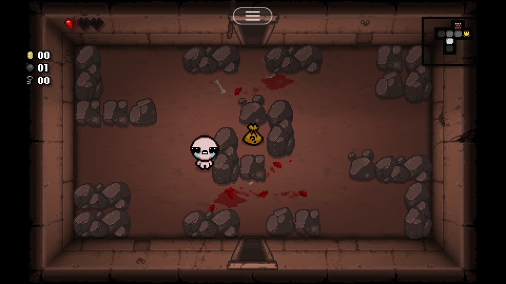

<!-- game facts: made by docs/gen_tables.py from android.tsv; edit android.tsv, not this block -->
# The Binding of Isaac: Afterbirth+

| | |
|---|---|
| Status | **playable** |
| Title ID | `010021C000B6A000` |
| Tested with nx2android | `v0.5.0` |
| Tested build and device | v524288 OnePlus 11 CPH2449 (Snapdragon 8 Gen 2, Adreno 740, Android 15) |
| App package | `org.nx2a.bindingofisaac` |

Read the profile's porting log in the comment header of [`android.tsv`](android.tsv). Back to the [games list](../../../../README.md#games).
<!-- end of the game facts -->

## Game version

- **Update 1.7.9b (`v524288`)** with the **Repentance** DLC (`010021C000B6B001`) was tested.
- Update `1.7.9b`'s launcher (`main`) loads `Repentance.nro` when the Repentance DLC is present and `AfterbirthPlus.nro` when it is absent, and each module compiles its own GLSL shader set. This profile's 43 shader table entries match `1.7.9b` + Repentance DLC, so place the Repentance DLC file beside the base game and update when porting. Base game `1.0` (`v0`) and `1.7.9b` without the Repentance DLC have not been tested.

## Frame rate

- Steady **60 fps** (as on Switch) on OnePlus 11 (`p50 16.70 ms`, GPU `3.26–4.10 ms`, `0` dropped frames in steady play).

## Tested devices

| Device | GPU | Vulkan driver | Game version | nx2android | Result |
|---|---|---|---|---|---|
| OnePlus 11 (CPH2449) | Adreno 740 | system (512.676.71) | 1.7.9b (v524288) + Repentance DLC | `v0.5.0` | playable: intro, title, file select, Repentance run gameplay, audio, save/continue, 60 fps, no `[RED]` lines |

## Options

- Default options work (system Vulkan driver).
- Porting requires an Android device connected over ADB (USB debugging on) even without `--install`, because the game compiles its 43 shaders at boot with `subsdk0` (GLSLC) and `porter` captures them automatically on the device.

## Quirks and known issues

- None known for `1.7.9b` + Repentance DLC. Porting `1.7.9b` without the Repentance DLC has not been tested because `AfterbirthPlus.nro` compiles a different set of shaders.
