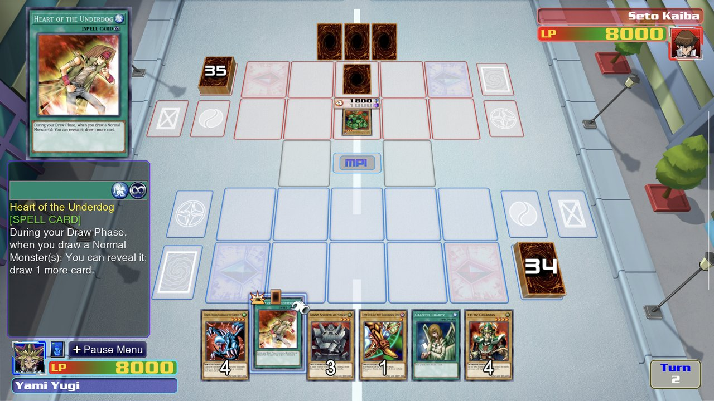

<!-- game facts: made by docs/gen_tables.py from android.tsv; edit android.tsv, not this block -->
# Yu-Gi-Oh! Legacy of the Duelist : Link Evolution

| | |
|---|---|
| Status | **experimental** |
| Title ID | `010022400BE5A000` |
| Tested with nx2android | `v0.4.0` |
| Tested build and device | v65536 AYN Odin 2 (Snapdragon 8 Gen 2 QCS8550, Adreno 740, Android 13; Mesa Turnip KIMCHI v26.0.0_R8) |
| App package | `org.nx2a.yugiohlotdle` |
| Vulkan driver | Turnip: the port packs Mesa's Turnip driver when the porter finds it (`vulkan_driver turnip`) |

The profile sets these for you (`android.tsv`); a player changes the pause menu ones in the game, and the env rows in the data pack's `env.txt`:

| Row | What it does |
|---|---|
| `docked=0` | pause menu default on first launch: docked mode (1) or handheld mode (0) |
| `overlay=0` | pause menu default on first launch: on-screen gamepad shown (1) or hidden (0) |
| `DM_GL_STRAY_SEMI=1` | removes a ';' after a function body in the game's GLSL (Adreno's compiler rejects it; NVIDIA's accepts it) |

Read the profile's porting log in the comment header of [`android.tsv`](android.tsv). Back to the [games list](../../../../README.md#games).
<!-- end of the game facts -->

## Game version

- Update 1.0.1 (v65536, main build `cdc49702ee3df923fb3773bf77f33102`). The base game alone was not tested.

## Frame rate

- 30 fps by default, with no late frames on the AYN Odin 2. The GPU is about 8 to 9% busy and the CPU 7 to 12%, so the port needs no dynamic resolution.
- The game's speed is tied to its frame rate, and the game never sets a swap interval, so without a cap it presents at 60 fps and every animation runs twice as fast. The profile caps it at 30 (`fps_ceiling 30` in `game.tsv`), the game's normal speed.
- The porter's 60 fps option (`--fps60`) lifts the cap for players who prefer 60 fps. The game then runs at 2x speed: the duel tutorial's pointing hand bobs every 0.75 s at 60 fps against 1.49 s at 30. The GPU is then about 17% busy.

## Tested devices

| Device | GPU | Vulkan driver | Game version | nx2android | Result |
|---|---|---|---|---|---|
| AYN Odin 2 (Android 13) | Adreno 740 | Mesa Turnip KIMCHI v26.0.0_R8 | 1.0.1 (v65536) | `v0.4.0` | plays: the title, a story duel, cutscenes, the card shop, card details and saving |

## Options

- The game draws with OpenGL ES on the device's own GLES driver. The port presents its frames through Vulkan, on Turnip by default (`vulkan_driver turnip`; tested with KIMCHI v26.0.0_R8).
- The profile sets `DM_GL_STRAY_SEMI=1` for you. Without it the movies stay black, because Adreno's GLSL compiler rejects the stray `;` after `void main() {...}` in the game's movie shaders.
- `--fps60` gives 60 fps at 2x game speed (see Frame rate). Leave it off for normal speed.

## Quirks and known issues

- Experimental: later story arcs, online play and local multiplayer were not tested.
- At 60 fps (`--fps60`) the whole game, duels included, runs at twice its normal speed.
