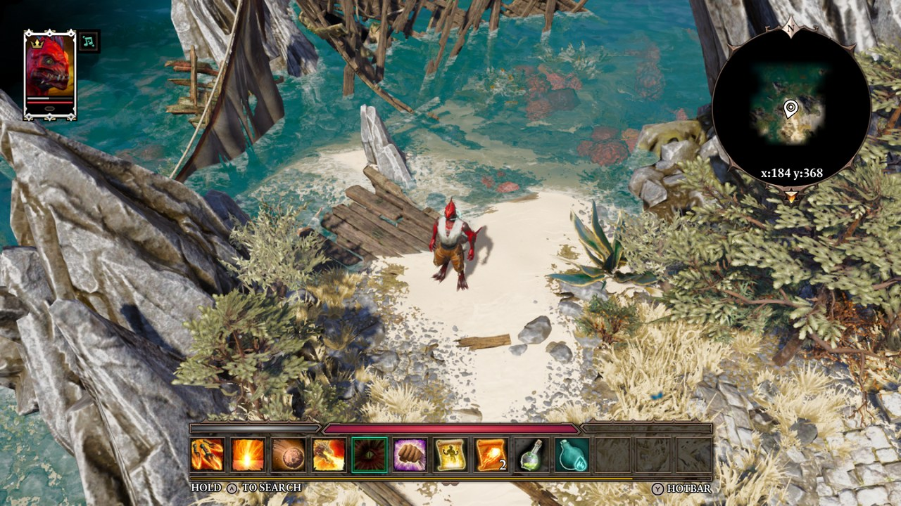

<!-- game facts: made by docs/gen_tables.py from android.tsv; edit android.tsv, not this block -->
# Divinity: Original Sin 2 - Definitive Edition

| | |
|---|---|
| Status | **playable** |
| Title ID | `010027400CDC6000` |
| Tested with nx2android | `v0.5.0` |
| Tested build and device | v786432 Legion Y700 Gen 4 (Snapdragon 8 Elite, Adreno 830, Android 16) |
| App package | `org.nx2a.divinityoriginalsin2` |

Read the profile's porting log in the comment header of [`android.tsv`](android.tsv). Back to the [games list](../../../../README.md#games).
<!-- end of the game facts -->

## Game version

- Update 1.0.12.
- The profile was checked with `v786432` (the `tested` row of android.tsv).

## Frame rate

- 60 fps (30 on Switch).

## Tested devices

| Device | GPU | Vulkan driver | Game version | nx2android | Result |
|---|---|---|---|---|---|
| Legion Y700 Gen 4 (Snapdragon 8 Elite, Adreno 830, Android 16) | Adreno 830 | not recorded | 1.0.12 (v786432) | `v0.5.0` | playable |

What was tested:

- Tested to Fort Joy.

## Options

- Not recorded.

## Quirks and known issues

- Heavy fights can dip below 60.
