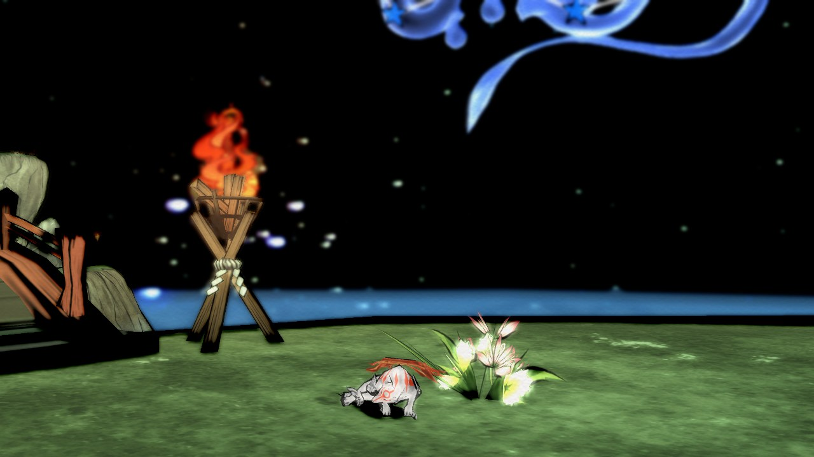

<!-- game facts: made by docs/gen_tables.py from android.tsv; edit android.tsv, not this block -->
# ŌKAMI HD

| | |
|---|---|
| Status | **experimental** |
| Title ID | `0100276009872000` |
| Tested with nx2android | `v0.5.0` |
| Tested build and device | 1.0.0 AYN Odin 2 (Adreno 740, Android 13, Turnip) |
| App package | `org.nx2a.okamihd` |

The profile sets these for you (`android.tsv`); a player changes the pause menu ones in the game, and the env rows in the data pack's `env.txt`:

| Row | What it does |
|---|---|
| `DM_TOUCH_STATES=16` | GetTouchScreenStates hands back this many entries (1-16; unset = 1), the newest state repeated: Okami HD drops a held finger unless more than 8 history entries … |
| `DM_VK_LIN_COPY_BACK=1` | 1 = a texture copy into a LINEAR texture in CPU-visible memory also copies the region back to its storage, so the CPU reads what the GPU copied … |

Read the profile's porting log in the comment header of [`android.tsv`](android.tsv). Back to the [games list](../../../../README.md#games).
<!-- end of the game facts -->

## Game version

- Base game 1.0.0 (SDK 4). Updates are not tested.

## Frame rate

- 30 fps (as on Switch).
- On the AYN Odin 2 it holds 30 in the intro and the first area (frame interval p99 33.3 ms). GPU time is about 5 ms a frame.
- Scene loads hold one frame for 1 to 5 s, then play resumes at 30.

## Tested devices

| Device | GPU | Vulkan driver | Game version | nx2android | Result |
|---|---|---|---|---|---|
| AYN Odin 2 (Android 13) | Adreno 740 | Turnip (KIMCHI turnip v26.0.0_R8, Mesa 26.0.0-devel), packed with `--vulkan-driver` | 1.0.0 | `v0.5.0` | plays: the intro, the first area, the Celestial Brush by touch and with the stick (Tachigami Power Slash) |

## Options

- `--vulkan-driver`: pack the Turnip driver above. The stock Qualcomm driver is not tested.
- Keep the profile's env rows. Without them the Celestial Brush does not work (see Quirks and known issues).

## Quirks and known issues

- The Celestial Brush needs both profile rows. Without `DM_TOUCH_STATES=16` a touch stroke vanished while the finger was still down. Without `DM_VK_LIN_COPY_BACK=1` no stroke was recognized, by touch or with the stick: the game reads the stroke back from a texture on the CPU.
