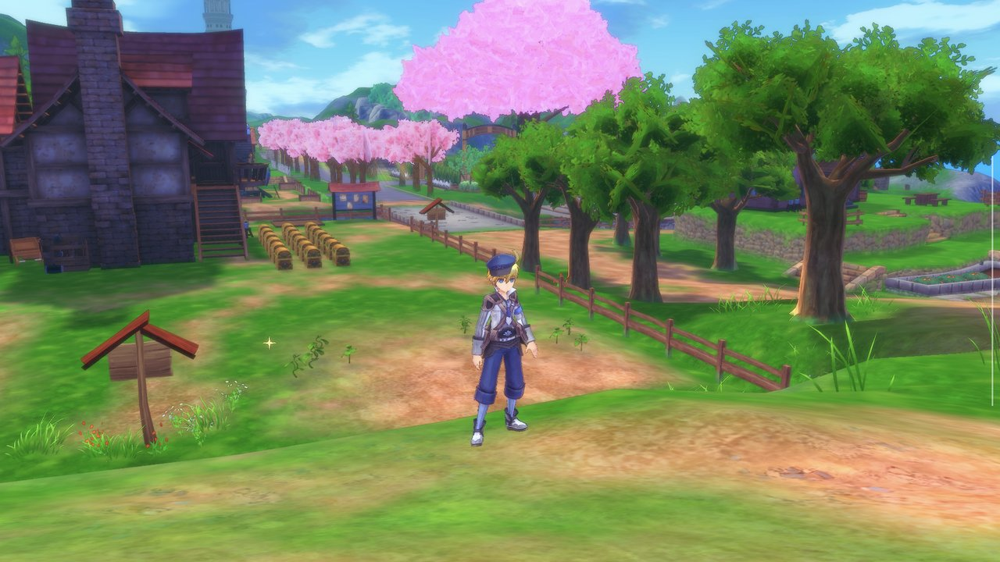

<!-- game facts: made by docs/gen_tables.py from android.tsv; edit android.tsv, not this block -->
# Rune Factory 5

| | |
|---|---|
| Status | **experimental** |
| Title ID | `01002F7013224000` |
| Tested with nx2android | `v0.4.0` |
| Tested build and device | v131072 AYN Odin 2 (Snapdragon 8 Gen 2, Adreno 740, Android 13) |
| App package | `org.nx2a.runefactory5` |

The profile sets these for you (`android.tsv`); a player changes the pause menu ones in the game, and the env rows in the data pack's `env.txt`:

| Row | What it does |
|---|---|
| `DM_NVN_CPU_TEX2D_FIRST_USE=1` | 1 = 2D textures the CPU writes are uploaded at their first use, not at creation |

Read the profile's porting log in the comment header of [`android.tsv`](android.tsv). Back to the [games list](../../../../README.md#games).
<!-- end of the game facts -->

## Game version

- Update 1.0.2 (`v131072`). Other updates are untested.

## Frame rate

- 30 fps in the world, as on the Switch; menus and loading screens run at 60.
- The game's speed follows its frame rate: forced to 60 fps, the player walks at about 0.7x speed. Keep the game's own 30 fps.

## Tested devices

| Device | GPU | Vulkan driver | Game version | nx2android | Result |
|---|---|---|---|---|---|
| AYN Odin 2 | Adreno 740 | system | 1.0.2 | `v0.4.0` | plays: the title, a loaded save, the town outdoors |

## Options

- None: the default options work.

## Quirks and known issues

- Experimental: tested only up to a loaded save and the town; longer play is unchecked.
- The first run after install hitches (frames up to about 200 ms) while it builds its pipelines; this stops once the cache is warm.
- Grass and ground textures can look soft; not yet compared with the Switch.
