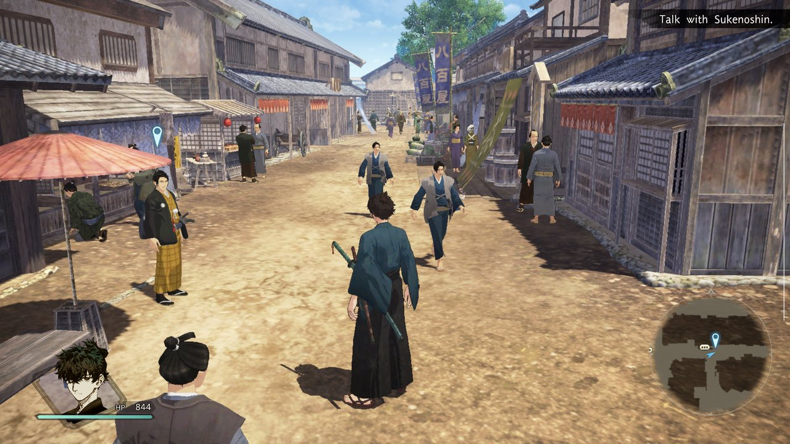

<!-- game facts: made by docs/gen_tables.py from android.tsv; edit android.tsv, not this block -->
# Fate/Samurai Remnant

| | |
|---|---|
| Status | **experimental** |
| Title ID | `01003AE01AA76000` |
| Tested with nx2android | `v0.5.0` |
| Tested build and device | 1.3.2 AYN Odin 2 |
| App package | `org.nx2a.fatesamurairemnant` |
| Vulkan driver | Turnip: the port packs Mesa's Turnip driver when the porter finds it (`vulkan_driver turnip`) |

The profile sets these for you (`android.tsv`); a player changes the pause menu ones in the game, and the env rows in the data pack's `env.txt`:

| Row | What it does |
|---|---|
| `DM_VK_X_FENCES=1` | submissions signal a ring of fences instead of a timeline semaphore, as on a Vulkan 1.1 driver without timeline semaphores (the Adreno 618 / 619 of 2021, issue … |
| `DM_DYN_SCALE=medium` | the host's dynamic resolution: a level for a profile's env row, `low` (lowest scale 0.85 against 90% of the frame time), `medium` (0.70, 85%) or `high` (0.50, … |
| `DM_DYN_FPS=30` | the frame rate DM_DYN_SCALE's budget is a share of, 30 or 60, when the frame step is off; unset = the rate the game's present interval gives |
| `DM_VK_SYNC_PIPE_MS=100` | once the pipelines built on the replay thread in one present took this many ms, a young target's draws (built there so a target drawn once keeps them) go to … |
| `DM_VK_COMPUTE_WARM_MAX=512` | the most compute shaders a bundle may have for their pipelines (without integer-texel variants) to be made ahead on a background thread at the first … |

Read the profile's porting log in the comment header of [`android.tsv`](android.tsv). Back to the [games list](../../../../README.md#games).
<!-- end of the game facts -->

## Game version

- Update 1.3.2, with the DLC installed.

## Frame rate

- 30 fps, as on Switch. The game paces itself at 30 fps with present interval 1.
- In the boss fight and in town the GPU needs 26–31 ms a frame, even at the lowest dynamic-resolution scale. Frames still land at about 30 fps (p50 33.4 ms).

## Tested devices

| Device | GPU | Vulkan driver | Game version | nx2android | Result |
|---|---|---|---|---|---|
| AYN Odin 2 (Snapdragon 8 Gen 2) | Adreno 740 | KIMCHI turnip v26.0.0_R8 | 1.3.2 | `v0.5.0` | plays: the opening, the first fights, the boss fight and the town |

## Options

- The profile packs Turnip by default (`vulkan_driver turnip`; tested with KIMCHI v26.0.0_R8). `--vulkan-driver <path to vulkan.ad07xx.so>` packs a given Turnip build. `--vulkan-driver system` keeps the device's own Qualcomm driver, which was not tested.
  - It draws less power than the stock Qualcomm driver: 5.67 W against 5.93 W in the same scene.
- The profile sets these switches:
  - `DM_VK_X_FENCES=1`: with Turnip, each submit that signals the timeline semaphore blocked in `vkQueueSubmit` for 15 ms a frame.
  - `DM_DYN_SCALE=medium`: the game's own dynamic resolution never lowers its ratio. The host now steers it from the GPU time, down to 0.70. A 0.50 floor looked blurry and saved only 3-7 ms, because the shadow maps do not follow the scale.
  - `DM_DYN_FPS=30`: sets the dynamic-resolution budget to 28.3 ms, for a 30 fps game. Without it, the game's present interval 1 gives a 60 fps budget, and the scale stays at its lowest.
  - `op_mode handheld` (in game.tsv): the game runs in handheld mode, with less detail than docked. In the heaviest battle it drew about half the draws, and GPU time fell from 28-33 ms to 20-24 ms a frame. Median frame time in that battle was 33.5 ms (30 fps).
  - `DM_VK_SYNC_PIPE_MS=100`: a scene shown for the first time froze the game for up to 2 s while it built new pipelines. Now the game waits about 100 ms, and the remaining pipelines build in the background. Their draws appear a few frames late.
  - `DM_VK_COMPUTE_WARM_MAX=512`: the game has 497 compute shaders, over the default cap of 256, so none were built ahead. A compute pipeline built during combat froze it for up to 600 ms. Now all of them build in the background at start.
- The profile's `android_fetch1d buffer` row makes the game's bone matrices readable as texture buffers. Without it the first fight's 3D scene was black.

## Quirks and known issues

- Battery use is high: about 6 W in town and in the boss fight. The GPU is busy for the whole frame at its top clock. No single render pass is wasteful: the 210 passes of a boss-fight frame add up to 26.5 ms.
- These optimizations would lower power but also lower image quality, so the profile does not use them:
  - A dynamic-resolution floor below 0.70. A 0.50 floor saved only 3-7 ms in the heaviest battle and looked blurry.
  - Smaller shadow maps. The 1024x2048 shadow pass takes 3 ms a frame.
  - A lower GPU clock cap. Frames would drop below 30 fps.
- Turnip's render modes (`TU_DEBUG=sysmem`, `gmem`, `forcebin`) did not lower power on the title menu: 4.07–4.21 W against 3.85–4.06 W with the default. The profile keeps the default.
- Skipping attachment loads and stores does not lower GPU time. In a handheld battle, a live A/B with `DM_VK_X_DEPTH=1` (depth neither loaded nor stored) and `DM_VK_X_COLOR=1` (colour not loaded) gave 28.8 and 27.8 µs of GPU time per draw, against 26.7 µs with both off. Render targets already use UBWC compression (each carries 2–3% of metadata), and the main pass uses 32-bit formats (RGBA8, B10G11R11, D24S8).
- A new install compiled each new scene's pipelines while the frame waited: the first battle effects held one frame for 2 s. The profile now ships `vk_pipelines_seed.bin`, the 974 pipelines recorded from the opening to the town and the battles, and the app builds them in the background at boot. A scene past that recording can still stall once; later runs build it at boot.
