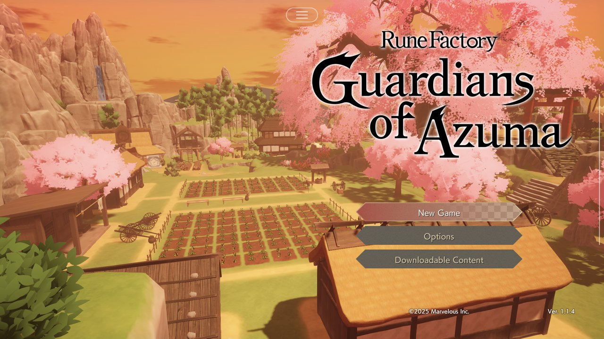

<!-- game facts: made by docs/gen_tables.py from android.tsv; edit android.tsv, not this block -->
# Rune Factory: Guardians of Azuma

| | |
|---|---|
| Status | **experimental** |
| Title ID | `01003AF0200B0000` |
| Tested with nx2android | `v0.5.0` |
| Tested build and device | v589824 AYN Odin 2 (Snapdragon 8 Gen 2, Adreno 740, Android 13, Turnip) |
| App package | `org.nx2a.runefactorygoa` |

The profile sets these for you (`android.tsv`); a player changes the pause menu ones in the game, and the env rows in the data pack's `env.txt`:

| Row | What it does |
|---|---|
| `DM_VK_FDZ=0` | no fragment-depth variants: draws that test a depth buffer a fragment shader wrote through `gl_FragDepth` (in the last two presents) normally get a variant of … |
| `DM_NGC_CONTENT_VERSION=1` | nn::ngc::ProfanityFilter::GetContentVersion result; unset: 0 |
| `DM_NGC_CHINA_PASSTHROUGH=1` | nn::ngc::MaskProfanityWordsInTextForPlatformRegionChina leaves the text as it is instead of filtering through ngct:u, which the host does not serve (abort … |
| `TU_DEBUG=sysmem` | - |
| `DM_VK_X_FENCES=1` | submissions signal a ring of fences instead of a timeline semaphore, as on a Vulkan 1.1 driver without timeline semaphores (the Adreno 618 / 619 of 2021, issue … |
| `DM_GPU_TURBO=1` | "auto" or 1: ask the GPU for its high clocks while the game is GPU-bound; "need": only while the game is held below its target; unset or 0 = no |

Read the profile's porting log in the comment header of [`android.tsv`](android.tsv). Back to the [games list](../../../../README.md#games).
<!-- end of the game facts -->

## Game version

- Update 1.1.4 (v589824), with the downloadable content installed. Other versions are untested.

## Frame rate

- **Handheld mode and the game's 30 fps setting are highly recommended on mid-range devices** (such as the Odin 2,
  Snapdragon 8 Gen 2). With them and the profile's `DM_GPU_TURBO=1`, Spring Village holds 30 fps: about 29 ms of GPU
  work a frame, frame work p50 28.9 ms and p95 29.3 ms, no long frames.
- Docked: about 21-25 fps on the Odin 2 against the game's 30 fps target. The game is GPU-bound: about 33-35 ms of GPU work a frame
  in Docked mode.
- `DM_VK_X_FENCES=1` stops the CPU from waiting for the GPU on every submission (on Turnip, a submission that signals the
  timeline semaphore blocks until the previous one finishes). Title scene, Docked: 18.3 ms to 0.2 ms of submit time and
  25.9 ms to 19.7 ms of frame work a frame. In Spring Village the frame time now follows the GPU time (about 39 ms against
  about 35 ms), so the play still feels slow there.
- For smoother play, a Snapdragon 8 Gen 3 or newer is recommended. The Odin 2 (Snapdragon 8 Gen 2) stays below 30 fps.
- Game speed follows real time, not the frame rate, so the game does not slow down when the frame rate drops.
- Handheld mode is faster (about 25 fps outdoors against about 21.5 fps Docked) at a lower render resolution.
- The game's 60 fps mode is not useful: it does not hold 30 fps.
- `DM_GPU_TURBO=1` holds the GPU at its highest clock. It uses more power; `DM_GPU_TURBO=0` in `env.txt` turns it off.

## Tested devices

| Device | GPU | Vulkan driver | Game version | nx2android | Result |
|---|---|---|---|---|---|
| AYN Odin 2 | Adreno 740 | Turnip v26.0.0_R8 by K11MCH1 (`--vulkan-driver`) | 1.1.4 | `v0.5.0` | plays: the title, character creation, a new save, Spring Village, combat; 21-25 fps Docked, 30 fps Handheld at the 30 fps setting |

## Options

- `--vulkan-driver` with a Turnip build: the profile's `TU_DEBUG=sysmem` speed-up only works on Turnip. All testing used
  the K11MCH1 Turnip build v26.0.0_R8.
- Pause menu, Game tab: Handheld (recommended) holds 30 fps at a lower resolution. Docked is the default and looks sharper, but
  runs at 21-25 fps.
- Battery: about 4.9 W while playing in Docked mode without `DM_GPU_TURBO`, about 5 hours on the Odin 2. With turbo the
  draw is higher (not measured).

## Quirks and known issues

- Docked mode is below the game's 30 fps target in most scenes (see Frame rate).
- A fresh install with no saved shaders rendered the title, character creation, the opening and the first house without
  glitches.
- The game's opening movie (`Mov001_F.bk2`) was not seen in testing.
