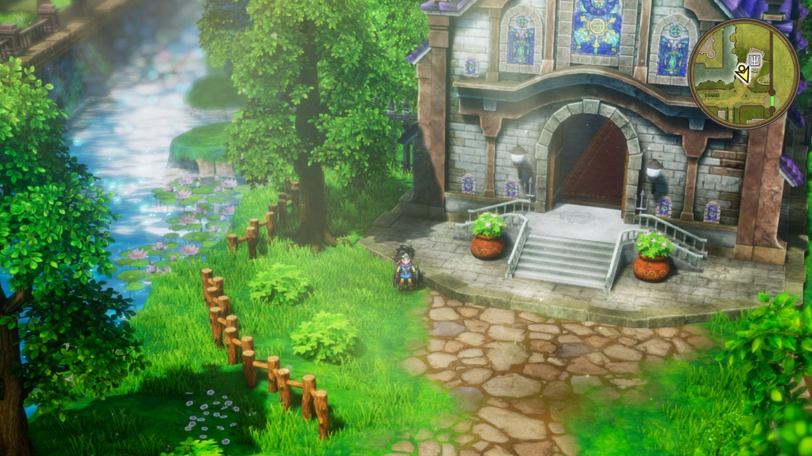

<!-- game facts: made by docs/gen_tables.py from android.tsv; edit android.tsv, not this block -->
# DRAGON QUEST III HD-2D Remake

| | |
|---|---|
| Status | **experimental** |
| Title ID | `01003E601E324000` |
| Tested with nx2android | `v0.5.0` |
| Tested build and device | 1.1.2 Lenovo Legion Y700 TB321FU (Snapdragon 8 Gen 3, Adreno 750, Android 16, Turnip 26.2.3) |
| App package | `org.nx2a.dragonquestiii` |
| Vulkan driver | Turnip: the port packs Mesa's Turnip driver when the porter finds it (`vulkan_driver turnip`) |

Read the profile's porting log in the comment header of [`android.tsv`](android.tsv). Back to the [games list](../../../../README.md#games).
<!-- end of the game facts -->

## Game version

- Update **1.1.2** (v262144), the version the profile registers; the base game (1.0.0) is not covered by this profile's rewriter patches or shader tables.

## Frame rate

- About **30 fps** in the opening area at docked 1920x1080 on the Y700 with Turnip (frame p50 33.7 ms, GPU p50 22.8 ms over 300-frame windows). The profile's target is 60, which the adaptive governor steps down from here; battles, the field and handheld 720p are not measured yet.
- First-use pipeline loads hitch: the game's 691 pipelines are built as its draws reach them.

## Tested devices

| Device | GPU | Vulkan driver | Game version | nx2android | Result |
|---|---|---|---|---|---|
| Lenovo Legion Y700 (TB321FU) | Adreno 750 | Turnip 26.2.3 | 1.1.2 | `v0.5.0` | boots: the logos and the opening movie, the title, a new adventure log (name, appearance, voice language, difficulty), the opening into the prologue's church by the water |

## Options

- None: the default options work. The profile packs Turnip (the device's system driver dies compiling a pipeline, see below), and the pause menu's Docked switch picks 1920x1080 against handheld 1280x720; only docked is tested so far.

## Quirks and known issues

- Turnip is required. On the Y700's Adreno system driver (LLVM `libllvm-qgl.so`) the app died with `SIGSEGV` at `libllvm-qgl.so+0x463ed4` while compiling a pipeline at boot, as DRAGON QUEST VII Reimagined's Asian release did; the profile packs Turnip for that reason.
- Only the opening is tested (title, a new adventure log, the prologue's church by the water): battles, the field menu, autosaves and Continue are not tested yet.