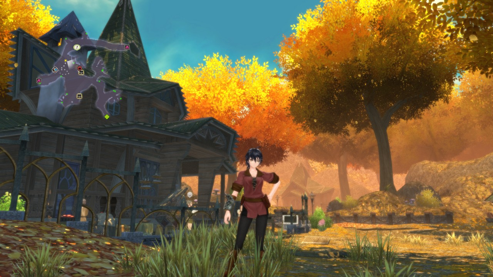

<!-- game facts: made by docs/gen_tables.py from android.tsv; edit android.tsv, not this block -->
# Tales of Berseria Remastered

| | |
|---|---|
| Status | **playable** |
| Title ID | `01003FD01F22E000` |
| Tested with nx2android | `v0.5.0` |
| Tested build and device | v262144 (1.0.5) Sony XQ-DQ72 (Adreno 740) and OnePlus 15 (Snapdragon 8 Elite Gen 5) |
| App package | `org.nx2a.t01003fd01f22e000` |

Read the profile's porting log in the comment header of [`android.tsv`](android.tsv). Back to the [games list](../../../../README.md#games).
<!-- end of the game facts -->

## Game version

- Tested with the Asia release and update 1.0.5 (`v262144`). The opening-transition fix applies only to this build; other versions were not tested.

## Frame rate

- About 30 fps at 1920×1080 in the opening area on Xperia 1 V. No 60 fps override was used. Frame rate on OnePlus 15 was not measured.

## Tested devices

| Device | GPU | Vulkan driver | Game version | nx2android | Result |
|---|---|---|---|---|---|
| Sony Xperia 1 V (XQ-DQ72, Android 13) | Adreno 740 | System | 1.0.5 (`v262144`) | `v0.5.0` | Passed the former white-screen transition; movement, camera and pause menu worked. The player reported about one hour without issues. |
| OnePlus 15 (Snapdragon 8 Elite Gen 5) | Adreno 840 | System | 1.0.5 (`v262144`) | `v0.5.0` | The player reported three hours of gameplay without issues. |

## Options

- None required: use the default frame pacing and system Vulkan driver. The test build used Simplified Chinese (`--language zh-Hans`).

## Quirks and known issues

- Without the 1.0.5 patch, the opening can freeze on a white screen. The profile applies the fix automatically to the matching build.
- Full completion, cutscene skipping and other GPU families were not verified.
