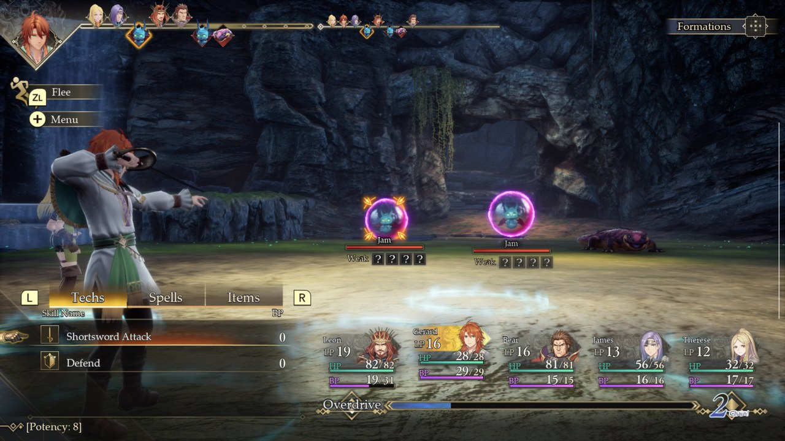

<!-- game facts: made by docs/gen_tables.py from android.tsv; edit android.tsv, not this block -->
# Romancing SaGa 2: Revenge of the Seven



| | |
|---|---|
| Status | **experimental** |
| Title ID | `010045301B86C000` |
| Tested with nx2android | `v0.5.0` |
| Tested build and device | v196608 AYN Odin 2 (Snapdragon 8 Gen 2 QCS8550, Adreno 740, Android 13; Mesa Turnip KIMCHI v26.0.0_R8) |
| App package | `org.nx2a.romancingsaga2rots` |
| Vulkan driver | Turnip: the port packs Mesa's Turnip driver when the porter finds it (`vulkan_driver turnip`) |

The profile sets these for you (`android.tsv`); a player changes the pause menu ones in the game, and the env rows in the data pack's `env.txt`:

| Row | What it does |
|---|---|
| `DM_SWKBD_SETTLE_MS=1000` | the game runs this long (ms) after the software keyboard closes before it gets the result, as the applet's close takes on hardware (Romancing SaGa 2: Revenge … |
| `DM_VK_X_FENCES=1` | submissions signal a ring of fences instead of a timeline semaphore, as on a Vulkan 1.1 driver without timeline semaphores (the Adreno 618 / 619 of 2021, issue … |

Read the profile's porting log in the comment header of [`android.tsv`](android.tsv). Back to the [games list](../../../../README.md#games).
<!-- end of the game facts -->

## Game version

- Update 1.1.0 (v196608, main build `d7a32c718e9d63639fa1cc7ef29b836d`) on the USA base game. The texture streaming patch (`patches.py`) applies to this main build only; another update ports without it.

## Frame rate

- 30 fps, as on the Switch. Game speed follows real time, so it runs at normal speed at 30 and 60 fps. A frame takes 24 to 35 ms of work in the story and the field on the AYN Odin 2, so the profile caps at 30 (`fps_ceiling 30`); `--fps60` lifts the cap, but the game does not hold 60.
- Towns are the heaviest scenes. In Avalon, without the profile's `DM_VK_X_FENCES=1`, each Vulkan submit waited about 20 ms on a lock in Turnip's emulated timeline semaphore, and frames took 41.5 ms (24 fps). With fences, frames take 33.2 ms p50 and 37 ms p95, so the game holds 30 fps.
- Power, whole device, handheld mode (the default, `docked=0` in the pause menu, 1280x720):
  - In the Sealed Cave: about 4.7 W, about 6.5 hours on the Odin 2's battery.
  - In Avalon: about 6.6 W, about 4.7 hours.
  - Power follows the frame rate. Each frame costs about 220 mJ in Avalon, whatever the settings below, so the cost is the game's work per frame.
- Docked mode renders at 1600x900. It draws about 5.6 W in the Sealed Cave and about 8 W in Avalon.
- These were measured in Avalon and are left out, as they did not help:
  - `DM_NVN_ASYNC=1` and `DM_VK_MT_REPLAY=1` used about half a core more and made frame p95 worse (about 47 ms).
  - `DM_PIN_REPLAY=prime`, `DM_NO_ADPF=1` and `DM_SVC_SPIN=1` changed nothing.
  - The Turnip build MrPurpleTurnip was slower (about 41 ms frames).
- On this device's kernel, the GPU busy and clock files under `/sys/class/kgsl` do not update while the game runs. Performance overlays that read them show a fixed value (for example 39% at 680 MHz).

## Tested devices

| Device | GPU | Vulkan driver | Game version | nx2android | Result |
|---|---|---|---|---|---|
| AYN Odin 2 (Android 13) | Adreno 740 | Mesa Turnip KIMCHI v26.0.0_R8 (`--vulkan-driver`) | 1.1.0 (v196608) | `v0.5.0` | plays: the intro, a new game with naming, the opening story, the field, the Sealed Cave and its battles, the start menu, saving and Continue; a fresh install with no shader caches |

## Options

- The profile packs Turnip by default (`vulkan_driver turnip`; tested with KIMCHI v26.0.0_R8). `--vulkan-driver system` keeps the device's own Qualcomm driver, which was not tested.
- The profile sets `DM_SWKBD_SETTLE_MS=1000` for you. Without it the game never shows "Is this name okay?" after the name is typed, and the naming page takes no more input.
- Handheld mode (`docked=0`) draws about 0.9 W less than docked mode in the Sealed Cave, and about 1.5 W less in Avalon (1280x720 against 1600x900), for a slightly softer picture.
- The profile sets `DM_VK_X_FENCES=1` for you. Without it, towns run at about 24 fps.
- Lower render resolution, opt-in and not set by the profile. The game scales its 3D view with Unreal's dynamic resolution, whose upper bound is the console variable `r.DynamicRes.MaxScreenPercentage` (100 by default); `r.ScreenPercentage` does nothing in this game. A player can cap it by hand to save power, for a softer 3D picture; the HUD and menus stay sharp. Measured in Avalon in handheld mode on the Odin 2, whole device, 30 s at the same spot:

  | Cap | Power | Frame p50 / p95 |
  |---|---|---|
  | 100 (default) | 6.7 W | 33.4 / 36.9 ms |
  | 75 | 5.7 W | 33.4 / 37.5 ms |
  | 50 | 5.0 W | 33.3 / 36.8 ms |

  To use it, save this as `lowres.tsv` (tab-separated; the two numbers are the cap at 30 fps and at `--fps60`, here 75) and push it to the app's files folder, `/sdcard/Android/data/org.nx2a.romancingsaga2rots/files/`:

  ```
  build	d7a32c718e9d63639fa1cc7ef29b836d
  DynamicRes.MaxScreenPercentage	float	0x7c01c58,0x0	75,75	75,75	-
  ```

  Then add two lines to `env.txt` in the same folder (measured at the default 30 fps only; a port built with `--fps60` already has `DM_FPS_TARGET` and `DM_FPS_LOCKS` lines, which these would replace, untested):

  ```
  DM_FPS_TARGET=30
  DM_FPS_LOCKS=/sdcard/Android/data/org.nx2a.romancingsaga2rots/files/lowres.tsv
  ```

  The host's FPSLocker writer (`hle_fpslock.c`) then rewrites the variable on every present (the game resets it about 2 s after launch). The offset is for main build `d7a32c718e9d63639fa1cc7ef29b836d` only; on another build the row is not used. Remove the two lines to go back to full resolution.

## Quirks and known issues

- The name is typed in Android's keyboard; the game takes it about a second after the keyboard closes.
- Unreal's texture streamer dropped the big mip levels of every texture that was not drawn for a frame, so the field and the characters were blurry for about half a second after each start menu toggle and battle or dungeon camera cut. `patches.py` fixes the game's keep loop (KeepOneMip, see the comment there); on another main build the blur comes back.
- After a fresh install, the Vulkan pipelines are built in the background the first time each scene is seen, and a draw that needs one is left out of the frame until it is ready. On the Odin 2 the first 12 minutes (intro, title, Continue, the Sealed Cave field, battles) built 773 pipelines and left out 1,785 of about 12 million draws, with no stalls from pipeline builds and nothing visibly wrong. The caches (`vk_pipelines.bin`, `vk_pipeline_cache.bin`) then keep them for later runs.
