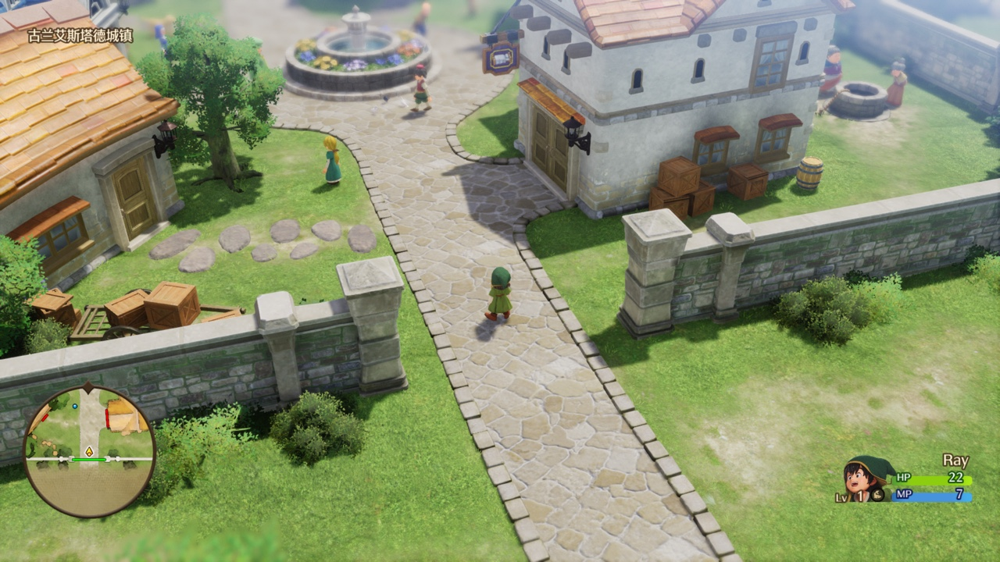

<!-- game facts: made by docs/gen_tables.py from android.tsv; edit android.tsv, not this block -->
# DRAGON QUEST VII Reimagined

| | |
|---|---|
| Status | **experimental** |
| Title ID | `0100505021440000` |
| Tested with nx2android | `v0.5.0` |
| Tested build and device | v65536 Lenovo Legion Y700 TB321FU (Snapdragon 8 Gen 3, Adreno 750, Android 16) |
| App package | `org.nx2a.dragonquestvii.asia` |
| Vulkan driver | Turnip: the port packs Mesa's Turnip driver when the porter finds it (`vulkan_driver turnip`) |

The profile sets these for you (`android.tsv`); a player changes the pause menu ones in the game, and the env rows in the data pack's `env.txt`:

| Row | What it does |
|---|---|
| `pacing fixed30` | frame pacing preset: DM_FPS_TARGET=30, DM_ADAPTIVE_FPS=0 |

Read the profile's porting log in the comment header of [`android.tsv`](android.tsv). Back to the [games list](../../../../README.md#games).
<!-- end of the game facts -->

## Game version

- Update 1.1.0 (v65536), the Asian (Korean / Chinese) release. The JP/WW release has its own profile for the Mac (`0100A9D01C446000`), which the shader split, the allocator cut and the memory layout here follow: its SDK and movie module builds are the same.
- Other updates are not tested.

## Frame rate

- 30 fps, held (`pacing fixed30`), as on the Switch. The game itself caps Unreal at 30 and asks for present interval 2; the profile lifts both (`fps_locks.tsv`) and the host holds 30. Docked at 1920x1080 it is GPU-bound (GPU p50 20-28 ms against the 33 ms of 30 fps); held there the GPU stayed at 46-66 °C on the tested device. With the frame-rate governor on it stepped between 40 and 30.

## Tested devices

| Device | GPU | Vulkan driver | Game version | nx2android | Result |
|---|---|---|---|---|---|
| Lenovo Legion Y700 TB321FU (Snapdragon 8 Gen 3, Android 16) | Adreno 750 | Turnip 26.2.3 | 1.1.0 (v65536) | `v0.5.0` | experimental: the title, a new game, the opening, the first village and its surroundings (walking, dialogue, battles), village transitions, the pause menu, an autosave and Continue from it |

## Options

- `--vulkan-driver <vulkan.turnip.so>`: the port needs Mesa's Turnip (26.2.3 tested). The Adreno 750's system driver (`libllvm-qgl.so`) crashes at boot compiling the first compute pipeline; the porter packs Turnip into the APK when it finds it.
- `--language zh-Hans` (or `zh-Hant`, `ko`): the game language; this is the Korean / Chinese release.
- `--app-name`: the launcher label. The control data names the game in Korean; pass the name you want (`DRAGON QUEST VII Reimagined`).

## Quirks and known issues

- None known.