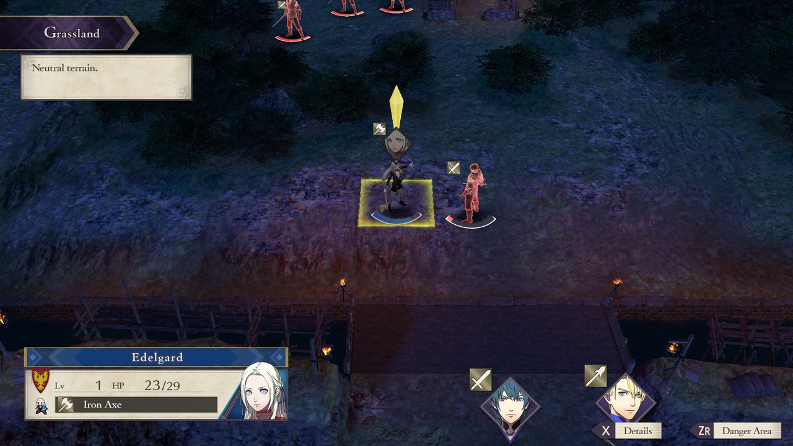

<!-- game facts: made by docs/gen_tables.py from android.tsv; edit android.tsv, not this block -->
# Fire Emblem: Three Houses

| | |
|---|---|
| Status | **playable** |
| Title ID | `010055D009F78000` |
| Tested with nx2android | `v0.5.0` |
| Tested build and device | v327680 Lenovo Legion Y700 TB322FC (Snapdragon 8 Elite, Adreno 830, Android 16) |
| App package | `org.nx2a.fireemblemthreehouses` |

The profile sets these for you (`android.tsv`); a player changes the pause menu ones in the game, and the env rows in the data pack's `env.txt`:

| Row | What it does |
|---|---|
| `DM_AUDREN_CATCHUP_FRAMES=200` | catch-up frames (a frame rendered on the updating thread when nothing was rendered since the last update) only while fewer than this many frames have been … |
| `DM_VK_X_FENCES=1` | submissions signal a ring of fences instead of a timeline semaphore, as on a Vulkan 1.1 driver without timeline semaphores (the Adreno 618 / 619 of 2021, issue … |

Read the profile's porting log in the comment header of [`android.tsv`](android.tsv). Back to the [games list](../../../../README.md#games).
<!-- end of the game facts -->

## Game version

- Update 1.2.0 (`v327680`), the version the profile's 60 fps patches are made for. Port the base game together with this update.
- The DLC (Cindered Shadows and the other packs) were not ported or tested.

## Frame rate

- 60 fps (30 on Switch) on the title, in the dialogue and the menus, on the first battle map and in its 3D combat scenes, docked and handheld, and in the monastery's halls and corridors (handheld, 5 minutes of walking in the Chapter 1 free roam: GPU 5 ms, no frame shown twice). The outdoor areas are not measured: at the start of Chapter 1 the guards close them.
- On a Legion Y700 (2025): the battle map takes about 9 ms of GPU time a frame handheld and 11-13 ms docked (rising as the device warms), the combat scenes about 7 ms handheld, the monastery hall 4-5 ms.
- No frame shown twice in 20 minutes of battle docked and 10 minutes handheld (before the frame limiter fix: 19 in 20 minutes docked). The game's 60.0 Hz clock and the panel's vsync differ slightly, so about every 11 minutes one frame stays on screen for one vsync instead of two.
- The anime movies play at their own 30 fps.

## Tested devices

| Device | GPU | Vulkan driver | Game version | nx2android | Result |
|---|---|---|---|---|---|
| Lenovo Legion Y700 (2025, TB322FC) | Adreno 830 | system | 1.2.0 (v327680) | `v0.5.0` | playable: title, movies, class demo, new game, character creation, prologue, first battle won with its combat scenes, Chapter 1 story and the monastery hall, save and load, pause menu, 30-minute battle soak; sound checked with a recording of the output (no repeats, gaps or frame-edge clicks in 54 minutes) |

## Options

- None: the default options work. Use the device's own Vulkan driver: Turnip draws the game too but takes about three times the GPU time.
- The port boots the game once on the device to capture the 9 shaders the game compiles when it starts, so connect the device (USB debugging on) even when you port without installing.

## Quirks and known issues

- The log has a `yield watchdog` red line on long sessions: the frame limiter yields during the last 2 ms of each frame (on purpose, see `patches.py`).
- The sound output clips for a few samples in the loudest combat moments (10 samples in 34 minutes).
- Name entry opens the on-screen keyboard; press + (OK) to confirm the name, as the game's help line says.
