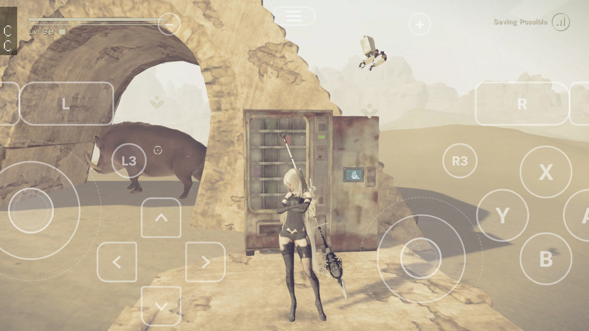

<!-- game facts: made by docs/gen_tables.py from android.tsv; edit android.tsv, not this block -->
# NieR:Automata The End of YoRHa Edition

| | |
|---|---|
| Status | **experimental** |
| Title ID | `010056B015FE8000` |
| Tested with nx2android | `v0.4.0` |
| Tested build and device | v131072 Xiaomi POCO F5 23049PCD8G (Snapdragon 7+ Gen 2 SM7475, Adreno 725, Android 15; Mesa Turnip v26 R8); Xiaomi Pad 7 2410CRP4CG (Snapdragon 7+ Gen 3 SM7675; Mesa Turnip v26 R8); Retroid Pocket 6 (Snapdragon 8 Gen 2, Adreno 740; Mesa Turnip v27.0.0-R2) |
| App package | `org.nx2a.nierautomata` |

The profile sets these for you (`android.tsv`); a player changes the pause menu ones in the game, and the env rows in the data pack's `env.txt`:

| Row | What it does |
|---|---|
| `DM_NVN_CPU_TEX2D_FIRST_USE=1` | 1 = 2D textures the CPU writes are uploaded at their first use, not at creation |
| `DM_VK_GS_SPLIT=1` | 1 = split geometry-shader draws (gfx_vk_gs_split.c) |

Read the profile's porting log in the comment header of [`android.tsv`](android.tsv). Back to the [games list](../../../../README.md#games).
<!-- end of the game facts -->

## Game version

- Base game `1.0.1` (`v0`) and optional update `1.0.3` (`v131072`) are both registered.
- All 660 RomFS files are identical between `1.0.1` and `1.0.3` except `/movie_logo/logo_00.usm`; shader tables match both versions.
- Update `1.0.3` (`v131072`) and base `1.0.1` (`v0`) were both verified on device.

## Frame rate

- Up to 60 fps (30 on Switch) via verified ARM64 `CUTS` in `patches.py` (60 fps frame-cost thresholds, present interval 1, and 1.0f dynamic-resolution floor) with `present_interval display` and `fps_target 60`.
- On Retroid Pocket 6 (Adreno 740, 720p handheld): 60 fps in menus, title, and indoor scenes; ~30–45 fps in heavy City Ruins outdoor traversal/combat (adaptive pacing holds a steady 30 fps when GPU work exceeds 16.7 ms).

## Tested devices

| Device | GPU | Vulkan driver | Game version | nx2android | Result |
|---|---|---|---|---|---|
| Xiaomi POCO F5 (23049PCD8G) | Adreno 725 | Mesa Turnip v26 R8 | 1.0.3 (`v131072`) | `v0.4.0` | boots: movies, title, menus, Desert Zone |
| Xiaomi Pad 7 (2410CRP4CG) | Adreno 735 | Mesa Turnip v26 R8 | 1.0.3 (`v131072`) | `v0.4.0` | boots: Desert Zone, City Ruins traversal & combat |
| Retroid Pocket 6 | Adreno 740 | Mesa Turnip v27.0.0-R2 | 1.0.3 (`v131072`) & 1.0.1 (`v0`) | `v0.4.0` | experimental: movies, title, saves, City Ruins, Desert cave, DLC mount |

## Options

- Tested with Mesa Turnip (`--vulkan-driver`, or the GUI's **Vulkan driver** field).
- The profile sets `DM_NVN_CPU_TEX2D_FIRST_USE=1` (for the CPU-filled 256×16 colour LUT) and `DM_VK_GS_SPLIT=1` (once-only Adreno geometry shader effects).

## Quirks and known issues

- `SetRenderEnableConditional` logs one `[RED]` line (conditional rendering is not yet implemented; the host draws unconditionally).
- Full-game progression and long-session stability have not been validated yet. See [`docs/NIER_AUTOMATA_ANDROID_PORT.md`](../../../../docs/NIER_AUTOMATA_ANDROID_PORT.md) for the earlier bring-up record.
