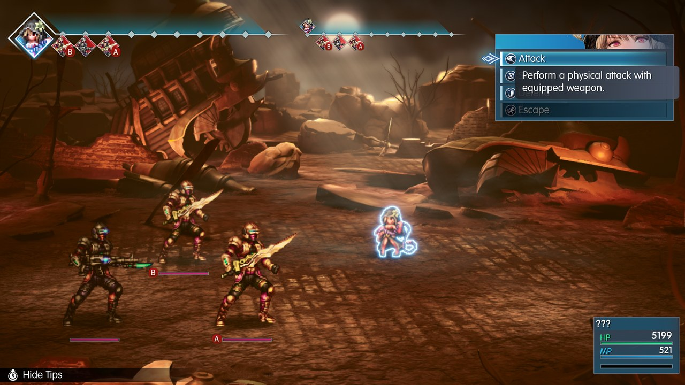

<!-- game facts: made by docs/gen_tables.py from android.tsv; edit android.tsv, not this block -->
# Final Fantasy Resonance

| | |
|---|---|
| Status | **playable** |
| Title ID | `0100606026F12000` |
| Tested with nx2android | `v0.4.0` |
| Tested build and device | v65536 Lenovo Legion Y700 TB322FC (Snapdragon 8 Elite, Adreno 830, Android 16) |
| App package | `org.nx2a.finalfantasyresonance` |

Read the profile's porting log in the comment header of [`android.tsv`](android.tsv). Back to the [games list](../../../../README.md#games).
<!-- end of the game facts -->

## Game version

- Update 1.0.1.
- The profile was checked with `v65536` (the `tested` row of android.tsv).

## Frame rate

- 60 fps.

## Tested devices

| Device | GPU | Vulkan driver | Game version | nx2android | Result |
|---|---|---|---|---|---|
| Lenovo Legion Y700 TB322FC (Snapdragon 8 Elite, Adreno 830, Android 16) | Adreno 830 | not recorded | 1.0.1 (v65536) | `v0.4.0` | playable |

Asian release: tested on the Legion Y700 TB321FU (Adreno 750) with a Turnip Vulkan driver.

## Options

- Not recorded.

## Quirks and known issues

- Not recorded.
