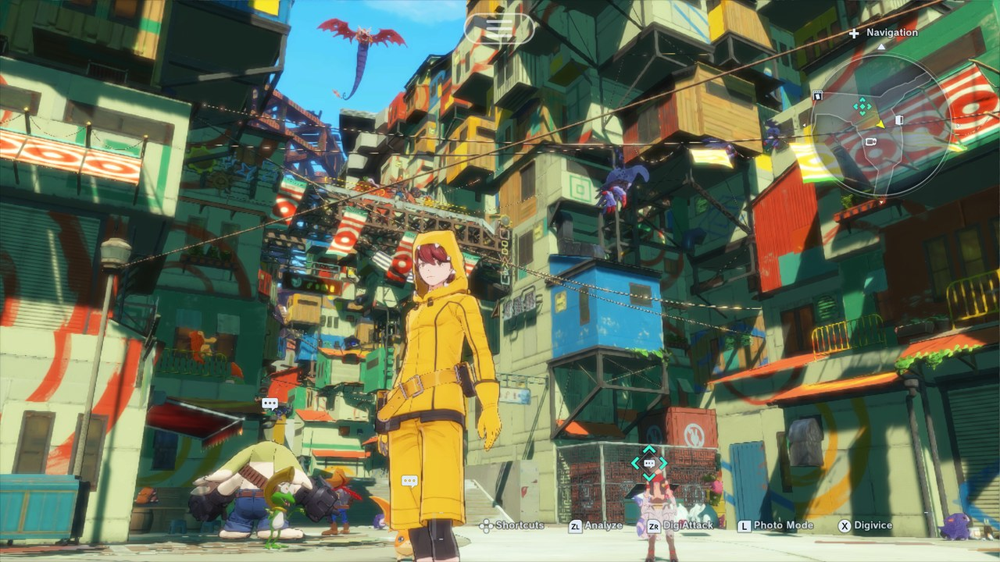

<!-- game facts: made by docs/gen_tables.py from android.tsv; edit android.tsv, not this block -->
# Digimon Story: Time Stranger

| | |
|---|---|
| Status | **wip** |
| Title ID | `010062E01FE0C000` |
| Tested with nx2android | `v0.5.0` |
| Tested build and device | v262144 Poco F5 (Snapdragon 7+ Gen 2, Adreno 725, Turnip 26.99.99) |
| App package | `org.nx2a.t010062e01fe0c000` |
| Vulkan driver | Turnip: the port packs Mesa's Turnip driver when the porter finds it (`vulkan_driver turnip`) |

The profile sets these for you (`android.tsv`); a player changes the pause menu ones in the game, and the env rows in the data pack's `env.txt`:

| Row | What it does |
|---|---|
| `DM_NVN_ASYNC=1` | asynchronous replay: submissions and presents run on a replay thread, syncs wait for the job's replay and then its GPU fence |
| `DM_VK_MT_REPLAY=1` | two-stage replay: the vkCmd* calls (40 of them) are copied into a 32 MB ring and a "vk record" thread makes the real calls in order; the calls that end, submit … |
| `DM_NVN_ACQ_REPLAYED=0` | with `DM_NVN_ASYNC=1`: the window acquire does not wait for the queued jobs' replay |
| `DM_PIN_REPLAY=prime` | pin the replay thread to fast cores: 0 = no, "prime" = the fastest core, "need" = the fastest core only while the replay is slow, other values = the big cores |
| `DM_VK_PASS_SPLIT=128` | split a pass into command buffers every N draws; 0 = never |
| `DM_VK_PASS_SPLIT_DEPTH=1` | with DM_VK_PASS_SPLIT: also split a pass that has a depth attachment (it writes back a depth texel before the second part, for Adreno's LRZ); 0 or unset = such … |
| `DM_FPS_PIN=30` | pin the governor at 60, 40 or 30 fps; 0 = no pin |

Read the profile's porting log in the comment header of [`android.tsv`](android.tsv). Back to the [games list](../../../../README.md#games).
<!-- end of the game facts -->

## Game version

- Update 1.2.2 (v262144) on the base game, with its 14 DLC.
- Other updates have not been tried.

## Frame rate

- 30 fps in handheld mode and in docked mode, in the crowded area that was tested.
- With the phone's own Vulkan driver the same area runs at about 20 fps, even with GPU turbo on. Mesa's Turnip driver is needed for 30 fps (see Options).

## Tested devices

| Device | GPU | Vulkan driver | Game version | nx2android | Result |
|---|---|---|---|---|---|
| Poco F5 (Snapdragon 7+ Gen 2) | Adreno 725 | Turnip 26.99.99 (Mesa 27.0.0-devel) | 1.2.2 (v262144) | `v0.5.0` | wip: plays, 30 fps in handheld and docked mode |

## Options

- The profile asks for Mesa's Turnip (`vulkan_driver turnip`). Point the port at a Turnip build for your GPU once with `python -m porter config turnip <libvulkan_freedreno.so>`; without one the port says so in red and uses the phone's driver, which is far slower (see Frame rate).
- GPU turbo is not needed.
- The profile splits the long 1920x1080 render pass (`DM_VK_PASS_SPLIT=128` with `DM_VK_PASS_SPLIT_DEPTH=1`): in the same area the slowest frames got shorter (95th percentile frame time about 56 ms without it, 38 ms with it, in short runs). A split of 512 helped much less; 256 and smaller values were not tried.

## Quirks and known issues

- **work in progress**: it plays, but only a short session, including one crowded area, has been tested, in both modes; more of the game needs testing.
- A brief stutter shows the first time an area is entered; after that the area runs smoothly.
- A blue line artifact showed in earlier builds; it was not reproduced on a recheck.
