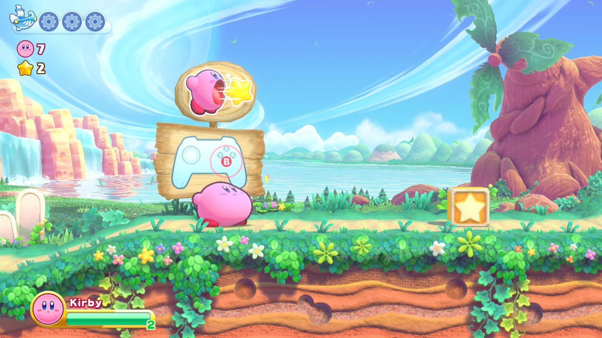

<!-- game facts: made by docs/gen_tables.py from android.tsv; edit android.tsv, not this block -->
# Kirby's Return to Dream Land Deluxe

| | |
|---|---|
| Status | **playable** |
| Title ID | `01006B601380E000` |
| Tested with nx2android | `v0.4.0` |
| Tested build and device | v0 AYN Thor (Snapdragon 8 Gen 2, Adreno 740, Android 13) |
| App package | `org.nx2a.t01006b601380e000` |
| Needs | your console's firmware dump (`--firmware`, the GUI's Firmware field) for shared font (standard), shared font (Nintendo extension) |

Read the profile's porting log in the comment header of [`android.tsv`](android.tsv). Back to the [games list](../../../../README.md#games).
<!-- end of the game facts -->

## Game version

- Not recorded.
- The profile was checked with `v0` (the `tested` row of android.tsv).

## Frame rate

- 60 fps.

## Tested devices

| Device | GPU | Vulkan driver | Game version | nx2android | Result |
|---|---|---|---|---|---|
| AYN Thor (Snapdragon 8 Gen 2, Adreno 740, Android 13) | Adreno 740 | Turnip | v0 | `v0.4.0` | playable |

Tested on the AYN Thor (Adreno 740) with a Turnip Vulkan driver.

## Options

- Tested with the Turnip Vulkan driver: port with it (`--vulkan-driver`).
- Needs your console's firmware for its fonts (`--firmware`).

## Quirks and known issues

- Not recorded.
