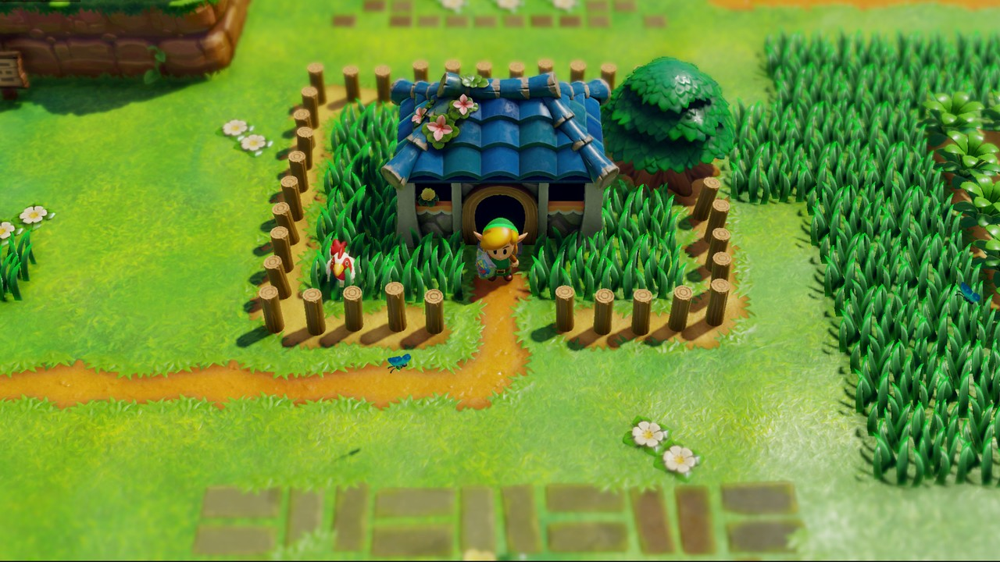

<!-- game facts: made by docs/gen_tables.py from android.tsv; edit android.tsv, not this block -->
# The Legend of Zelda: Link's Awakening

| | |
|---|---|
| Status | **playable** |
| Title ID | `01006BB00C6F0000` |
| Tested with nx2android | `v0.4.0` |
| Tested build and device | v131072 Lenovo TB323FU (Snapdragon 8 Elite Gen 5, Adreno 840, Android 16) |
| App package | `org.nx2a.t01006bb00c6f0000` |
| Needs | your console's firmware dump (`--firmware`, the GUI's Firmware field) for shared font (standard), shared font (Nintendo extension), shared font (simplified Chinese), shared font (traditional Chinese), shared font (Korean) |

Read the profile's porting log in the comment header of [`android.tsv`](android.tsv). Back to the [games list](../../../../README.md#games).
<!-- end of the game facts -->

## Game version

- Update 1.1.0.
- The profile was checked with `v131072` (the `tested` row of android.tsv).

## Frame rate

- 60 fps (drops to 30 on slow frames by default; uncomment the two NOPs in `patches.py` to hold 60 on fast chips — may cause judder and slow-motion on older devices).

## Tested devices

| Device | GPU | Vulkan driver | Game version | nx2android | Result |
|---|---|---|---|---|---|
| Lenovo TB323FU (Snapdragon 8 Elite Gen 5, Adreno 840, Android 16) | Adreno 840 | not recorded | 1.1.0 (v131072) | `v0.4.0` | playable |

Tested on the Lenovo TB323FU (Snapdragon 8 Elite Gen 5, Adreno 840).

## Options

- Needs your console's firmware for its fonts (`--firmware`): without them the game crashes at startup because the fallback font lacks `U+25A1`.

## Quirks and known issues

- A new area can hitch while it loads.
