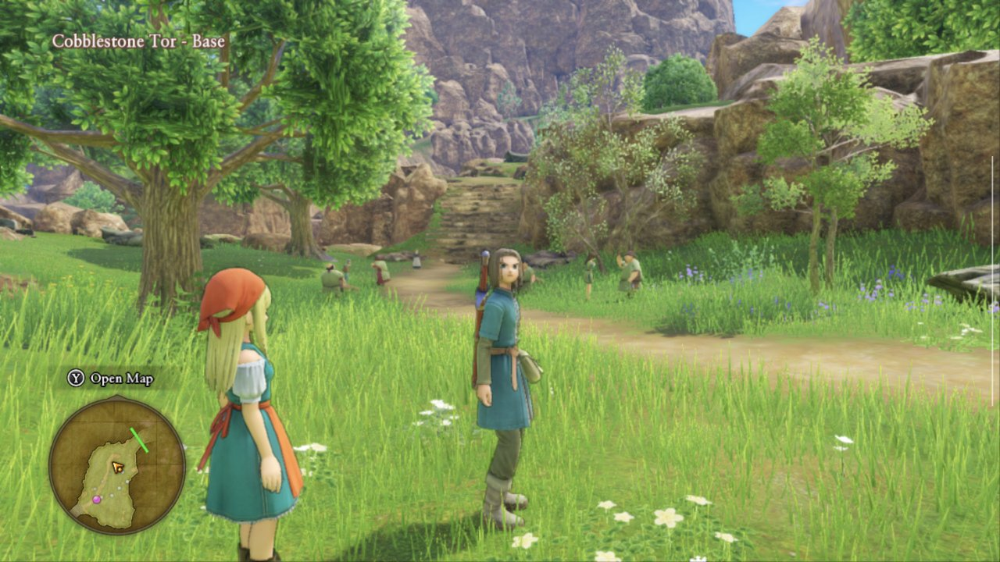

<!-- game facts: made by docs/gen_tables.py from android.tsv; edit android.tsv, not this block -->
# DRAGON QUEST XI S: Echoes of an Elusive Age – Definitive Edition

| | |
|---|---|
| Status | **experimental** |
| Title ID | `01006C300E9F0000` |
| Tested with nx2android | `v0.5.0` |
| Tested build and device | v262144 AYN Odin 2 (Snapdragon 8 Gen 2, Adreno 740, Android 13, Turnip) |
| App package | `org.nx2a.dragonquestxide` |
| Vulkan driver | Turnip: the port packs Mesa's Turnip driver when the porter finds it (`vulkan_driver turnip`) |

The profile sets these for you (`android.tsv`); a player changes the pause menu ones in the game, and the env rows in the data pack's `env.txt`:

| Row | What it does |
|---|---|
| `docked=0` | pause menu default on first launch: docked mode (1) or handheld mode (0) |
| `DM_FPS_TARGET=30` | the frame rate the game is held to; 0 = the game's own |
| `DM_VK_X_FENCES=1` | submissions signal a ring of fences instead of a timeline semaphore, as on a Vulkan 1.1 driver without timeline semaphores (the Adreno 618 / 619 of 2021, issue … |
| `TU_DEBUG=sysmem` | - |

Read the profile's porting log in the comment header of [`android.tsv`](android.tsv). Back to the [games list](../../../../README.md#games).
<!-- end of the game facts -->

## Game version

- Update 1.0.4 (v262144). No other update was tested.

## Frame rate

- 30 fps, the same rate as on the Switch. In handheld mode, the first field (Cobblestone Tor) takes about 23 ms of GPU time per frame and holds 30 fps (frame p50 33.2 ms, p95 36.9 ms).
- Docked mode also holds 30 fps, because the game's own dynamic resolution lowers the rendering resolution. It draws about a third more battery (1.62 A against 1.21 A at the same spot).
- 60 fps is out of reach: the field needs about 58 ms of GPU time per frame at 60. `porter port --fps60` turns 60 on for testing.

## Tested devices

| Device | GPU | Vulkan driver | Game version | nx2android | Result |
|---|---|---|---|---|---|
| AYN Odin 2 (Snapdragon 8 Gen 2, Adreno 740, Android 13) | Adreno 740 | Turnip, KIMCHI v26.0.0 R8 (packed by default) | 1.0.4 (v262144) | `v0.5.0` | plays: the opening movie, the title, a new game through the prologue into the first field, a loaded save in the field; a fresh install with no shader caches showed no glitches |

## Options

- The profile packs Turnip by default (`vulkan_driver turnip`; tested with KIMCHI v26.0.0 R8). The system Adreno driver was not tested.
- Handheld mode is the default on first launch. It runs cooler and drains less battery than docked mode. Docked mode is in the pause menu.
- `DM_GPU_TURBO=1` in `env.txt` holds the GPU at its highest clock. In handheld mode it lowered GPU time from 24 to 17 ms a frame with no frame-rate gain, so it is left off.

## Quirks and known issues

- Battles were not tested on Android.
- The log shows a yield watchdog line for the GameThread in the first minute after launch. The game keeps running and it has no visible effect.
