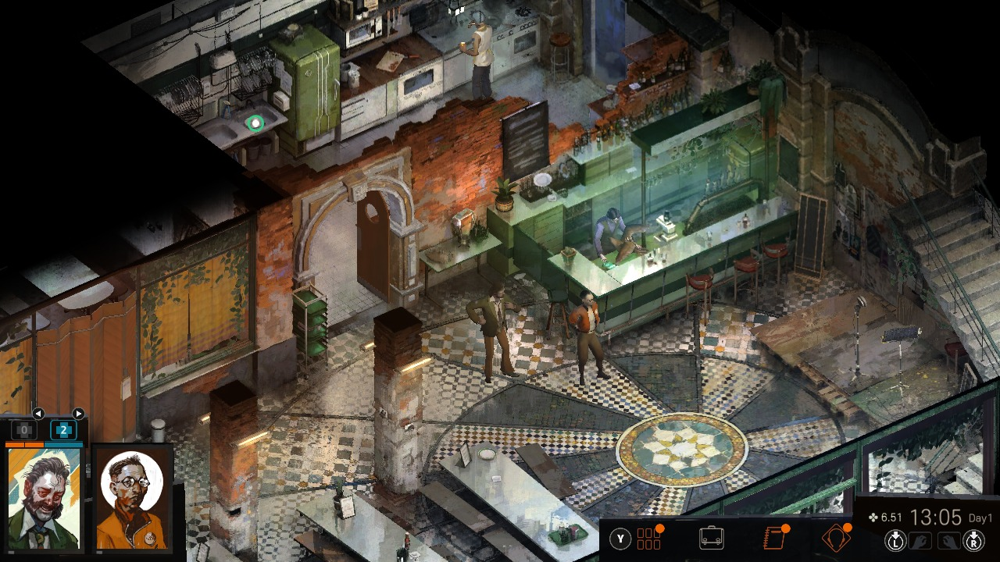

<!-- game facts: made by docs/gen_tables.py from android.tsv; edit android.tsv, not this block -->
# Disco Elysium - The Final Cut

| | |
|---|---|
| Status | **playable** |
| Title ID | `01006C5015E84000` |
| Tested with nx2android | `v0.4.0` |
| Tested build and device | v0 (1.0.7) Sony XQ-DQ72 (Adreno 740) and OnePlus 15 (Snapdragon 8 Elite Gen 5), 2026-11-10 |
| App package | `org.nx2a.t01006c5015e84000` |

The profile sets these for you (`android.tsv`); a player changes the pause menu ones in the game, and the env rows in the data pack's `env.txt`:

| Row | What it does |
|---|---|
| `docked=0` | pause menu default on first launch: docked mode (1) or handheld mode (0) |

Read the profile's porting log in the comment header of [`android.tsv`](android.tsv). Back to the [games list](../../../../README.md#games).
<!-- end of the game facts -->

## Game version

- Base game 1.0.7.
- The profile was checked with `v0` (the `tested` row of android.tsv).

## Frame rate

- 30 fps (as on Switch).

## Tested devices

| Device | GPU | Vulkan driver | Game version | nx2android | Result |
|---|---|---|---|---|---|
| (1.0.7) Sony XQ-DQ72 (Adreno 740) and OnePlus 15 (Snapdragon 8 Elite Gen 5), 2026-11-10 | Adreno 740 | not recorded | 1.0.7 (v0) | `v0.4.0` | playable |

Tested on the Sony XQ-DQ72 and the OnePlus 15.

## Options

- Not recorded.

## Quirks and known issues

- Severe block and triangle artifacts are reported on POCO X3 Pro
  (Snapdragon 860 / Adreno 640) with Turnip reporting 26.99.99, in game versions
  1.0.7 and 1.0.12 ([issue #283](https://github.com/shirai91/nx2android/issues/283),
  [follow-up log](https://github.com/shirai91/nx2android/pull/484#issuecomment-7074295461)).
  The supplied logs advertise subgroup support only in compute (`stages 0x20`)
  and show the existing one-invocation fallback on 219 fragment shaders. This
  does not establish the cause of the corruption. Investigation and verification
  on the affected device remain pending; the playable results above apply to
  the listed tested devices.
