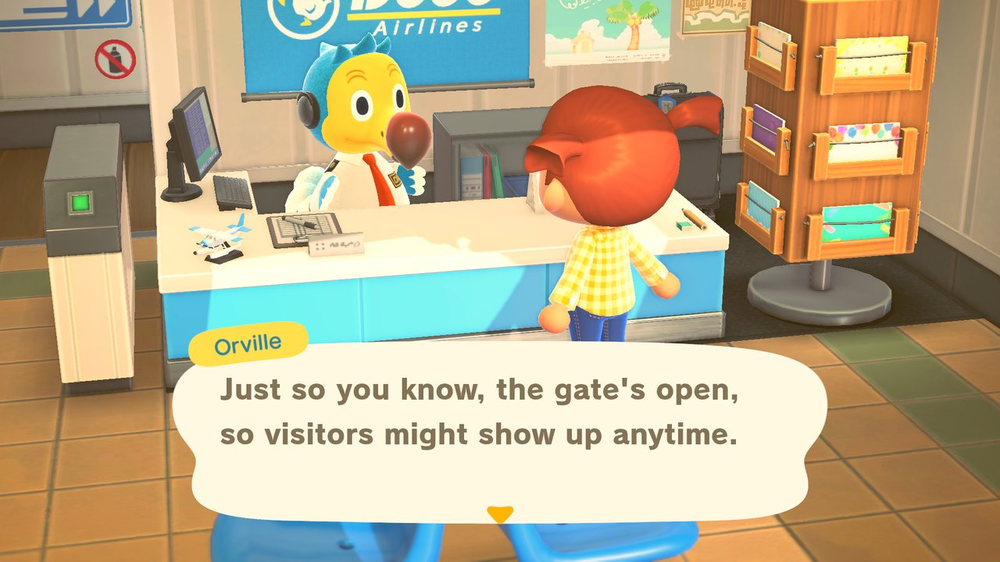

<!-- game facts: made by docs/gen_tables.py from android.tsv; edit android.tsv, not this block -->
# Animal Crossing: New Horizons

| | |
|---|---|
| Status | **playable** |
| Title ID | `01006F8002326000` |
| Tested with nx2android | `v0.4.0` |
| Tested build and device | v2228224 Lenovo Legion Y700 TB322FC (Snapdragon 8 Elite, Adreno 830, Android 16) |
| App package | `org.nx2a.animalcrossing` |

The profile sets these for you (`android.tsv`); a player changes the pause menu ones in the game, and the env rows in the data pack's `env.txt`:

| Row | What it does |
|---|---|
| `DM_VK_CB_DRAWS=0` | split the frame into command buffers every N draws (128), only before passes with a new depth image; `0` = never |
| `DM_VK_ASYNC_PIPE=0` | 0 = new pipelines are built on the replay thread, not in the background |
| `DM_YIELD_BACKOFF=0` | back off after this many ms of repeated yields (ms[:start ms]); 0 = plain spin |
| `DM_LAN=1` | local wireless play over the LAN (ldn): 1 = on |

Read the profile's porting log in the comment header of [`android.tsv`](android.tsv). Back to the [games list](../../../../README.md#games).
<!-- end of the game facts -->

## Game version

- Update 3.0.3.
- The profile was checked with `v2228224` (the `tested` row of android.tsv).

## Frame rate

- 30 fps (as on Switch).

## Tested devices

| Device | GPU | Vulkan driver | Game version | nx2android | Result |
|---|---|---|---|---|---|
| Lenovo Legion Y700 TB322FC (Snapdragon 8 Elite, Adreno 830, Android 16) | Adreno 830 | not recorded | 3.0.3 (v2228224) | `v0.4.0` | playable |

## Options

- Not recorded.

## Quirks and known issues

- Local play over Wi-Fi with Switches that run ldn_mitm (Atmosphère 1.11.2 needs ldn_mitm 1.21.2).
