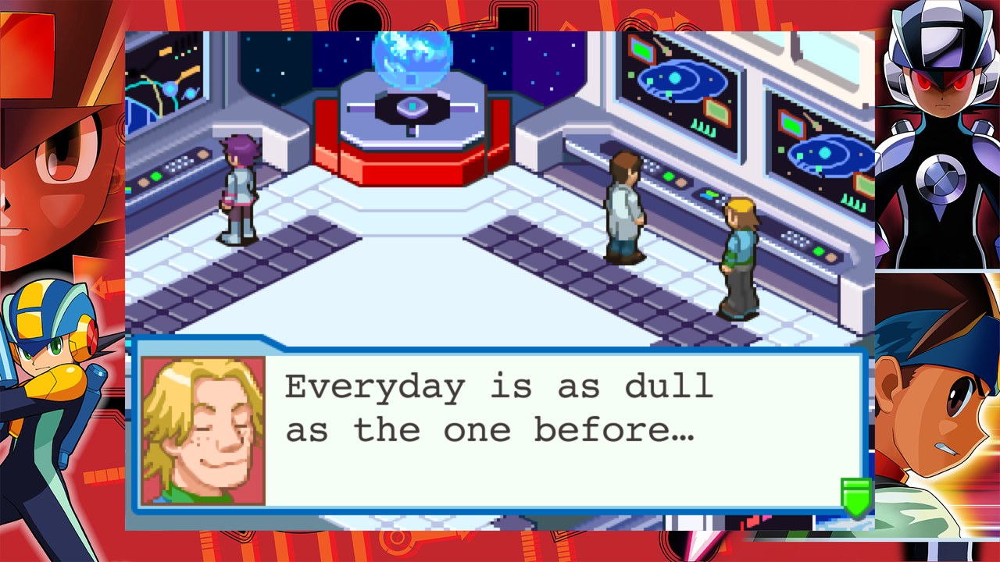

<!-- game facts: made by docs/gen_tables.py from android.tsv; edit android.tsv, not this block -->
# Mega Man Battle Network Legacy Collection Vol. 2

| | |
|---|---|
| Status | **playable** |
| Title ID | `0100734016266000` |
| Tested with nx2android | `v0.4.0` |
| Tested build and device | v196608 (1.0.3) AYN Odin 2 (QCS8550, Adreno 740, Android 13, Turnip), 2026-11-13 |
| App package | `org.nx2a.mmbnlc2` |

The profile sets these for you (`android.tsv`); a player changes the pause menu ones in the game, and the env rows in the data pack's `env.txt`:

| Row | What it does |
|---|---|
| `pacing steady` | frame pacing preset: DM_ADAPTIVE_FPS=0 |

Read the profile's porting log in the comment header of [`android.tsv`](android.tsv). Back to the [games list](../../../../README.md#games).
<!-- end of the game facts -->

## Game version

- Update 1.0.3.
- The profile was checked with `v196608` (the `tested` row of android.tsv).

## Frame rate

- 60 fps, held.

## Tested devices

| Device | GPU | Vulkan driver | Game version | nx2android | Result |
|---|---|---|---|---|---|
| (1.0.3) AYN Odin 2 (QCS8550, Adreno 740, Android 13, Turnip), 2026-11-13 | Adreno 740 | Turnip | 1.0.3 (v196608) | `v0.4.0` | playable |

Tested on the AYN Odin 2 (Adreno 740) with a Turnip Vulkan driver.

What was tested:

- Battle Network 4, 5 and 6 played: saving, loading, battles, gallery.

## Options

- Tested with the Turnip Vulkan driver: port with it (`--vulkan-driver`).
- The launcher's menus draw fully from the second port with the device connected after a first run (it builds some shaders at run time).

## Quirks and known issues

- Not recorded.
