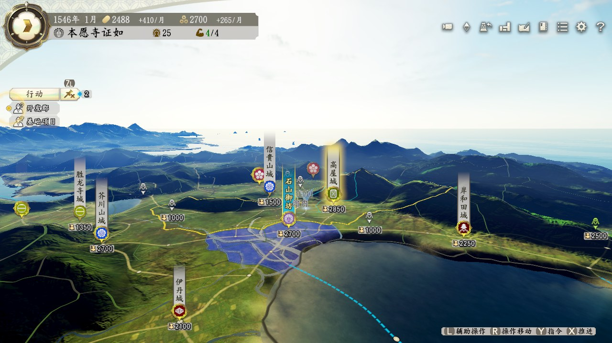

<!-- game facts: made by docs/gen_tables.py from android.tsv; edit android.tsv, not this block -->
# NOBUNAGA'S AMBITION: Shinsei

| | |
|---|---|
| Status | **playable** |
| Title ID | `01007AB012872000` |
| Tested with nx2android | `v0.5.0` |
| Tested build and device | v65536 Lenovo Legion Y700 TB321FU (Snapdragon 8 Gen 3, Adreno 750, Android 16) |
| App package | `org.nx2a.t01007ab012872000` |
| Vulkan driver | Turnip: the port packs Mesa's Turnip driver when the porter finds it (`vulkan_driver turnip`) |

The profile sets these for you (`android.tsv`); a player changes the pause menu ones in the game, and the env rows in the data pack's `env.txt`:

| Row | What it does |
|---|---|
| `pacing fixed30` | frame pacing preset: DM_FPS_TARGET=30, DM_ADAPTIVE_FPS=0 |

Read the profile's porting log in the comment header of [`android.tsv`](android.tsv). Back to the [games list](../../../../README.md#games).
<!-- end of the game facts -->

## Game version

- Update 1.0.1 (v65536) was tested. The base game 1.0.0 has not been tried.
- The Japanese / Asian release has Japanese and Simplified and Traditional Chinese text, no English (`--language zh-Hans`, `zh-Hant` or `ja`).
- The five add-on contents (three scenarios, the strategy data / art book / soundtrack, and the update's bonus) were not packed: put their NSPs beside the base game's (hard links are fine) and port again.

## Frame rate

- 30 fps (as on Switch) on the campaign map and in the menus; the opening movies run at 60.
- On the Y700 with Turnip: frame time p50 33.0 ms, GPU 17–19 ms in the tutorial's campaign map.

## Tested devices

| Device | GPU | Vulkan driver | Game version | nx2android | Result |
|---|---|---|---|---|---|
| Lenovo Legion Y700 TB321FU (Snapdragon 8 Gen 3, Adreno 750, Android 16) | Adreno 750 | Turnip 26.2.3 (Mesa), packed by the profile; also run with GameSir's rutabaga 26.3.0-devel | 1.0.1 (v65536) | `v0.5.0` | playable: the opening movies, the title, the tutorial's new game, the faction select, the campaign map, a retainer's advice, an in-game save and the pause menu |

## Options

- `--language zh-Hans` for Simplified Chinese (`zh-Hant` for Traditional, `ja` for Japanese): the game has no English text, and without the option the port falls back to Japanese.
- Turnip is required, and the profile asks for it: point the porter at a driver (`porter config turnip <libvulkan_freedreno.so>`, or `--vulkan-driver <file>`). The port was tested with Turnip-26.2.3-EMULATOR. `--vulkan-driver system` is not playable: the Adreno driver crashes (see below).
- The pause menu's defaults are the ones to play with; Show FPS is off.

## Quirks and known issues

- **The device's own driver crashes on this game's compute shaders.** The Adreno 750's driver (512.762.40) faults inside `libllvm-qgl.so` while building a pipeline for the compute shaders that use `OpGroupNonUniformBallot` / `SubgroupLtMask` (at boot in the compute prewarm, and again when the game builds one after the opening movie). Mesa's Turnip builds all 70 compute shaders in about 26–28 s in the background and the game runs normally; this is why the profile sets `vulkan_driver turnip`.
- **First boot starts the tutorial** instead of the title screen; later boots show the title with "继续上一局游戏" when a save exists. The opening movies play in full: + (Plus) skips them.
- **Save.** The game's own save works (slot 1 writes `svdSC01.n16` with the language's suffix); the pause menu's Export save / Import save copies the host save folder.
- **Not tested yet:** a battle, and text entry (naming a custom officer, `nn::swkbd`); the overlap of battles and the overlay's 3D layout.