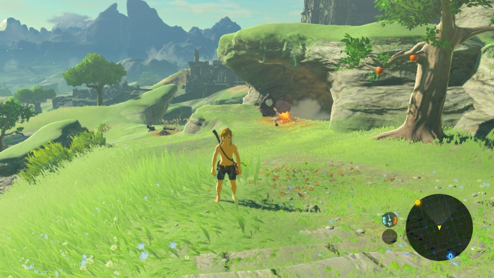

<!-- game facts: made by docs/gen_tables.py from android.tsv; edit android.tsv, not this block -->
# The Legend of Zelda: Breath of the Wild

| | |
|---|---|
| Status | **experimental** |
| Title ID | `01007EF00011E000` |
| Tested with nx2android | `v0.4.0` |
| Tested build and device | v1114112 Samsung Galaxy S25 Ultra (Snapdragon 8 Elite for Galaxy, Adreno 830); Turnip 26.2.3 |
| App package | `org.nx2a.zeldabreathofthewild` |
| Needs | a GPU that reads BC-compressed textures (Adreno, Xclipse; not Mali or PowerVR) |

The profile sets these for you (`android.tsv`); a player changes the pause menu ones in the game, and the env rows in the data pack's `env.txt`:

| Row | What it does |
|---|---|
| `DM_VK_FDZ=0` | no fragment-depth variants: draws that test a depth buffer a fragment shader wrote through `gl_FragDepth` (in the last two presents) normally get a variant of … |
| `DM_NVN_ASYNC=1` | asynchronous replay: submissions and presents run on a replay thread, syncs wait for the job's replay and then its GPU fence |
| `DM_PIN_REPLAY=prime` | pin the replay thread to fast cores: 0 = no, "prime" = the fastest core, other values = the big cores |
| `DM_VK_X_CUTANY=1` | 1 = command buffers may be cut before any pass (not only passes with a new depth image) |
| `DM_VK_CB_DRAWS=128` | split the frame into command buffers every N draws (128), only before passes with a new depth image; `0` = never |
| `DM_VK_WINDOW_GAME_RATE=1` | 1 = the display rate vote follows the game's rate |
| `DM_VK_BC_DRAW=1` | BC texture stand-in mode for drivers without BC: 0 = off |
| `DM_GPU_TURBO=1` | "auto" or 1: ask the GPU for its high clocks while the game is GPU-bound; unset or 0 = no |

Read the profile's porting log in the comment header of [`android.tsv`](android.tsv). Back to the [games list](../../../../README.md#games).
<!-- end of the game facts -->

## Game version

- Update 1.9.0.
- The profile was checked with `v1114112` (the `tested` row of android.tsv).

## Frame rate

- 60 fps in the open world and shrines; about 30 in the busiest villages, which hold 60 while the phone is cool (30 on Switch).

## Tested devices

| Device | GPU | Vulkan driver | Game version | nx2android | Result |
|---|---|---|---|---|---|
| Samsung Galaxy S25 Ultra (Snapdragon 8 Elite for Galaxy, Adreno 830); Turnip 26.2.3 | Adreno 830 | Turnip | 1.9.0 (v1114112) | `v0.4.0` | experimental |

Tested on the Galaxy S25 Ultra (Adreno 830) with Turnip (Stable Turnip v2, Mesa 26.2.3).
**work in progress**: tested on the Great Plateau, in shrines, villages and teleports.

## Options

- Tested with the Turnip Vulkan driver: port with it (`--vulkan-driver`).
- The profile turns on `DM_GPU_TURBO=1` (the GPU at its highest clock: the phone runs hot, 67-76 °C; `DM_GPU_TURBO=0` in env.txt turns it off).

## Quirks and known issues

- Not recorded.
