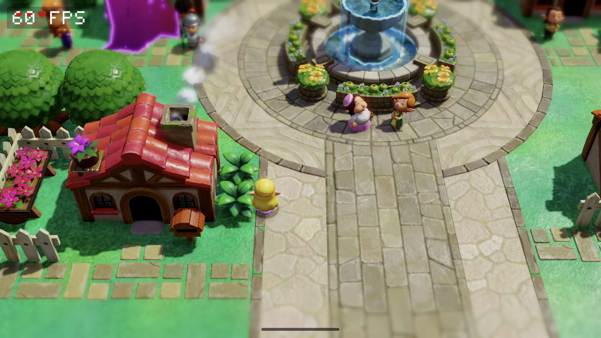

<!-- game facts: made by docs/gen_tables.py from android.tsv; edit android.tsv, not this block -->
# The Legend of Zelda: Echoes of Wisdom

| | |
|---|---|
| Status | **playable** |
| Title ID | `01008CF01BAAC000` |
| Tested with nx2android | `v0.4.0` |
| Tested build and device | v196608 Retroid Pocket 6 (Adreno 740, PurpleVK) |
| App package | `org.nx2a.t01008cf01baac000` |
| Needs | your console's firmware dump (`--firmware`, the GUI's Firmware field) for shared font (standard), shared font (Nintendo extension) |

Read the profile's porting log in the comment header of [`android.tsv`](android.tsv). Back to the [games list](../../../../README.md#games).
<!-- end of the game facts -->

## Game version

- Version 1.1.0.
- The profile was checked with `v196608` (the `tested` row of android.tsv).

## Frame rate

- Not recorded.

## Tested devices

| Device | GPU | Vulkan driver | Game version | nx2android | Result |
|---|---|---|---|---|---|
| Retroid Pocket 6 (Adreno 740, PurpleVK) | Adreno 740 | PurpleVK | 1.1.0 (v196608) | `v0.4.0` | playable |

Playable on Retroid Pocket 6 with PurpleVK.

## Options

- Tested with the PurpleVK Vulkan driver (`--vulkan-driver`).
- For a startup error mentioning `U+25A1`, supply your console's firmware dump with `--firmware` (the GUI's Firmware field) to package the standard and Nintendo extension fonts.

## Quirks and known issues

- **work in progress**: minor transparency artifacts around rifts.
- The opening-cutscene freeze reported in [#455](https://github.com/shirai91/nx2android/issues/455) remains unresolved by this font-packaging change.
