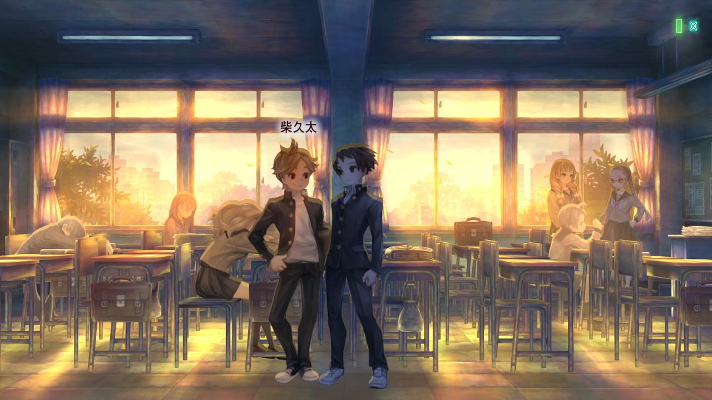

<!-- game facts: made by docs/gen_tables.py from android.tsv; edit android.tsv, not this block -->
# 13 Sentinels: Aegis Rim (Asia)

| | |
|---|---|
| Status | **playable** |
| Title ID | `01008D7016438000` |
| Tested with nx2android | `v0.4.0` |
| Tested build and device | v0 Xiaomi 23117RK66C (Snapdragon 8 Gen 3, Adreno 750, Android 16) |
| App package | `org.nx2a.thirteensentinelsasia` |
| Needs | a GPU that reads BC-compressed textures (Adreno, Xclipse; not Mali or PowerVR) |

Read the profile's porting log in the comment header of [`android.tsv`](android.tsv). Back to the [games list](../../../../README.md#games).
<!-- end of the game facts -->

## Game version

- Base game 1.00.
- The Asian release (Japanese, Korean, Chinese).
- The profile was checked with `v0` (the `tested` row of android.tsv).

## Frame rate

- 60 fps.

## Tested devices

| Device | GPU | Vulkan driver | Game version | nx2android | Result |
|---|---|---|---|---|---|
| Xiaomi 23117RK66C (Snapdragon 8 Gen 3, Adreno 750, Android 16) | Adreno 750 | not recorded | 1.00 (v0) | `v0.4.0` | playable |

Tested on the Xiaomi 23117RK66C (Android 16).

## Options

- Not recorded.

## Quirks and known issues

- Not recorded.

## Porting notes

Status: **playable** — ported and played on an Android device.

The Asian release (Japanese, Korean, Chinese) of the game the western profile `01003FC01670C000` covers: its own title ID and its own `main` build, the same `subsdk0` / `sdk` builds and the same shader keys at other offsets in `main`. It covers **1.00 (`v0`)**, title ID `01008D7016438000`. Other game versions are outside this assessment.

### Compatibility evidence

NVN GLSLC shaders are embedded in main; shaders/pairs match the supported western game (the offsets differ in `shader_map`). The existing `alloc_big_align`, movie path, pool chunking, BC textures and renderer support apply; no code is keyed to this Asian main.

The game and build are supported by nxnative; see its [game notes](https://github.com/seedds/nxnative/blob/3084f7a205bcb3a9cb74cf26180dabcc01c7abca/dm/games/01008D7016438000/README.md) and [profile](https://github.com/seedds/nxnative/blob/3084f7a205bcb3a9cb74cf26180dabcc01c7abca/dm/games/01008D7016438000/game.tsv). The local profile is authored from that build metadata, with the shader input tables consumed by this fork.

Relevant existing paths:

- `nxnative/dm/gfx/tools/shader_split.py`

### Build and defaults

| Module | Build ID |
|---|---|
| `main` | `311947020f64f5742ce3c16162c4d87f` |
| `subsdk0` | `507f19d1240d09d00992248e8a0fd77e` |
| `sdk` | `2d369d9999e3e10e665106f840ffff9b` |

Android starts docked, with the gamepad visible. The gamepad's theme pack is the western release's (`13sentinels`), and the gamepad's layout, the pause menu's settings and the operation mode are the western profile's, so the two releases play the same way.

### Device testing

Tested on the **Xiaomi 23117RK66C** (Snapdragon 8 Gen 3, Adreno 750, Android 16), the player's own dump and keys:

1. The port of the version above finishes without missing inputs: the extraction, the rewriting and the shader translation all complete (the profile's 751 shader keys all resolve).
2. A fresh save goes through the menus into gameplay: the game's Chinese text, its cutscenes and its save menu work, the sound plays, and the on-screen gamepad draws the theme.
3. 58-59 fps at 1440p (the game's own frame rate), 1.4 GB resident, no red log line.

The frame rate is the game's own: the western release asks for 60 fps (present interval 1) and so does this one, the same engine and the same display.
