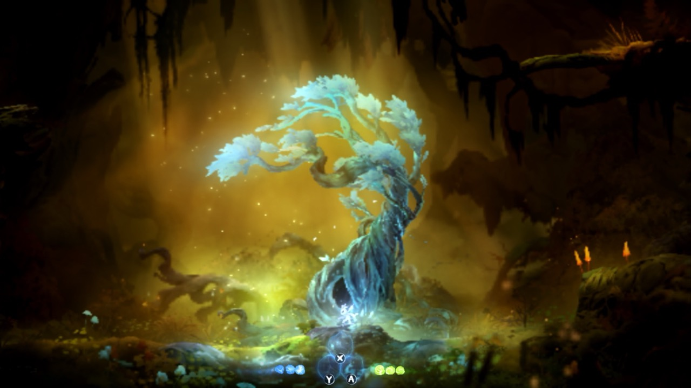

<!-- game facts: made by docs/gen_tables.py from android.tsv; edit android.tsv, not this block -->
# Ori and the Will of the Wisps

| | |
|---|---|
| Status | **experimental** |
| Title ID | `01008DD013200000` |
| Tested with nx2android | `v0.5.0` |
| Tested build and device | v196608 POCO X3 Pro (Snapdragon 860, Adreno 640, Android 13), community test |
| App package | `org.nx2a.t01008dd013200000` |
| Needs | a GPU that reads BC-compressed textures (Adreno, Xclipse; not Mali or PowerVR) |

The profile sets these for you (`android.tsv`); a player changes the pause menu ones in the game, and the env rows in the data pack's `env.txt`:

| Row | What it does |
|---|---|
| `docked=1` | pause menu default on first launch: docked mode (1) or handheld mode (0) |
| `overlay=1` | pause menu default on first launch: on-screen gamepad shown (1) or hidden (0) |
| `rumble=1` | pause menu default on first launch: rumble on (1) or off (0) |
| `pacing game` | frame pacing preset: DM_FPS_TARGET=0, DM_ADAPTIVE_FPS=0 |

Read the profile's porting log in the comment header of [`android.tsv`](android.tsv). Back to the [games list](../../../../README.md#games).
<!-- end of the game facts -->

**Experimental. A community tester plays it on Android, but it crashes at random at boot.** The crash is a Unity race that nxnative fixes with a patch nx2android's rewriter cannot load yet (see Quirks). Retry the start when it happens.

## Game version

- Update **1.2.1 (`v196608`)** over the base game, title ID `01008DD013200000`. Other updates are untested.
- SDK 9.4.0; Unity 2018.4.24f1 IL2CPP with Wwise, NVN rendering.

| Module | Build ID |
|---|---|
| `main` | `11c33c7c2dbd3c5491841f67495c7ee8` |
| `subsdk0` | `8bdabfabc6964cd9e55b7079659f51f1` |
| `sdk` | `014256a5d58180219805a7d05fba02e4` |

## Frame rate

- The game targets 60 fps (`pacing game`: its own limiter, the adaptive governor off).
- On an Adreno 640: 36-39 fps in the menus and 18-31 fps in play. The GPU is the limit: the game draws at 1600x900, and long frames take 33-100 ms of GPU time. Handheld mode in the pause menu gave the same frame rate.

## Tested devices

| Device | GPU | Vulkan driver | Game version | nx2android | Result |
|---|---|---|---|---|---|
| POCO X3 Pro (Snapdragon 860, 6 GB, Android 13), community test by dusk-beep, 2026-11-25 | Adreno 640 | Turnip, Mesa 27.0.0-devel | 1.2.1 | `v0.4.0` with #581, #585, #562, #590 | plays: the opening, through the wolf fight to the first ability, about 13 minutes with 59 saves; random crash at boot |

Results: [the run](https://github.com/shirai91/nx2android/pull/518#issuecomment-7160590170), [route and boot crash](https://github.com/shirai91/nx2android/pull/518#issuecomment-7161015990).

## Options

- An arm64 device with BC texture support. The only device run used Turnip on Adreno 640; the system driver is untested for this game.
- Starts docked, with the on-screen gamepad visible and rumble on (pause-menu defaults).
- Until they are merged, a port needs these core fixes, each found with this game:
  - #581: the shader split unpacks Unity bundles one node at a time (the 822 MB `data_1.unity3d` ran a 6 GB phone out of memory, even with `--jobs 1`);
  - #585: the shader translator no longer copies one expression into both operands of `x * x` (12 pixel shaders grew the translator without end);
  - #562 (merged): the shader export writes the bundle in batches;
  - #590: a copy of an NVN program finds its shader keys (without it the screen stays black, with 142 `[RED] shader ... is not in the bundle` lines).

## Quirks and known issues

- **Random crash at boot.** It crashes in a `std::map` copy (`main+0x3e540`) while the game loads its shaders. This is the race [nxnative's analysis](https://github.com/seedds/nxnative/blob/6e12b9f8471c0ea80628ef33f7ffcfe2380cada5/dm/games/01008DD013200000/README.md#startup) found (3 crashes in 7 Mac boots): the main thread and the render thread change Unity's constant-buffer table at once. nxnative's fix, `registry_lock`, runs Unity's own mutex around that table through `STUBS`, which nx2android's `patch_nso.py` does not load, so this profile does not carry it. Start the game again when it happens.
- A brief audio stall at boot (`[RED] audio #0: the device has not called back for 201 ms`); sound played normally after it.
- The rewrite of `main` stopped at `jump table 1b56540` and `1b574e0` on earlier builds. The shared rewriter now tries nxnative's tail-call proofs at a `br x18` it cannot otherwise classify, and the rewrite finishes on a real 1.2.1 dump.
- Six hull and six domain shaders are in the game; the Android pipeline builds vertex, fragment and geometry stages only. Nothing missing was seen in the scenes played.
- Memory layout from nxnative's profile: 4 GiB guest reservation, 256 MiB alias and stack regions. The tester's run stayed at about 1.8 GB.

## Source and profile scope

Build identity and shader tables come from the pinned [nxnative profile](https://github.com/seedds/nxnative/tree/6e12b9f8471c0ea80628ef33f7ffcfe2380cada5/dm/games/01008DD013200000) at `6e12b9f8471c`. A port of a real 1.2.1 dump reproduces the shader tables (the split stops when they differ) and translates all 52,682 shaders. Apple pipeline archives, `pso_pairs.tsv` and the `STUBS` patch are not copied.
