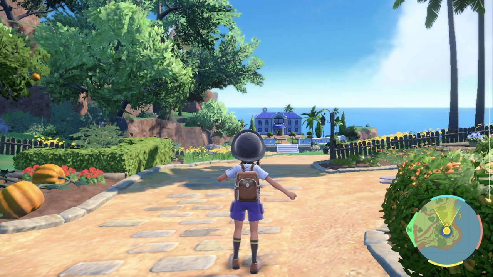

<!-- game facts: made by docs/gen_tables.py from android.tsv; edit android.tsv, not this block -->
# Pokémon Violet

| | |
|---|---|
| Status | **playable** |
| Title ID | `01008F6008C5E000` |
| Tested with nx2android | `v0.4.0` |
| Tested build and device | 4.0.0 AYN Odin 2 (Adreno 740, Android 13, Turnip) |
| App package | `org.nx2a.pokemonviolet` |
| Needs | a GPU that reads BC-compressed textures (Adreno, Xclipse; not Mali or PowerVR) |

The profile sets these for you (`android.tsv`); a player changes the pause menu ones in the game, and the env rows in the data pack's `env.txt`:

| Row | What it does |
|---|---|
| `docked=0` | pause menu default on first launch: docked mode (1) or handheld mode (0) |
| `DM_DYN_SCALE=low` | the host's dynamic resolution: a level for a profile's env row, `low` (lowest scale 0.85 against 90% of the frame time), `medium` (0.70, 85%) or `high` (0.50, … |
| `DM_VK_LIN_COPY_BACK=1` | 1 = a texture copy into a LINEAR texture in CPU-visible memory also copies the region back to its storage, so the CPU reads what the GPU copied … |
| `DM_VK_UBO_COMPONENT=1` | 1 = fragment shaders' uniform buffer loads that pick a vector component at a non-constant index load the whole vector and take the component with … |
| `DM_VK_ZC_CHUNK_MB=512` | the chunk size in MB that a memory pool over it is cut into (unset: 256 MB, or the largest of 128 / 64 / 32 MB that this gralloc takes when it refuses 256 MB, … |

Read the profile's porting log in the comment header of [`android.tsv`](android.tsv). Back to the [games list](../../../../README.md#games).
<!-- end of the game facts -->

## Game version

- Update 4.0.0 (SDK 13.3.13). Other updates are not tested.

## Frame rate

- 30 fps (as on Switch). The profile's `fps_ceiling 30` holds it there.
- On the AYN Odin 2 it holds 30 in the opening, Cabo Poco, Poco Path and wild battles.
- Mezagoza plaza is the heavy case: while you turn the camera there, it drops to about 27 fps (frame time p50 about 37 ms).
- `--fps60` lifts the ceiling, but overworld frame work is 25-32 ms, so it gives about 33 fps, not 60. Game speed stays correct at 30 and at 33.
- Below 30 fps the game slows down rather than skipping ahead, as on Switch.

## Tested devices

| Device | GPU | Vulkan driver | Game version | nx2android | Result |
|---|---|---|---|---|---|
| AYN Odin 2 (Android 13) | Adreno 740 | Turnip (Mesa), packed with `--vulkan-driver` | 4.0.0 | `v0.4.0` | plays: the opening, Cabo Poco, Poco Path, Mezagoza, wild battles |
| AYN Odin 2 (Android 13) | Adreno 740 | system (Qualcomm 512.676) | 4.0.0 | `v0.4.0` | does not boot: crashes in `vkCmdDraw` on the first attachment-less pass |

## Options

- `--vulkan-driver`: pack a Turnip driver. The Odin 2's stock Qualcomm driver crashes before the game boots.
- Keep the profile's `DM_DYN_SCALE=low`. `medium` or `high` in the data pack's `env.txt` lowers resolution more in heavy scenes: `high` saves about 1 ms of GPU time but shows stair-stepped edges.
- `--fps60` is optional and gives about 33 fps (see Frame rate).

## Quirks and known issues

- Black frames in the classroom-to-crowd transition of the opening. The original game shows them too.
- The fixes in the profile's env rows are tested only on Turnip. Hair edges drew jagged white steps there without `DM_VK_UBO_COMPONENT=1`; keep that row.
