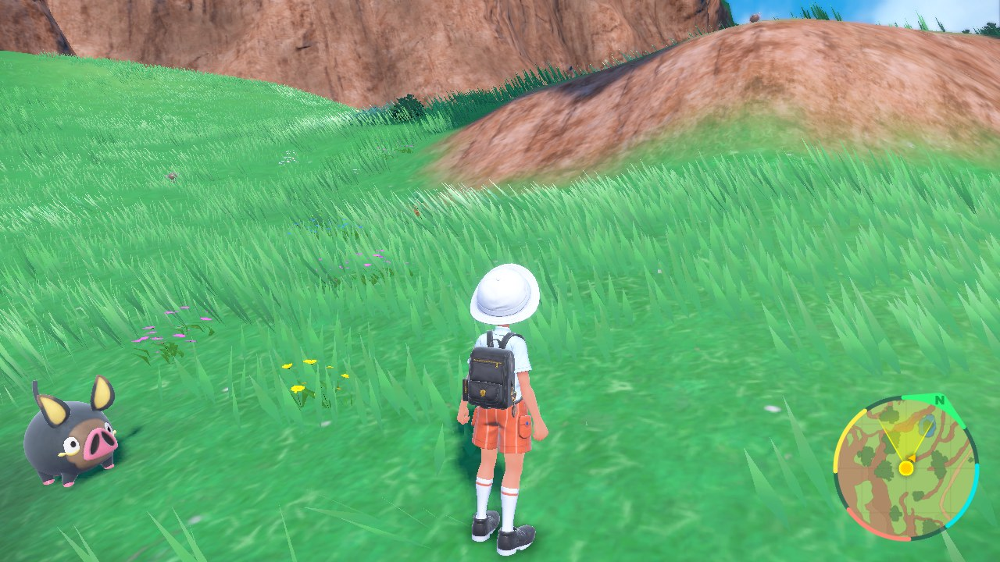

<!-- game facts: made by docs/gen_tables.py from android.tsv; edit android.tsv, not this block -->
# Pokémon Scarlet

| | |
|---|---|
| Status | **experimental** |
| Title ID | `0100A3D008C5C000` |
| Tested with nx2android | `v0.4.0` |
| Tested build and device | 4.0.0 RedMagic NX809J (Adreno 840, Android 16) |
| App package | `org.nx2a.scarlet` |
| Needs | a GPU that reads BC-compressed textures (Adreno, Xclipse; not Mali or PowerVR) |

The profile sets these for you (`android.tsv`); a player changes the pause menu ones in the game, and the env rows in the data pack's `env.txt`:

| Row | What it does |
|---|---|
| `docked=0` | pause menu default on first launch: docked mode (1) or handheld mode (0) |
| `fps=1` | pause menu default on first launch: frame-rate counter shown (1) or hidden (0) |
| `DM_FPS_TARGET=0` | the frame rate the game is held to; 0 = the game's own |
| `DM_FPS_PIN=60` | pin the governor at 60, 40 or 30 fps; 0 = no pin |
| `DM_FPS_HOLD=off` | "off" = no frame hold; any other value holds |
| `DM_VK_X_FLAT_VS=45cd97ab0aae9cdc:8` | vertex shaders (hex keys, key:n) whose outputs are made flat |

Read the profile's porting log in the comment header of [`android.tsv`](android.tsv). Back to the [games list](../../../../README.md#games).
<!-- end of the game facts -->

## Game version

- Update 4.0.0.
- The profile was checked with `4.0.0` (the `tested` row of android.tsv).

## Frame rate

- 50–60 fps (30 on Switch).

## Tested devices

| Device | GPU | Vulkan driver | Game version | nx2android | Result |
|---|---|---|---|---|---|
| RedMagic NX809J (Adreno 840, Android 16) | Adreno 840 | not recorded | 4.0.0 (4.0.0) | `v0.4.0` | experimental |
| AYN Thor (Adreno 740) | Adreno 740 | Turnip | 4.0.0 | `v0.4.0` | experimental |

Tested on the AYN Thor (Adreno 740) with a Turnip Vulkan driver.

## Options

- Not recorded.

## Quirks and known issues

- **work in progress**: tested in the opening and the South Province fields.
