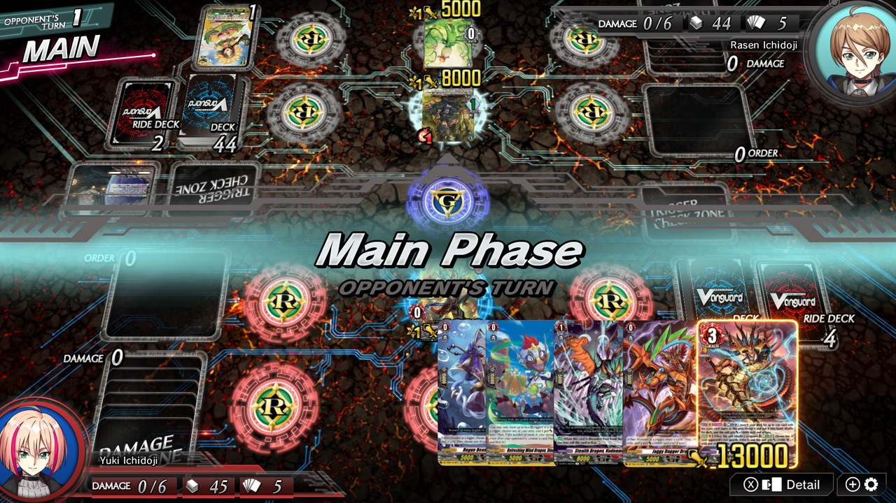

<!-- game facts: made by docs/gen_tables.py from android.tsv; edit android.tsv, not this block -->
# Cardfight!! Vanguard Dear Days 2

| | |
|---|---|
| Status | **playable** |
| Title ID | `0100B6F01DAF6000` |
| Tested with nx2android | `v0.4.0` |
| Tested build and device | v1441792 AYN Odin 2 (Snapdragon 8 Gen 2, Adreno 740, Android 13) |
| App package | `org.nx2a.vanguarddeardays2` |

Read the profile's porting log in the comment header of [`android.tsv`](android.tsv). Back to the [games list](../../../../README.md#games).
<!-- end of the game facts -->

## Game version

- Update 1.7.2.
- The profile was checked with `v1441792` (the `tested` row of android.tsv).

## Frame rate

- 30 fps, 60 with the 60 fps box.

## Tested devices

| Device | GPU | Vulkan driver | Game version | nx2android | Result |
|---|---|---|---|---|---|
| AYN Odin 2 (Snapdragon 8 Gen 2, Adreno 740, Android 13) | Adreno 740 | Turnip | 1.7.2 (v1441792) | `v0.4.0` | playable |

Tested on the AYN Odin 2 with a Turnip driver.

## Options

- Tested with the Turnip Vulkan driver: port with it (`--vulkan-driver`).

## Quirks and known issues

- Not recorded.
