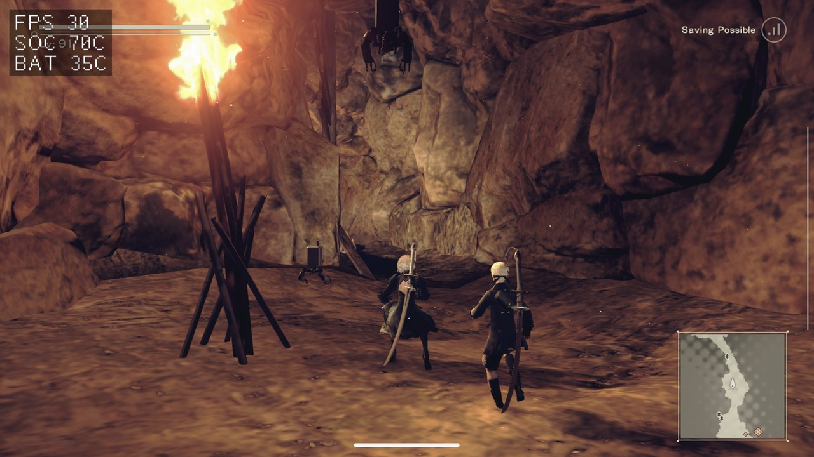

<!-- game facts: made by docs/gen_tables.py from android.tsv; edit android.tsv, not this block -->
# NieR:Automata The End of YoRHa Edition (Asia)

| | |
|---|---|
| Status | **experimental** |
| Title ID | `0100B8E016F76000` |
| Tested with nx2android | `v0.4.0` |
| Tested build and device | v65536 Retroid Pocket 6 (Snapdragon 8 Gen 2, Adreno 740; Mesa Turnip v27.0.0-R2) |
| App package | `org.nx2a.nierautomataasia` |

The profile sets these for you (`android.tsv`); a player changes the pause menu ones in the game, and the env rows in the data pack's `env.txt`:

| Row | What it does |
|---|---|
| `DM_NVN_CPU_TEX2D_FIRST_USE=1` | 1 = 2D textures the CPU writes are uploaded at their first use, not at creation |
| `DM_VK_GS_SPLIT=1` | 1 = split geometry-shader draws (gfx_vk_gs_split.c) |

Read the profile's porting log in the comment header of [`android.tsv`](android.tsv). Back to the [games list](../../../../README.md#games).
<!-- end of the game facts -->

## Game version

- Update `1.0.2` (`v65536`), Asian release (`0100B8E016F76000`), DLC `0100B8E016F77001` (`aoc/1/data500.cpk`) detected and mounted.
- Shares the same `subsdk0`, `sdk`, and 1,241 RomFS shader variants as the Global / US release (`010056B015FE8000`), with its own `main` build (`992787e2b54259948b844059a8ab21ad`).

## Frame rate

- Up to 60 fps (30 on Switch) via verified ARM64 `CUTS` in `patches.py` (60 fps frame-cost thresholds, present interval 1, and 1.0f dynamic-resolution floor) with `present_interval display` and `fps_target 60`.
- On Retroid Pocket 6 (Adreno 740, 720p handheld): 60 fps in menus, title, and light indoor scenes; steady 30 fps in City Ruins traversal, combat, and Desert cave (pure GPU 20.6 ms p50 / 26.9 ms p95 at 720p).

## Tested devices

| Device | GPU | Vulkan driver | Game version | nx2android | Result |
|---|---|---|---|---|---|
| Retroid Pocket 6 | Adreno 740 | Mesa Turnip v27.0.0-R2 | 1.0.2 (`v65536`) | `v0.4.0` | experimental: movies, title, saves, City Ruins combat, Desert cave, DLC |

## Options

- Tested with Mesa Turnip (`--vulkan-driver`, or the GUI's **Vulkan driver** field).
- The profile sets `DM_NVN_CPU_TEX2D_FIRST_USE=1` (for the CPU-filled 256×16 colour LUT) and `DM_VK_GS_SPLIT=1` (once-only Adreno geometry shader effects).

## Quirks and known issues

- `SetRenderEnableConditional` logs one `[RED]` line (conditional rendering is not yet implemented; the host draws unconditionally).
- Full-game progression and long-session stability have not been validated yet.
