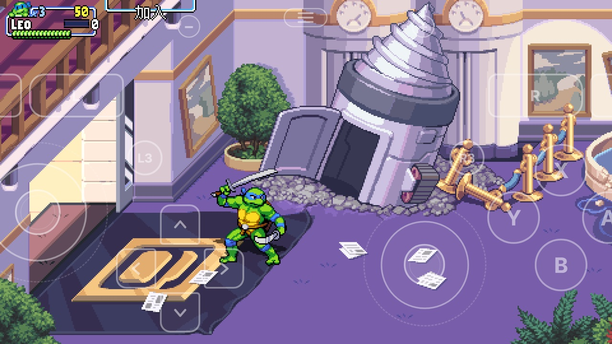

<!-- game facts: made by docs/gen_tables.py from android.tsv; edit android.tsv, not this block -->
# Teenage Mutant Ninja Turtles: Shredder's Revenge

| | |
|---|---|
| Status | **playable** |
| Title ID | `0100BB8017F24000` |
| Tested with nx2android | `v0.4.1` |
| Tested build and device | v589824 Xiaomi 23117RK66C (Android 16) |
| App package | `org.nx2a.t0100bb8017f24000` |

The profile sets these for you (`android.tsv`); a player changes the pause menu ones in the game, and the env rows in the data pack's `env.txt`:

| Row | What it does |
|---|---|
| `DM_ONLINE_SDK=1` | load the game's own online SDK (Epic Online Services) instead of refusing it: a game that needs the SDK's code to get past its start-up crashes without it … |

Read the profile's porting log in the comment header of [`android.tsv`](android.tsv). Back to the [games list](../../../../README.md#games).
<!-- end of the game facts -->

## Game version

- Update 1.0.9 (v589824).
- The profile was checked with `v589824` (the `tested` row of android.tsv).

## Frame rate

- The logo screen holds 60 fps, the main menu 40 fps.

## Tested devices

| Device | GPU | Vulkan driver | Game version | nx2android | Result |
|---|---|---|---|---|---|
| Xiaomi 23117RK66C (Android 16) | Adreno 750 | system | 1.0.9 (v589824) | `v0.4.1` | playable: the title, the main menu, the first level |

Tested on the Xiaomi 23117RK66C (Android 16) with the system's own driver.

## Options

- None: the default options work.

## Quirks and known issues

- The intro video is skipped. The game's own code asks its runtime for the `RenderTarget2D` member of the video context, and on a worker thread the answer is null; the game calls through it without a check and dies. Two cuts in the game's own main (`patches.py`, the update 1.0.9 build) turn that into a clean failure of the video context, so the game goes on to the menu. The cuts are keyed by the build ID, so a new update needs them again.
- The game needs its own Epic Online Services SDK: the host refuses online SDK NROs by default, and without the SDK the game dereferences a null online object at its start-up. The profile asks for it (`online_sdk 1` in `game.tsv`, `DM_ONLINE_SDK=1` in `android.tsv`), so the SDK's code is in the data pack and the host loads it. The host serves none of Epic's services: the game plays offline.
