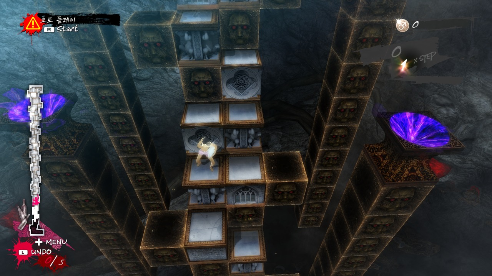

<!-- game facts: made by docs/gen_tables.py from android.tsv; edit android.tsv, not this block -->
# Catherine: Full Body (Korean / Chinese release)

| | |
|---|---|
| Status | **experimental** |
| Title ID | `0100BC4010896000` |
| Tested with nx2android | `v0.4.0` |
| Tested build and device | v0 Legion Y700 TB322FC (Snapdragon 8 Elite, Adreno 830, Android 16) |
| App package | `org.nx2a.t0100bc4010896000` |

Read the profile's porting log in the comment header of [`android.tsv`](android.tsv). Back to the [games list](../../../../README.md#games).
<!-- end of the game facts -->

## Game version

- Base game 1.0.0 (`v0`, this release's own build row; it has no update).
- The Korean / Chinese release has Korean and Traditional Chinese text, no English: port with Game language: Chinese (Traditional) (`--language zh-Hant`) or Korean (`--language ko`). The porter's default is English.

## Frame rate

- 30 fps (as on Switch): the game holds its own frame limit (its present interval 2).

## Tested devices

| Device | GPU | Vulkan driver | Game version | nx2android | Result |
|---|---|---|---|---|---|
| Lenovo Legion Y700 TB322FC (Snapdragon 8 Elite, Adreno 830, Android 16) | Adreno 830 | not recorded | base game 1.0.0 (v0) | `v0.4.0` | experimental: the boot, the title with its puzzle type choice, the anime opening with its sound, the Golden Playhouse, the first Nightmare stage's difficulty and puzzle type menus, its cutscenes and its block puzzle |

## Options

- Port with Game language: Chinese (Traditional) (`--language zh-Hant`) or Korean (`--language ko`): the release has no English text, and without the option the port falls back to English.
- Nothing else: the default options work.

## Quirks and known issues

- **Work in progress.** The playthrough is not checked yet (the stick, the pause menu, a save, the text entry), so the port's status is experimental.
- The two run-time shaders the game compiles at boot with its own GLSLC are captured on the device (the porter's GLSLC capture stage, #344): the profile's shader tables hold their outputs.
