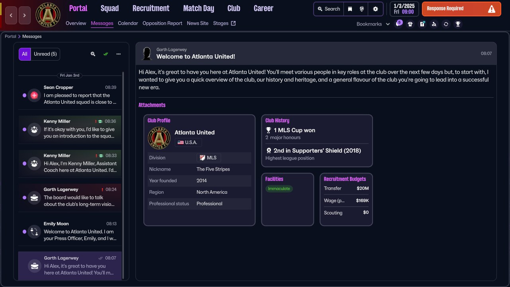

<!-- game facts: made by docs/gen_tables.py from android.tsv; edit android.tsv, not this block -->
# Football Manager 26 Touch

| | |
|---|---|
| Status | **playable** |
| Title ID | `0100D4A023450000` |
| Tested with nx2android | `v0.4.0` |
| Tested build and device | v131072 Lenovo Legion Y700 TB322FC (Snapdragon 8 Elite, Adreno 830, Android 16) |
| App package | `org.nx2a.fm26touch` |

The profile sets these for you (`android.tsv`); a player changes the pause menu ones in the game, and the env rows in the data pack's `env.txt`:

| Row | What it does |
|---|---|
| `docked=0` | pause menu default on first launch: docked mode (1) or handheld mode (0) |
| `overlay=0` | pause menu default on first launch: on-screen gamepad shown (1) or hidden (0) |
| `rumble=1` | pause menu default on first launch: rumble on (1) or off (0) |
| `DM_TOUCH_DOCKED=pixels` | touch in docked mode: "screen" = the screen's points, "pixels" = the game's pixels; unset = no touch when docked |

Read the profile's porting log in the comment header of [`android.tsv`](android.tsv). Back to the [games list](../../../../README.md#games).
<!-- end of the game facts -->

## Game version

- Update 1.0.2.
- The profile was checked with `v131072` (the `tested` row of android.tsv).

## Frame rate

- 30 fps (as on Switch).

## Tested devices

| Device | GPU | Vulkan driver | Game version | nx2android | Result |
|---|---|---|---|---|---|
| Lenovo Legion Y700 TB322FC (Snapdragon 8 Elite, Adreno 830, Android 16) | Adreno 830 | not recorded | 1.0.2 (v131072) | `v0.4.0` | playable |

## Options

- Played by touch.
- Port with a Turnip Vulkan driver (the crowd glitches on Qualcomm's driver).

## Quirks and known issues

- Not recorded.
