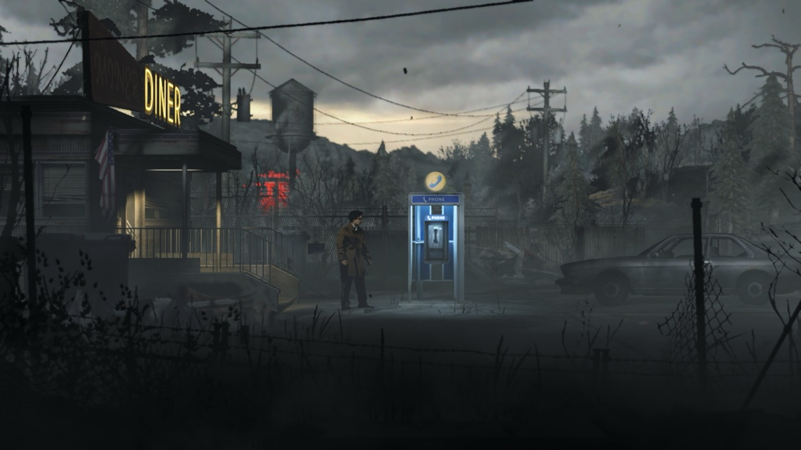

<!-- game facts: made by docs/gen_tables.py from android.tsv; edit android.tsv, not this block -->
# Silver Pines

| | |
|---|---|
| Status | **playable** |
| Title ID | `0100D5B026844000` |
| Tested with nx2android | `v0.5.0` |
| Tested build and device | v131072 POCO X3 Pro (Snapdragon 860, Adreno 640, Android 13), community test |
| App package | `org.nx2a.t0100d5b026844000` |
| Needs | a GPU that reads BC-compressed textures (Adreno, Xclipse; not Mali or PowerVR) |

The profile sets these for you (`android.tsv`); a player changes the pause menu ones in the game, and the env rows in the data pack's `env.txt`:

| Row | What it does |
|---|---|
| `docked=1` | pause menu default on first launch: docked mode (1) or handheld mode (0) |
| `overlay=1` | pause menu default on first launch: on-screen gamepad shown (1) or hidden (0) |
| `rumble=1` | pause menu default on first launch: rumble on (1) or off (0) |
| `pacing game` | frame pacing preset: DM_FPS_TARGET=0, DM_ADAPTIVE_FPS=0 |

Read the profile's porting log in the comment header of [`android.tsv`](android.tsv). Back to the [games list](../../../../README.md#games).
<!-- end of the game facts -->

**Plays on Android: update 1.0.2, tested by a community tester.** dusk-beep ported update 1.0.2 with the bounded shader export from #562 and played it on a POCO X3 Pro. The profile registers 1.0.2 with the build row, shader tables and memory layout of that run; 1.0.0, which nobody has run on Android, is no longer registered.

## Game version

- Switch 1 title ID: `0100D5B026844000`.
- Registered build: **update 1.0.2 (`v131072`)** over the base game, the build the tester played. Its build IDs and shader tables come from the tester's derived profile, which the porter made from 1.0.2's own files.
- SDK 21.4.7; Unity 6000.3.15f1 IL2CPP with URP and FMOD, NVN rendering.

| Module (1.0.2) | Build ID |
|---|---|
| `main` | `fde81dd4a0bef165765435c535342489` |
| `subsdk0` | `92a5f1a1e8d50e4d05b2212f564bf226` |
| `sdk` | `ab3835b2a37b1916e296f27e82dd4e36` |

## Frame rate

- The game targets 30 fps: present interval 2 on a 60 Hz display. The profile uses `pacing game`, the game's own limiter with the adaptive governor off.
- In the 2026-11-24 run, the tester saw drops to about 15 fps, in the same places on every run and in many places through the game. The log has 2,879 long frames among 43,073 frames in 28 minutes. They are GPU-bound: GPU time in those frames has a median of 35.8 ms and a 90th percentile of 66.9 ms (a 30 fps frame has 33.3), the game draws to 1920x1080 targets, and none of them waited on a new pipeline. The Adreno 640 is the limit there.

## Tested devices

| Device | GPU | Vulkan driver | Game version | nx2android | Result |
|---|---|---|---|---|---|
| POCO X3 Pro (Snapdragon 860, 6 GB, Android 13), community test, 2026-11-23 and 2026-11-24 | Adreno 640 | Turnip, Mesa 27.0.0-devel (git-2648b2059f) | 1.0.2 (`v131072`), derived profile | `785c575` (#562, 0.4.0) with this profile, derived for 1.0.2 | plays; no rendering errors seen on the street or in the diner; frequent drops to about 15 fps |

Results: [first run](https://github.com/shirai91/nx2android/pull/519#issuecomment-7089754345), [retest](https://github.com/shirai91/nx2android/pull/519#issuecomment-7126204142).

## Options

- An arm64 Android device with BC texture support. The only device run used Turnip on Adreno 640; the system driver is untested for this game.
- Start docked with the on-screen gamepad visible and rumble enabled. These are initial pause-menu defaults.
- The profile carries the layout the derived profile ran 1.0.2 with (see Memory layout below), so a port of 1.0.2 no longer takes the derived-profile path.

## Quirks and known issues

- **Shader export memory** was the first port's failure: the OS killed the port while compressing 1.0.2's shaders. #562 bounds that memory, and the retest loads 66,250 compressed shaders.
- **URP integer colour outputs.** [Upstream's analysis](https://github.com/seedds/nxnative/blob/6e12b9f8471c0ea80628ef33f7ffcfe2380cada5/dm/games/0100D5B026844000/README.md#files-and-shaders) finds 9,720 pixel shaders writing rendering-layer masks to unsigned integer attachments. The Android path uses default float outputs for them. The tester saw no rendering errors on the street or in the diner, so this has no visible effect in the scenes played, but later scenes are unchecked.
- **Memory layout.** `mem_reserve 0x380000000` and `mem_alias 0x358000000` (a 13.38 GiB alias region), as the tester's derived 1.0.2 profile ran it: 8 GB more than nxnative's 1.0.0 profile (`0x180000000` / `0x158000000`).
- Stack 256 MiB, heap 128 MiB, `app_pool 0xCD500000`, `sys_resource 0x1000000`. Address space is reserved with `MAP_NORESERVE`, so the virtual sizes do not commit physical RAM.
- The run's log shows VP8 movie decoding, audio callbacks and 21 save commits. Save reload after a restart has not been reported.

## Source and profile scope

The profile's keys come from the pinned [nxnative profile](https://github.com/seedds/nxnative/tree/6e12b9f8471c0ea80628ef33f7ffcfe2380cada5/dm/games/0100D5B026844000) at `6e12b9f8471c`, which covers 1.0.0. The 1.0.2 build row, memory layout and shader tables (shader map, conflict table, shader facts, shader pairs, `bf_want`) come from the tester's derived profile, which the porter wrote from 1.0.2's own files ([attached here](https://github.com/shirai91/nx2android/pull/519#issuecomment-7160758064)). Apple pipeline archives, `pso_pairs.tsv` and unsupported patches are not copied.
