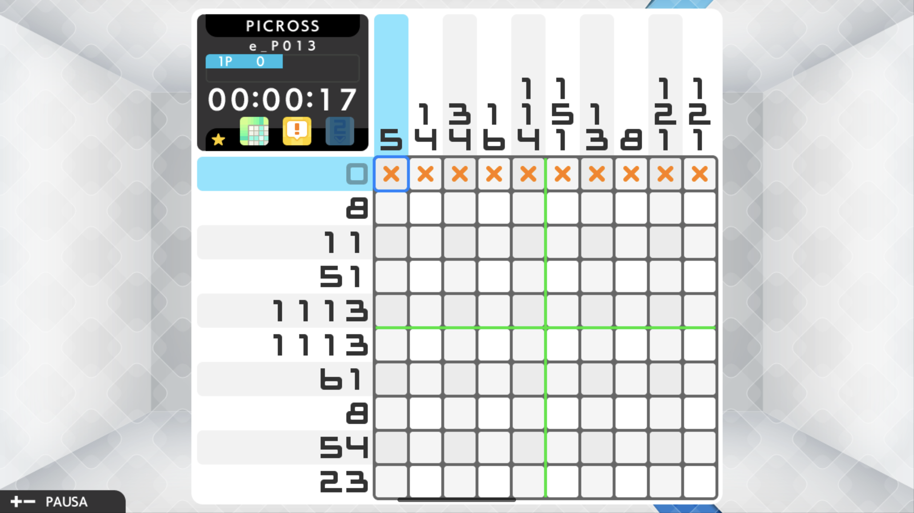

<!-- game facts: made by docs/gen_tables.py from android.tsv; edit android.tsv, not this block -->
# Picross S+

| | |
|---|---|
| Status | **playable** |
| Title ID | `0100D7B01AE58000` |
| Tested with nx2android | `v0.4.0` |
| Tested build and device | v65536 Retroid Pocket 6 (Adreno 740, Android 13); PurpleVK-public git-62ac221a33 |
| App package | `org.nx2a.t0100d7b01ae58000` |

The profile sets these for you (`android.tsv`); a player changes the pause menu ones in the game, and the env rows in the data pack's `env.txt`:

| Row | What it does |
|---|---|
| `DM_VK_MT_REPLAY=1` | two-stage replay: the vkCmd* calls (40 of them) are copied into a 32 MB ring and a "vk record" thread makes the real calls in order; the calls that end, submit … |

Read the profile's porting log in the comment header of [`android.tsv`](android.tsv). Back to the [games list](../../../../README.md#games).
<!-- end of the game facts -->

## Game version

- Update 1.0.1.
- The profile was checked with `v65536` (the `tested` row of android.tsv).

## Frame rate

- Not recorded.

## Tested devices

| Device | GPU | Vulkan driver | Game version | nx2android | Result |
|---|---|---|---|---|---|
| Retroid Pocket 6 (Adreno 740, Android 13); PurpleVK-public git-62ac221a33 | Adreno 740 | PurpleVK | 1.0.1 (v65536) | `v0.4.0` | playable |

Tested on the Retroid Pocket 6 with PurpleVK.

What was tested:

- Menu and puzzle verified.

## Options

- Tested with the PurpleVK Vulkan driver (`--vulkan-driver`).

## Quirks and known issues

- **Mali rendering issues**.
