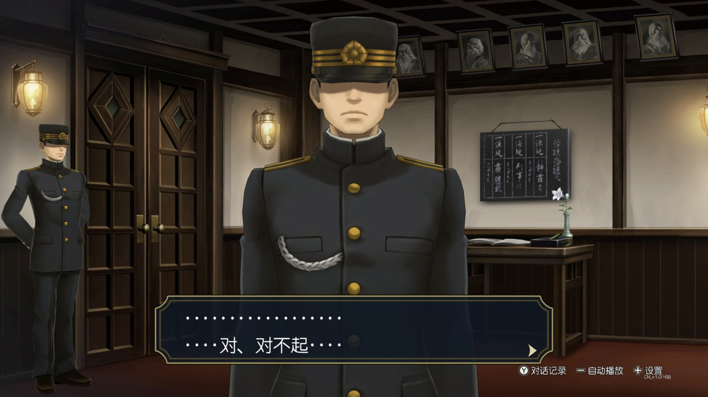

<!-- game facts: made by docs/gen_tables.py from android.tsv; edit android.tsv, not this block -->
# The Great Ace Attorney Chronicles

| | |
|---|---|
| Status | **wip** |
| Title ID | `0100D7F00FAAA000` |
| Tested with nx2android | `v0.4.0` |
| Tested build and device | v0 OPPO Pad OPD2101 (Snapdragon 870, Adreno 650, Android 15) |
| App package | `org.nx2a.t0100d7f00faaa000` |
| Vulkan driver | Turnip: the port packs Mesa's Turnip driver when the porter finds it (`vulkan_driver turnip`) |

Read the profile's porting log in the comment header of [`android.tsv`](android.tsv). Back to the [games list](../../../../README.md#games).
<!-- end of the game facts -->

## Game version

- Base game 1.0.0, the Chinese release (`1.0.0(CN1.3)`, `build v0`). No update has been tried: this profile carries a build row for the base game only.

## Frame rate

- 30 fps, as on the Switch, and steady: the frame time's p50 is 33.3 ms and the GPU takes 10-14 ms of it, so the engine's own 1/30 step is the limit, not the GPU.

## Tested devices

| Device | GPU | Vulkan driver | Game version | nx2android | Result |
|---|---|---|---|---|---|
| OPPO Pad (OPD2101) | Adreno 650 | Turnip 25.99.99 (bundled) | 1.0.0 (CN1.3) | `v0.4.0` | plays: the title screen and the first episode's office with its dialogue, at 30 fps; both pause-menu tabs, the layout editor, touch in handheld and docked, save export and import |

## Options

- `--vulkan-driver` on Adreno devices whose own driver is Vulkan 1.1: the OPPO Pad's reports `Vulkan 1.1.128` and has neither dynamic rendering nor imageless framebuffers, and the host picks a Vulkan 1.3 device
- No setting inside the game had to be changed for the parts that were tested

## Quirks and known issues

- Without `tex_flush_upload` and `tex_dirty_upload` (this profile sets both) every 3D prop renders black: the game copies each texture into a CPU-cached pool after `nvnTextureInitialize` and never flushes it, and `main` has no cache maintenance at all
- 30 fps only (see above): the frame gate is inside the engine, so a faster GPU does not raise it
- Not played end to end: the title screen, the first episode's office and the pause menu are what was checked
