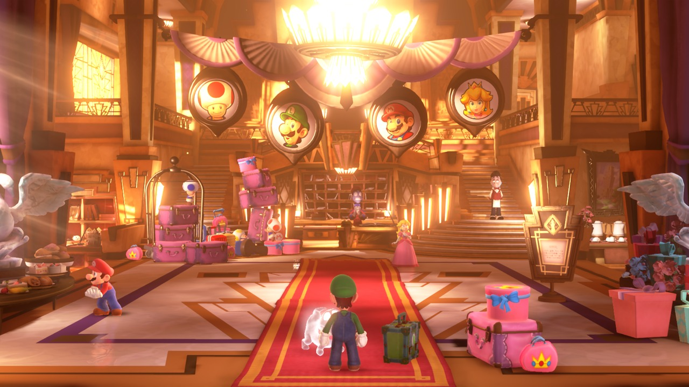

<!-- game facts: made by docs/gen_tables.py from android.tsv; edit android.tsv, not this block -->
# Luigi's Mansion 3



| | |
|---|---|
| Status | **experimental** |
| Title ID | `0100DCA0064A6000` |
| Tested with nx2android | `v0.5.0` |
| Tested build and device | v327680 Xiaomi 17 (Adreno 840, Android 17) |
| App package | `org.nx2a.luigis3` |

The profile sets these for you (`android.tsv`); a player changes the pause menu ones in the game, and the env rows in the data pack's `env.txt`:

| Row | What it does |
|---|---|
| `DM_NVN_CPU_NO_ACCESS_IMAGE_FIRST_USE=1` | 1 = upload initial data for uncompressed 2D colour IMAGE textures in CPU_NO_ACCESS storage once, unless a GPU-written image overlaps them |

Read the profile's porting log in the comment header of [`android.tsv`](android.tsv). Back to the [games list](../../../../README.md#games).
<!-- end of the game facts -->

## Game version

- Update 1.4.0 (`v327680`). Put the base game and update dumps in one folder as separate files.

## Frame rate

- SurfaceFlinger recorded 908 actual presents over 30.231 seconds in the stationary lobby on Xiaomi 17, averaging **30.0 fps**. The median and 95th percentile present intervals were both 33.24 ms.
- The game profile targets 60 fps. The default Android adaptive governor settled at 30 fps in this scene.

## Tested devices

| Device | GPU | Vulkan driver | Game version | nx2android | Result |
|---|---|---|---|---|---|
| Xiaomi 17 (Android 17) | Adreno 840 | system | 1.4.0 (`v327680`) | Debug build `b3ed186` | Reached the title, menus, opening and playable hotel lobby |

## Options

To follow the Android system language at startup, select **Follow Android system language** in the GUI's **Game language** field or pass `--language system` when porting.

```text
python -m porter port "<game folder>" --version v327680 --language system
```

## Quirks and known issues

- Android support is experimental. Later areas and long-session stability still need testing.

## Lobby rendering

The lobby binds prefilled 2048 × 2048 `RGB9E5` and `R8_UNORM` material atlases as `IMAGE` textures in a `CPU_NO_ACCESS` pool. Missing first uploads made the carpet, floor tiles, and stairs dark. The profile enables `DM_NVN_CPU_NO_ACCESS_IMAGE_FIRST_USE=1` to seed these images once. The Vulkan backend skips the upload when overlapping storage has been written by the GPU.

## Validation

Both Vulkan atlas readbacks matched the deswizzled guest storage byte for byte. A registered-profile build produced the APK and data pack from separate base and update dumps.

- The November 20, 2026 lobby frame is a 1920×1080 game render resized to 1280×720. The carpet, floor tiles, and stairs render normally, and the game render has no Android gamepad overlay.
- With `--language system`, the phone's system locale selected `zh-Hans`. A temporary English (UK) locale for the test app selected `en-GB`. Clearing that app override restored `zh-Hans` on the next launch.

```text
[locale] Android zh-CN -> game zh-Hans
[locale] Android en-GB -> game en-GB
```
