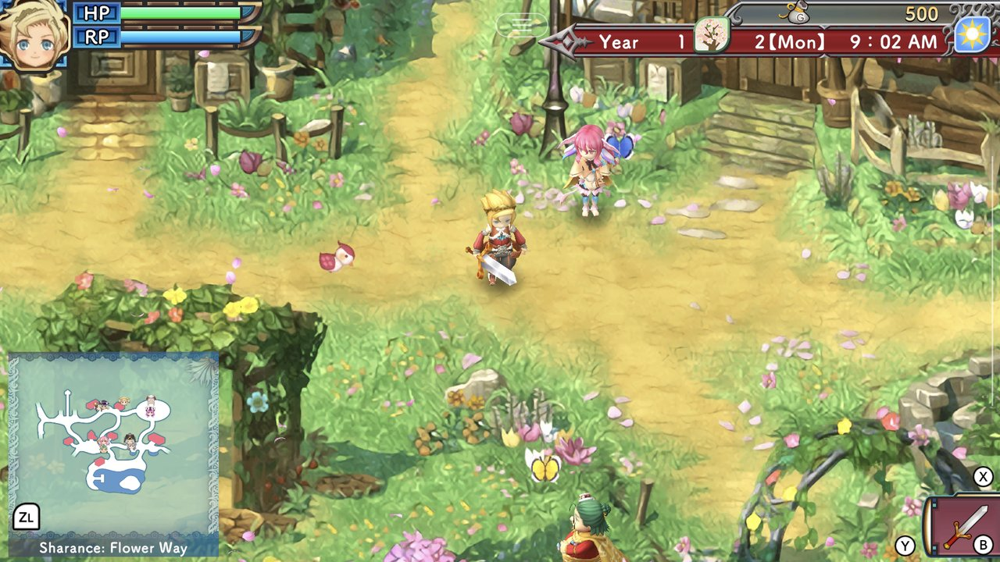

<!-- game facts: made by docs/gen_tables.py from android.tsv; edit android.tsv, not this block -->
# Rune Factory 3 Special

| | |
|---|---|
| Status | **experimental** |
| Title ID | `0100E000191B4000` |
| Tested with nx2android | `v0.5.0` |
| Tested build and device | - |
| App package | `org.nx2a.runefactory3special` |

The profile sets these for you (`android.tsv`); a player changes the pause menu ones in the game, and the env rows in the data pack's `env.txt`:

| Row | What it does |
|---|---|
| `overlay=0` | pause menu default on first launch: on-screen gamepad shown (1) or hidden (0) |
| `pacing fixed60` | frame pacing preset: DM_FPS_TARGET=60, DM_ADAPTIVE_FPS=0 |
| `DM_NGC_CONTENT_VERSION=1` | nn::ngc::ProfanityFilter::GetContentVersion result; unset: 0 |

Read the profile's porting log in the comment header of [`android.tsv`](android.tsv). Back to the [games list](../../../../README.md#games).
<!-- end of the game facts -->

## Game version

- Tested with update 1.0.4 (v131072) on top of the base game. Other updates are untested.

## Frame rate

- Held at 60 fps (`pacing fixed60`): the adaptive governor does not step down. Game speed is the same at 30 and 60 fps (checked by hand), so the lock changes smoothness only. Measured in the town of Sharance: about 51% GPU busy, about 113% CPU and about 1000 mA at 60 fps; a 30 fps lock gave about 25% GPU, 71% CPU and 756 mA, with no late frames. No fidelity-neutral saving was found, so 60 fps stays as is.

## Tested devices

| Device | GPU | Vulkan driver | Game version | nx2android | Result |
|---|---|---|---|---|---|
| AYN Odin 2 (rooted) | Adreno 740 | Turnip (`vulkan.ad07xx.so`) | 1.0.4 | `v0.5.0` | plays: title, a new save, name entry, the first town |

## Options

- Port with `--vulkan-driver` pointing at a Turnip driver for Adreno 7xx. No other option is needed.
- The on-screen gamepad starts hidden; the pause menu brings it back.

## Quirks and known issues

- The name entry rejected every name ("This name cannot be used") until the profile set `DM_NGC_CONTENT_VERSION=1`. The host has no word list, so the filter's version read 0 and the game treated every name as blocked. Reading 1 fixes it. The row is a profile-scope switch, so no other game is affected.
- The game ran out of address space at boot with the default memory layout; `game.tsv` now sets an 8 GB alias region and a 2 GB pool.
- No graphical glitches seen. A 30 minute soak was not run.
