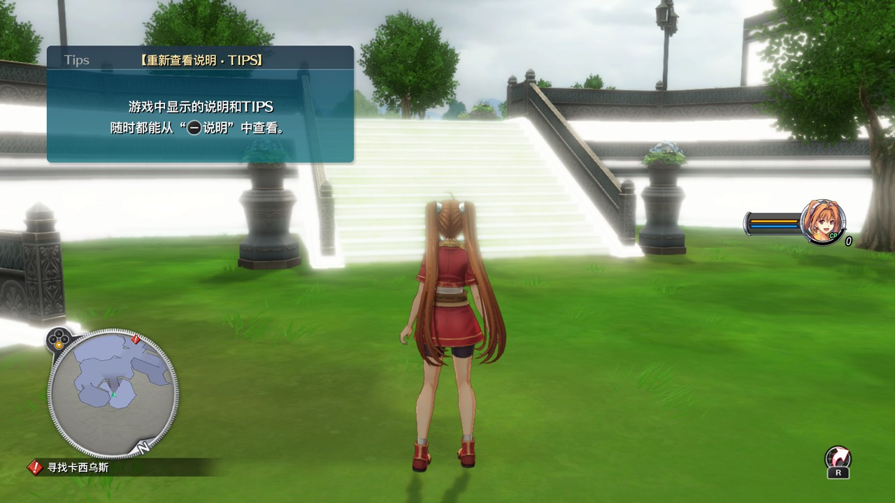

<!-- game facts: made by docs/gen_tables.py from android.tsv; edit android.tsv, not this block -->
# Trails in the Sky the 2nd (Korean release)

| | |
|---|---|
| Status | **playable** |
| Title ID | `0100E8B028B54000` |
| Tested with nx2android | `v0.4.0` |
| Tested build and device | v196608 Xiaomi 23117RK66C (Android 16, Adreno 750); Turnip (libvulkan_freedreno.so) |
| App package | `org.nx2a.t0100e8b028b54000` |

The profile sets these for you (`android.tsv`); a player changes the pause menu ones in the game, and the env rows in the data pack's `env.txt`:

| Row | What it does |
|---|---|
| `DM_VK_ZEROCOPY_MAX_MB=2048` | pools above this many MB are not mapped zero-copy; 0 = no limit |

Read the profile's porting log in the comment header of [`android.tsv`](android.tsv). Back to the [games list](../../../../README.md#games).
<!-- end of the game facts -->

## Game version

- Update 1.0.3a (v196608), the Korean release's own update series: the update NSP carries no `[v<N>]` tag in its name, so the number is the series' own (1.0.3 → 3 × 65536) and
  not the international release's. The base game (1.0.0) alone was not tried.

## Frame rate

- 60 fps in the opening scene: the frame work p50 17.3 ms / p90 25.5 ms / p95 31.2 ms, 2 of the last 64 frames late, 25 of the last 300 dropped on screen. The game is GPU-bound
  there (the GPU's own p50 18.1 ms). The governor holds 60 fps on its own; `DM_VK_ZEROCOPY_MAX_MB=2048` (the profile's env row) is what lets it: the game's main pool is
  1,508 MiB, and above 1,024 it fell back to a copied (shadow) pool whose sync drains the GPU before every submission, which held the game at 15 fps.

## Tested devices

| Device | GPU | Vulkan driver | Game version | nx2android | Result |
|---|---|---|---|---|---|
| Xiaomi 23117RK66C (Android 16) | Adreno 750 | Turnip 26.99.99 (Mesa 27.0.0-devel, Vulkan 1.4.367) | 1.0.3a | `v0.4.0` | plays: the title, a new game's opening (the first town), the walk with the HUD and the minimap; about a minute of frames |

## Options

- `--vulkan-driver turnip`: the system's own driver crashes in its shader compiler on this game's shaders (`CRASH sig=11` in `libllvm-qgl.so`), so the pack's Turnip build is
  the one that runs. `--language zh-Hans` for the Chinese text of the Korean release (the game ships Korean).
- The pause menu's own settings work as they are; the profile sets no `setting` rows.

## Quirks and known issues

- The picture's colours are a little lighter than on the Switch: the log says "[vk] the surface offers no format 0 for the window texture: its picture is lighter" (the
  window's texture has no matching format on the device).
- The instance culling compute shader needed a patch (`patches.py`, the binary SPIR-V path): without it the shader zeroes every indirect draw's instance count, and the whole
  instanced scenery (the terrain tiles, the cliff walls, the shore, the grass, the furniture) is never drawn - the ground is one flat grey. Its 45,056-byte workgroup array
  is also past an Adreno's 32 KB, which kept the farthest terrain band culled; the patch moves the scratch into a private array.
- Only the opening was played: the title, a new game's opening and a walk. Later towns, dungeons and the save menu were not tested.
