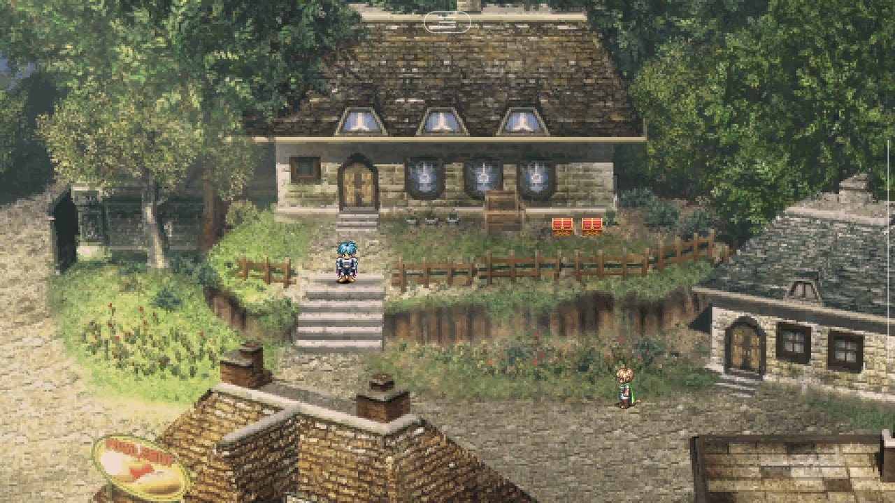

<!-- game facts: made by docs/gen_tables.py from android.tsv; edit android.tsv, not this block -->
# STAR OCEAN First Departure R

| | |
|---|---|
| Status | **experimental** |
| Title ID | `0100EBF00E702000` |
| Tested with nx2android | `v0.4.0` |
| Tested build and device | v0 AYN Odin 2 (Snapdragon 8 Gen 2 QCS8550, Adreno 740, Android 13; Mesa Turnip KIMCHI v26.0.0_R8) |
| App package | `org.nx2a.staroceanfirstdeparturer` |

The profile sets these for you (`android.tsv`); a player changes the pause menu ones in the game, and the env rows in the data pack's `env.txt`:

| Row | What it does |
|---|---|
| `DM_VK_FMT_4444=1` | 1 = NVN RGBA4 textures (format 0x39) get VK_FORMAT_A4B4G4R4_UNORM_PACK16 where the device samples it, not the 16-bit table value (64033, not a format); Star … |

Read the profile's porting log in the comment header of [`android.tsv`](android.tsv). Back to the [games list](../../../../README.md#games).
<!-- end of the game facts -->

## Game version

- Base game 1.0.0 (v0, main build `5ec132f471291b7e3e667e77487195b9`). No update was tested.

## Frame rate

- 60 fps with no dropped frames on the AYN Odin 2: title, menus, the movies, the opening house and the town of Kratus.
- The frame loop takes 3.6 to 4.9 ms of the 16.7 ms frame (median), and the GPU 1.3 to 2.7 ms. The GPU is about 5% busy at 220 MHz, so the port needs no dynamic resolution.

## Tested devices

| Device | GPU | Vulkan driver | Game version | nx2android | Result |
|---|---|---|---|---|---|
| AYN Odin 2 (Android 13) | Adreno 740 | Mesa Turnip KIMCHI v26.0.0_R8 (`--vulkan-driver vulkan.ad07xx.so`) | 1.0.0 (v0) | `v0.4.0` | plays: the title, a new game, the opening house and Kratus |

## Options

- `--vulkan-driver` with the KIMCHI Turnip v26.0.0_R8 build (`vulkan.ad07xx.so`), the driver this port was tested with. The device's own Qualcomm driver was not tested.
- The profile sets `DM_VK_FMT_4444=1` for you. Without it every text string is drawn as a dark box.

## Quirks and known issues

- Experimental: battle, saving to a slot and the world map are not tested yet.
- The movies play in a 16:9 window inside a starfield frame, and the anime scenes show stair-step edges. Both look like the game's own frame and source video; they were not compared with the Switch.
- The game draws all text on the CPU into one RGBA4 texture. A Vulkan driver that cannot sample `VK_FORMAT_A4B4G4R4_UNORM_PACK16` shows dark boxes for text and logs a `[RED]` line about texture format 0x39.
