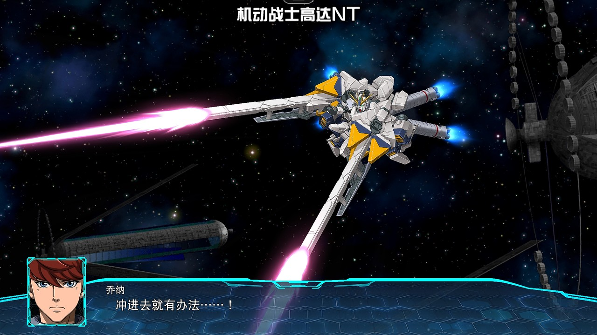

<!-- game facts: made by docs/gen_tables.py from android.tsv; edit android.tsv, not this block -->
# Super Robot Wars 30

| | |
|---|---|
| Status | **playable** |
| Title ID | `0100ECB0129BE000` |
| Tested with nx2android | `v0.5.0` |
| Tested build and device | v655360 Lenovo Legion Y700 TB321FU (Snapdragon 8 Gen 3, Adreno 750, Android 16) |
| App package | `org.nx2a.srw30` |
| Vulkan driver | Turnip: the port packs Mesa's Turnip driver when the porter finds it (`vulkan_driver turnip`) |

Read the profile's porting log in the comment header of [`android.tsv`](android.tsv). Back to the [games list](../../../../README.md#games).
<!-- end of the game facts -->

## Game version

- Update 1.2.3 (`v655360`), from the Korean SKU, as separate files in the folder: the base game and this update (the SKU ships them as one 14.24 GB XCI
  with 15 DLC; the tested install split it into NSPs).
- The console runs the update's Program NCA, and so does the port: the base game's code with the update's files parks on a black screen (the porting log in
  [`android.tsv`](android.tsv) has the thread dump).

## Frame rate

- 60 fps on the map, as on the Switch.
- 30 fps in battle, as on the Switch: entering a battle the game sets present interval 2 and sets 1 again when it ends. On the Y700 with Turnip the battle
  holds 29-30 fps (replay 0.3-4 ms a frame, GPU 15-20 ms); in the heaviest animations the GPU takes about 32 ms a frame and the game falls to 16-21 fps.

## Tested devices

| Device | GPU | Vulkan driver | Game version | nx2android | Result |
|---|---|---|---|---|---|
| Lenovo Legion Y700 TB321FU (Snapdragon 8 Gen 3, Adreno 750, Android 16) | Adreno 750 | Turnip (Mesa 26.3-devel, `libvulkan_freedreno.so`) | 1.2.3 (v655360) | `v0.5.0` | plays: the title and anniversary screen, the menus, a save loaded from the title, the battle map and battle animations, saving |

The device's own Qualcomm driver runs the port too, but its replay took 40-55 ms a frame in battle (6-15 fps); Turnip cut that to 0.3-4 ms.

## Options

- Turnip: the profile asks for it (`vulkan_driver turnip`); give it with `--vulkan-driver <libvulkan_freedreno.so>`, or set `porter config turnip` so the
  porter finds it by itself.
- Text language: `--language` (the tested build uses `zh-Hans`; the Korean SKU also carries Korean).

## Quirks and known issues

- The battle's 30 fps is the game's own frame rate (present interval 2), not a port limit.
- The heaviest battle animations miss 30 fps on the Y700 (GPU about 32 ms a frame); the GPU's highest clock (DM_GPU_TURBO=1) is being tried for them.
- There is no 60 fps patch yet: the battle's frame rate and its clock would have to be raised together.