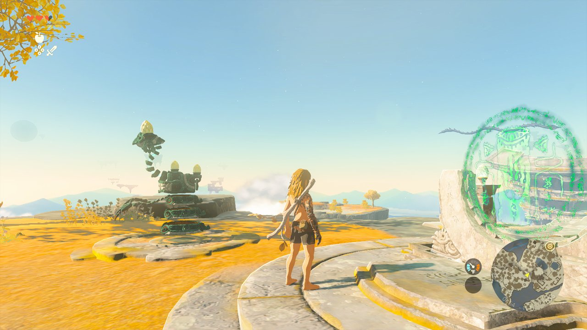

<!-- game facts: made by docs/gen_tables.py from android.tsv; edit android.tsv, not this block -->
# The Legend of Zelda: Tears of the Kingdom

| | |
|---|---|
| Status | **experimental** |
| Title ID | `0100F2C0115B6000` |
| Tested with nx2android | `v0.3.0` |
| Tested build and device | v720896 Lenovo Legion Y700 TB322FC (Snapdragon 8 Elite, Adreno 830, Android 16) |
| App package | `org.nx2a.zeldatearsofthekingdom` |
| Vulkan driver | Turnip: the port packs Mesa's Turnip driver when the porter finds it (`vulkan_driver turnip`) |

The profile sets these for you (`android.tsv`); a player changes the pause menu ones in the game, and the env rows in the data pack's `env.txt`:

| Row | What it does |
|---|---|
| `docked=0` | pause menu default on first launch: docked mode (1) or handheld mode (0) |
| `DM_VK_FDZ=0` | no fragment-depth variants: draws that test a depth buffer a fragment shader wrote through `gl_FragDepth` (in the last two presents) normally get a variant of … |
| `DM_NVN_ASYNC=1` | asynchronous replay: submissions and presents run on a replay thread, syncs wait for the job's replay and then its GPU fence |
| `DM_PIN_REPLAY=prime` | pin the replay thread to fast cores: 0 = no, "prime" = the fastest core, "need" = the fastest core only while the replay is slow, other values = the big cores |

Read the profile's porting log in the comment header of [`android.tsv`](android.tsv). Back to the [games list](../../../../README.md#games).
<!-- end of the game facts -->

## Game version

- Update 1.4.3.
- The profile was checked with `v720896` (the `tested` row of android.tsv).

## Frame rate

- 30 fps, 60 in caves and shrines.

## Tested devices

| Device | GPU | Vulkan driver | Game version | nx2android | Result |
|---|---|---|---|---|---|
| Lenovo Legion Y700 TB322FC (Snapdragon 8 Elite, Adreno 830, Android 16) | Adreno 830 | Turnip | 1.4.3 (v720896) | `v0.3.0` | experimental |

## Options

- Smoothest with a Turnip Vulkan driver.

## Quirks and known issues

- **work in progress**: 60 fps in the open world.
