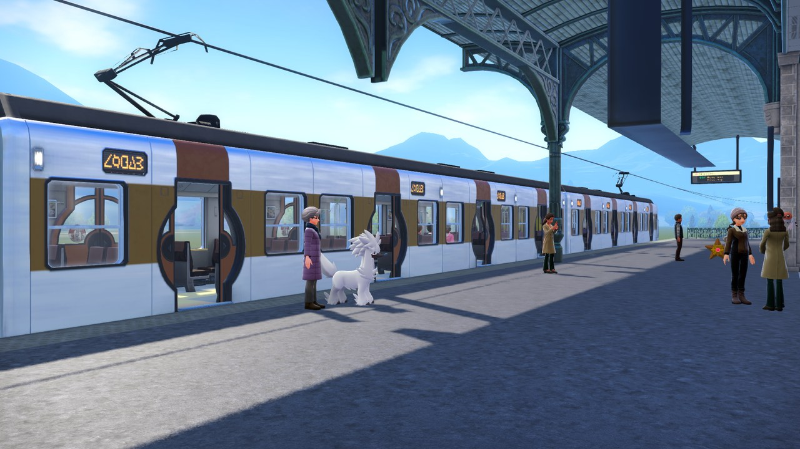

<!-- game facts: made by docs/gen_tables.py from android.tsv; edit android.tsv, not this block -->
# Pokémon Legends: Z-A

| | |
|---|---|
| Status | **playable** |
| Title ID | `0100F43008C44000` |
| Tested with nx2android | `v0.3.0` |
| Tested build and device | v393216 Lenovo Legion Y700 TB322FC (Snapdragon 8 Elite, Adreno 830, Android 16) |
| App package | `org.nx2a.plza` |

The profile sets these for you (`android.tsv`); a player changes the pause menu ones in the game, and the env rows in the data pack's `env.txt`:

| Row | What it does |
|---|---|
| `DM_FPS_HOLD=off` | "off" = no frame hold; any other value holds |
| `DM_VK_CB_DRAWS=32` | split the frame into command buffers every N draws (128), only before passes with a new depth image; `0` = never |

Read the profile's porting log in the comment header of [`android.tsv`](android.tsv). Back to the [games list](../../../../README.md#games).
<!-- end of the game facts -->

## Game version

- Update 2.0.2.
- The profile was checked with `v393216` (the `tested` row of android.tsv).

## Frame rate

- 30 fps (as on Switch).

## Tested devices

| Device | GPU | Vulkan driver | Game version | nx2android | Result |
|---|---|---|---|---|---|
| Lenovo Legion Y700 TB322FC (Snapdragon 8 Elite, Adreno 830, Android 16) | Adreno 830 | not recorded | 2.0.2 (v393216) | `v0.3.0` | playable |

What was tested:

- **tested to Lumiose station**: the city and battles not checked yet.

## Options

- Not recorded.

## Quirks and known issues

- Not recorded.
