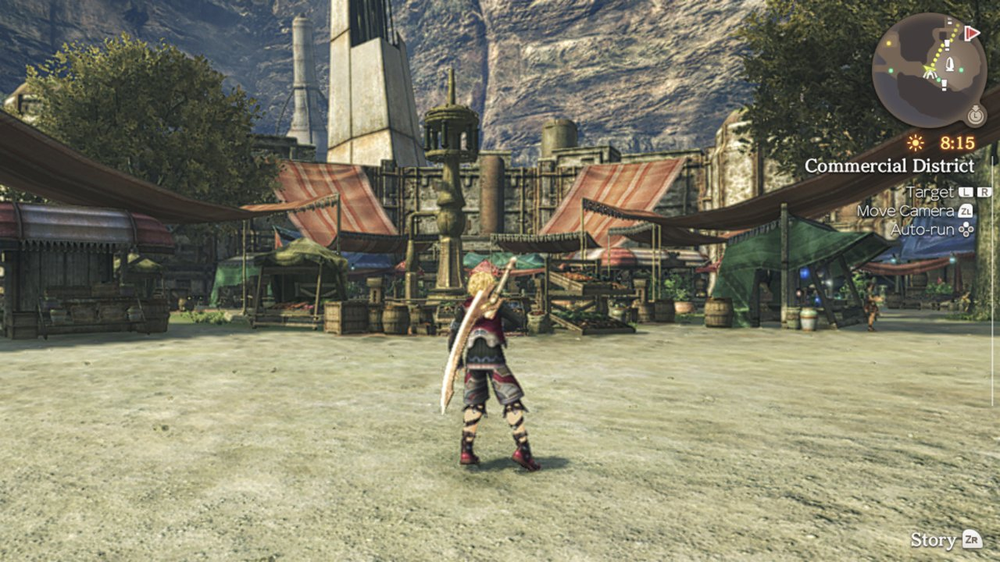

<!-- game facts: made by docs/gen_tables.py from android.tsv; edit android.tsv, not this block -->
# Xenoblade Chronicles: Definitive Edition

| | |
|---|---|
| Status | **playable** |
| Title ID | `0100FF500E34A000` |
| Tested with nx2android | `v0.4.0` |
| Tested build and device | v262144 AYN Odin 2 (Snapdragon 8 Gen 2, Adreno 740, Android 13); Turnip (vulkan.ad07xx.so) |
| App package | `org.nx2a.xenobladechroniclesde` |

The profile sets these for you (`android.tsv`); a player changes the pause menu ones in the game, and the env rows in the data pack's `env.txt`:

| Row | What it does |
|---|---|
| `DM_NVN_ASYNC=1` | asynchronous replay: submissions and presents run on a replay thread, syncs wait for the job's replay and then its GPU fence |
| `DM_PIN_REPLAY=prime` | pin the replay thread to fast cores: 0 = no, "prime" = the fastest core, other values = the big cores |
| `DM_VK_UBWC=7` | framebuffer compression mode bits (Adreno UBWC) |

Read the profile's porting log in the comment header of [`android.tsv`](android.tsv). Back to the [games list](../../../../README.md#games).
<!-- end of the game facts -->

## Game version

- Update 2.0.0.
- The profile was checked with `v262144` (the `tested` row of android.tsv).

## Frame rate

- 30 fps.

## Tested devices

| Device | GPU | Vulkan driver | Game version | nx2android | Result |
|---|---|---|---|---|---|
| AYN Odin 2 (Snapdragon 8 Gen 2, Adreno 740, Android 13); Turnip (vulkan.ad07xx.so) | Adreno 740 | Turnip | 2.0.0 (v262144) | `v0.4.0` | playable |

Tested on the AYN Odin 2 with a Turnip driver.

What was tested:

- **tested to Colony 9**, the pause menu and saving: later maps not checked yet.

## Options

- Tested with the Turnip Vulkan driver: port with it (`--vulkan-driver`).

## Quirks and known issues

- The scene drops to 896x504 in heavy fights.
- Rarely crashes at boot (restart).
